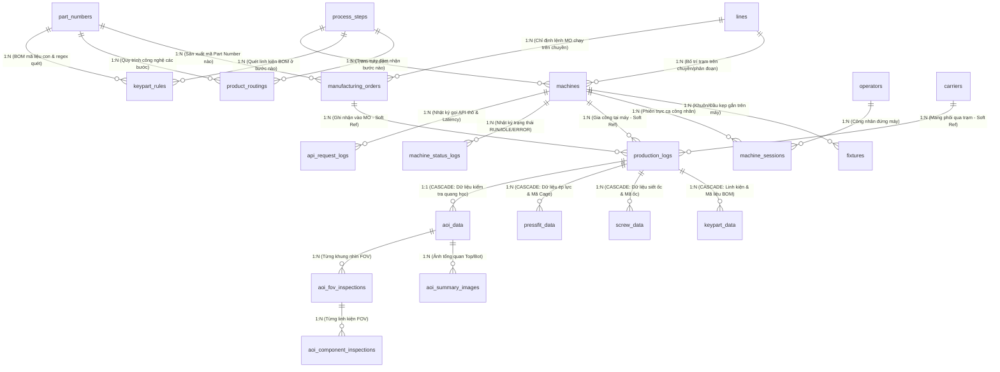

# TỔNG HỢP TOÀN BỘ ENTITY CHO DÂY CHUYỀN SẢN XUẤT TỰ ĐỘNG HÓA

## DỰ ÁN: FOXCONN & NVIDIA STATION MANAGEMENT SYSTEM (SALAMANDRA LC SWB SUB SA)

### ĐỐI CHIẾU CHUẨN XÁC DỮ LIỆU THỰC TẾ: `Slamandra_1015_update_1.xlsx` (F07-1F AUTOMATION LINE)

**Vị trí tài liệu:**

- `md/ALL_ENTITIES_SUMMARY_FOR_AUTOMATION_LINE.md`
- `src/main/java/com/example/EnterpriseProject/md/ALL_ENTITIES_SUMMARY_FOR_AUTOMATION_LINE.md`

---

## 1. TỔNG QUAN KIẾN TRÚC DỮ LIỆU TOÀN DÂY CHUYỀN

Dựa trên cơ sở dữ liệu hiện tại (`Official database.docx`, source code hiện có), tài liệu danh mục mã lỗi chuẩn (`error_code_guide_V4.xlsx`), và **đối chiếu chi tiết với bảng phân bổ trạm máy, mạng IP, dải mã khay gá, định mức BOM thực tế từ nhà máy** (`Slamandra_1015_update_1.xlsx` - Tầng `F07-1F`), hệ thống tự động hóa quản lý toàn diện **24 Entity**, chia thành **6 phân hệ cốt lõi**:

```
┌──────────────────────────────────────────────────────────────────────────────────┐
│                   HỆ THỐNG QUẢN LÝ DÂY CHUYỀN TỰ ĐỘNG HÓA MES                    │
├──────────────────────────────────────────────────────────────────────────────────┤
│ PHÂN HỆ 1: QUẢN TRỊ NGƯỜI DÙNG & BẢO MẬT (IAM)                                   │
│    1. User (Tài khoản Quản trị/Kỹ sư PE)  2. Role (Phân quyền hệ thống)         │
├──────────────────────────────────────────────────────────────────────────────────┤
│ PHÂN HỆ 2: DANH MỤC CẤU HÌNH GỐC & TÀI SẢN (MASTER DATA CONFIG)                  │
│    3. Line (Chuyền & Phân đoạn xưởng)     4. PartNumber (Danh mục 12 mã bo mạch) │
│    5. ProcessStep (Danh mục công đoạn)    6. Machine (Trạm máy, MAC, IP & VLAN)  │
│    7. Carrier (Khay gá phôi Fix 1~8)      8. Fixture (Khuôn ép & Đầu siết ốc)    │
│    9. Operator (Hồ sơ công nhân & Thẻ)                                           │
├──────────────────────────────────────────────────────────────────────────────────┤
│ PHÂN HỆ 3: MA TRẬN RÀNG BUỘC NGHIỆP VỤ & BOM (ROUTING & RECIPE RULES)            │
│    10. ProductRouting (Thứ tự công đoạn)  11. KeypartRule (BOM linh kiện & ốc vít)│
├──────────────────────────────────────────────────────────────────────────────────┤
│ PHÂN HỆ 4: ĐIỀU HÀNH SẢN XUẤT & PHIÊN LÀM VIỆC (OPERATIONAL & SESSIONS)          │
│    12. ManufacturingOrder (12 Lệnh MO)    13. MachineSession (Phiên trực ca)     │
│    14. CarrierPrecheckSession (Phiên đệm xác thực PreCheck 2 pha)                │
├──────────────────────────────────────────────────────────────────────────────────┤
│ PHÂN HỆ 5: GIAO DỊCH SẢN XUẤT & KIỂM ĐỊNH CHẤT LƯỢNG (TRANSACTIONS & QUALITY)   │
│    15. ProductionLog (Giao dịch trung tâm & Lưu vết đổi khay)                    │
│    16. KeypartData (Linh kiện đã quét & Lô BOM)                                  │
│    17. ScrewData (Lực siết, góc quay & Mã ốc)                                    │
│    18. PressfitData (Lực ép, hành trình & Mã Cage)                               │
│    19. AoiData (Dữ liệu tổng hợp AOI)     20. AoiSummaryImage (Ảnh toàn cảnh)    │
│    21. AoiFovInspection (Ảnh vùng FOV)    22. AoiComponentInspection (Linh kiện) │
├──────────────────────────────────────────────────────────────────────────────────┤
│ PHÂN HỆ 6: GIÁM SÁT THỜI GIAN THỰC & AUDIT LOG (TELEMETRY & AUDIT)               │
│    23. MachineStatusLog (Timeline OEE)    24. ApiRequestLog (Audit API & Latency)│
└──────────────────────────────────────────────────────────────────────────────────┘
```

---

## 2. KẾT QUẢ ĐỐI CHIẾU THỰC TẾ VỚI `Slamandra_1015_update_1.xlsx`

Qua đối chiếu 9 sheet dữ liệu (`SR-IP`, `TW-IP`, `IP`, `SR`, `TW`, `SR-Fixter_SN`, `TW-Fixtuer_SN`, `MES`, `Sheet2`), hệ thống phát hiện và chuẩn hóa các điểm nghiệp vụ quan trọng sau vào thiết kế:

### 2.1. Phân vùng Dây chuyền & Vendor chế tạo thiết bị

- **Địa điểm:** Tòa nhà & Tầng `F07-1F` (Foxconn Automation Workshop).
- **Vendor SR (Sunrise):** Phụ trách 2 phân đoạn lớn:
  - `SWB Automation` (Section S1): Các trạm từ `S1-1` đến `S1-27`.
  - `OSFP Automation` (Section S2): Các trạm từ `S2-1` đến `S2-24`.
- **Vendor TW (Tongwei):** Phụ trách 4 phân đoạn:
  - `Front Panel Sub Line` (Section S3): Các trạm `S3-1` đến `S3-4`.
  - `Front Section Main Line` (Section S4): Các trạm `S4-1` đến `S4-14`.
  - `Rear Section-MGMT Sub Line` (Section S1): Các trạm `S1-1` đến `S1-5`.
  - `Rear Section Main Line` (Section S2): Các trạm `S2-1` đến `S2-17`.

### 2.2. Phân đoạn Mạng công nghiệp (VLAN & Static IP, MAC Address)

Mỗi máy IPC đều có địa chỉ IP tĩnh, Gateway và địa chỉ MAC vật lý được quản lý nghiêm ngặt qua 4 Subnet:

- **VLAN 150** (`192.168.40.0/27`, Gateway `192.168.40.1`): Dải IP `192.168.40.4` - `.30` (SR Line S1: `S1-1` đến `S1-22`).
- **VLAN 151** (`192.168.40.32/27`, Gateway `192.168.40.33`): Dải IP `192.168.40.36` - `.62` (SR Line S1 cuối & S2 đầu).
- **VLAN 152** (`192.168.40.64/27`, Gateway `192.168.40.65`): Dải IP `192.168.40.68` - `.94` (SR Line S2 cuối & TW Front Line `S3`, `S4`).
- **VLAN 153** (`192.168.40.96/27`, Gateway `192.168.40.97`): Dải IP `192.168.40.100` - `.126` (TW Rear Line `S1`, `S2`).

### 2.3. Danh mục Khay gá tuần hoàn (Carriers) & Cơ chế Đổi khay (Carrier Swap)

Khay gá phôi không phải cố định suốt chuyền mà được chia theo từng chặng công đoạn (Carrier Stages):

- **Phía SR Line (Khay `Fix 1` đến `Fix 8`):**
  - `MTCJ8619` (12 khay, `MTCJ8619-001 ~ 012`): 1.1 Front Panel T Side Carrier (`Fix 1`)
  - `MTCJ8618` (16 khay, `MTCJ8618-001 ~ 016`): 1.1 Front Panel B Side Carrier (`Fix 2`)
  - `MTCJ8620` (25 khay, `MTCJ8620-001 ~ 025`): 1.1 Rear Panel B Side Carrier (`Fix 3`)
  - `MTCJ8621` (33 khay, `MTCJ8621-001 ~ 033`): 1.1 Rear Panel T Side Carrier (`Fix 4`)
  - `MTCJ8622` (25 khay, `MTCJ8622-001 ~ 025`): 1.2 Front OSFP B Side Carrier (`Fix 5`)
  - `MTCJ8623` (30 khay, `MTCJ8623-001 ~ 030`): 1.2 Front OSFP T Side Carrier (`Fix 6`)
  - `MTCJ8624` (30 khay, `MTCJ8624-001 ~ 030`): 1.2 Rear OSFP B Side Carrier (`Fix 7`)
  - `MTCJ8625` (26 khay, `MTCJ8625-001 ~ 026`): 1.2 Rear OSFP T Side Carrier (`Fix 8`)
- **Phía TW Line:**
  - `MTCJ8596` (16 khay, `MTCJ8596-001 ~ 016`): Front Panel Carrier
  - `MTCJ8597` (50 khay, `MTCJ8597-001 ~ 050`): Front Section Main Carrier
  - `MTCJ8598` (10 khay, `MTCJ8598-001 ~ 010`): OSFP Transfer Carrier
  - `MTCJ8599` (20 khay, `MTCJ8599-001 ~ 020`): MGMT Sub Line Carrier
  - `MTCJ8600` (45 khay, `MTCJ8600-001 ~ 045`): Rear Section Main Carrier
- **Các trạm Đổi khay / Lật mặt (Auto Flip & Switch Carrier):**
  - Trạm `S1-5`: Lật & đổi khay từ `Fix 1` (`MTCJ8619`) sang `Fix 2` (`MTCJ8618`). Quét cặp `Fix SN 1 + Fix SN 2`.
  - Trạm `S1-18`: Lật & đổi khay từ `Fix 3` (`MTCJ8620`) sang `Fix 4` (`MTCJ8621`). Quét cặp `Fix SN 3 + Fix SN 4`.
  - Trạm `S2-7`: Lật & đổi khay từ `Fix 5` (`MTCJ8622`) sang `Fix 6` (`MTCJ8623`). Quét cặp `Fix SN 5 + Fix SN 6`.
  - Trạm `S2-12`: Lật & đổi khay từ `Fix 6` (`MTCJ8623`) sang `Fix 7` (`MTCJ8624`). Quét cặp `Fix SN 6 + Fix SN 7`.
  - Trạm `S2-19`: Lật & đổi khay từ `Fix 7` (`MTCJ8624`) sang `Fix 8` (`MTCJ8625`). Quét cặp `Fix SN 7 + Fix SN 8`.
  - _Ý nghĩa DB:_ `ProductionLog` bắt buộc có cột `from_carrier_code` và `carrier_action` để truy vết chuỗi vòng đời bo mạch xuyên suốt 8 thế hệ khay gá mà không bị đứt đoạn dữ liệu!

### 2.4. Danh mục 12 Lệnh sản xuất (MO 1 ~ MO 12) & Part Number phân cấp

Trong cùng một chuyền lớn, các công đoạn tạo ra các cụm bán thành phẩm Sub-Assembly với Part Number và Lệnh MO riêng:

1. `MO 1`: Part Number `699-9N62F-0150-200` (SWB Automation Front Section, trạm `S1-1` đến `S1-10`)
2. `MO 2`: Part Number `673-9N62F-0160-000` (SWB Automation Rear Section, trạm `S1-12` đến `S1-27`)
3. `MO 3`: Part Number `699-9T974-0100-000` (OSFP Automation Front, trạm `S2-1` đến `S2-13`)
4. `MO 4`: Part Number `673-9T974-0150-000` (OSFP Automation Rear, trạm `S2-14` đến `S2-24`)
5. `MO 5`: Part Number `642-9T783-0160-000` (Front Panel Sub Line, trạm `S3-1` đến `S3-4`)
6. `MO 6`: Part Number `670-9N62F-0160-200` (Front Section Main Line, trạm `S4-1` đến `S4-14`)
7. `MO 7`: Part Number `673-9T713-0150-200_1` (Rear Section-MGMT Sub Line, trạm `S1-1` đến `S1-5`)
8. `MO 8`: Part Number `670-9N62F-0150-300_1` (Rear Section Main Line, trạm `S2-1` đến `S2-17`)
9. `MO 9`: Part Number `642-9T402-0310-300` (PDB Sub-assembly)
10. `MO 10`: Part Number `673-9T402-0310-300` (PDB Liquid System)
11. `MO 11`: Part Number `642-23809-1650-000` (BMC Sub-assembly)
12. `MO 12`: Part Number `673-331-0070-000` (SSD Sub-assembly)

### 2.5. Định mức Vật tư BOM kỹ thuật (`material_part_no`)

Tất cả các trạm lắp ráp, siết ốc, ép Cage đều quét mã barcode có chứa **Mã liệu BOM kỹ thuật**:

- **Cụm đầu nối Cage:** `CON003984`, `CON004109`, `CON004322`, `CON004321`, `CON004320`, `CON004319`.
- **Cụm tản nhiệt & Ống nước làm mát (WCK & Cold Plate):** `MA016412`, `MA016410`, `MA016411`, `MA016409`, `MA015754`, `642-9T402-0310800`, `MEC034219`.
- **Cụm gia cố & Khung máy:** `SMA015977`, `MA015832`, `MA015974`, `MEC034320`.
- **Cụm linh kiện cơ khí & Chốt định vị:** `MEC034379N`, `MEC034377N`, `MEC034360`, `MEC034342`, `MEC034311`, `MEC034310`, `MEC034309`, `MEC034395`, `MEC034394`, `MEC034696`, `MEC034392`, `MEC034389`, `MEC034403`, `MEC034372`, `MEC034349`, `MEC034595`, `MEC034579`.
- **Cáp & Cụm dây kết nối (Harness):** `HAR002278`, `HAR002302`, `HAR001985`, `HAR002265`, `HAR002264N`.
- **Ốc vít chính xác các loại (`SCR...`):** `SCR000888`, `SCR000889`, `SCR000564N`, `SCR000706N`, `SCR000897N`, `SCR000362N`, `SCR000890N`, `SCR000352N`, `SCR000812N`, `SCR000801`, `SCR000823`, `SCR000893`, `SCR000816`, `SCR000281`, `SCR000896`, `SCR000704`, `SCR000443`, `SCR000745`, `SCR000895`, `SCR000887`, `SCR000821`, `SCR000304`, `SCR000951`.
- **Mã nhãn Label:** `LBL002007`, `LBL002016`.
- _Ý nghĩa DB:_ Bảng `KeypartRule` bắt buộc có `material_part_no` để hệ thống so khớp mã tem quét với BOM thiết kế. Bảng `ScrewData` có `screw_part_no`. Bảng `PressfitData` có `component_part_no`.

---

## 3. SƠ ĐỒ THỰC THỂ TỔNG THỂ (COMPLETE ERD)



---

## 4. CHI TIẾT TỪNG PHÂN HỆ VÀ 24 ENTITY (ĐÃ ĐIỀU CHỈNH CHUẨN XÁC)

---

### PHÂN HỆ 1: QUẢN TRỊ NGƯỜI DÙNG & BẢO MẬT (IAM)

#### 1. `User` (Bảng `users`)

- **Mục đích:** Quản lý tài khoản quản trị viên, kỹ sư PE/IE, kỹ thuật viên truy cập Dashboard/Web UI.
- **Cấu trúc cột:**
  - `id` (`INT, PK, AUTO_INCREMENT`): Khóa chính.
  - `username` (`VARCHAR(50), UNIQUE, NOT NULL`): Tên đăng nhập.
  - `email` (`VARCHAR(100), UNIQUE, NOT NULL`): Email nhận cảnh báo lỗi chuyền.
  - `password` (`VARCHAR(255), NOT NULL`): Mật khẩu băm (BCrypt).
  - `status` (`VARCHAR(20), NOT NULL, DEFAULT 'ACTIVE'`): `ACTIVE`, `INACTIVE`, `LOCKED`.
  - `created_at`, `updated_at` (`DATETIME(6)`).
- **Quan hệ:** Nhiều-Nhiều (`@ManyToMany`) với bảng `roles`.

#### 2. `Role` (Bảng `roles`)

- **Mục đích:** Danh mục vai trò và quyền hạn quản trị hệ thống.
- **Cấu trúc cột:**
  - `id` (`INT, PK, AUTO_INCREMENT`).
  - `name` (`VARCHAR(50), UNIQUE, NOT NULL`): `ROLE_ADMIN`, `ROLE_ENGINEER`, `ROLE_OPERATOR`, `ROLE_QA`.

---

### PHÂN HỆ 2: DANH MỤC CẤU HÌNH GỐC & TÀI SẢN (MASTER DATA CONFIG)

#### 3. `Line` (Bảng `lines`) — _Đã làm giàu thông tin xưởng_

- **Mục đích:** Quản lý dây chuyền sản xuất tự động hóa, phân đoạn xưởng và Vendor chế tạo.
- **Cấu trúc cột:**
  - `id` (`INT, PK, AUTO_INCREMENT`).
  - `line_code` (`VARCHAR(50), UNIQUE, NOT NULL`): Mã chuyền (VD: `LINE_SR_SWB`, `LINE_SR_OSFP`, `LINE_TW_FRONT`, `LINE_TW_REAR`).
  - `line_name` (`VARCHAR(100), NOT NULL`): Tên hiển thị (VD: `Sunrise SWB Automation Line`, `Tongwei Rear Main Line`).
  - `vendor` (`VARCHAR(50), NOT NULL`): Nhà chế tạo thiết bị (`SR`, `TW`, `BOOSTER`).
  - `building` (`VARCHAR(50), DEFAULT 'F07'`): Tòa nhà xưởng.
  - `floor` (`VARCHAR(50), DEFAULT '1F'`): Tầng xưởng (`F07-1F`).
  - `project_name` (`VARCHAR(100), DEFAULT 'Salamandra'`): Dự án sản phẩm (`Salamandra LC SWB Sub SA`).
  - `is_active` (`BOOLEAN, NOT NULL, DEFAULT 1`).
  - `created_at`, `updated_at` (`DATETIME(6)`).
- **Quan hệ:** Không dùng `CascadeType.ALL` xuống `Machine` hay `ManufacturingOrder` để chống xóa lan.

#### 4. `PartNumber` (Bảng `part_numbers`) — _Đã bổ sung danh mục 12 Part Number thực tế_

- **Mục đích:** Quản lý danh mục Part Number bo mạch NVIDIA, cấu hình dung sai, chu kỳ chuẩn và biểu thức Regex mã vạch.
- **Cấu trúc cột:**
  - `id` (`INT, PK, AUTO_INCREMENT`).
  - `pn_code` (`VARCHAR(100), UNIQUE, NOT NULL`): Mã Part Number (VD: `699-9N62F-0150-200`, `673-9N62F-0160-000`, `699-9T974-0100-000`, `673-9T974-0150-000`, `642-9T783-0160-000`, `670-9N62F-0160-200`, `673-9T713-0150-200_1`, `670-9N62F-0150-300_1`, `642-9T402-0310-300`, `673-9T402-0310-300`, `642-23809-1650-000`, `673-331-0070-000`).
  - `product_name` (`VARCHAR(150), NOT NULL`): Tên thương phẩm (VD: `Salamandra SWB Sub SA Front`, `Salamandra OSFP Rear`).
  - `product_type` (`VARCHAR(50), NOT NULL`): Phân loại (`SWB_SUB_SA`, `OSFP_SA`, `FRONT_PANEL`, `FRONT_MAIN`, `MGMT_SUB`, `REAR_MAIN`, `PDB_LIQUID`, `BMC_SA`, `SSD_SA`).
  - `customer_name` (`VARCHAR(100), DEFAULT 'NVIDIA'`).
  - `revision` (`VARCHAR(20), DEFAULT 'A'`): Phiên bản bo mạch.
  - `sn_regex` (`VARCHAR(255)`): Biểu thức Regex kiểm tra Barcode SN bo mạch.
  - `standard_cycle_time` (`DECIMAL(6,2), DEFAULT 36.00`): Thời gian chu kỳ định mức (giây).
  - `is_active` (`BOOLEAN, DEFAULT 1`).
  - `created_at`, `updated_at` (`DATETIME(6)`).

#### 5. `ProcessStep` (Bảng `process_steps`)

- **Mục đích:** Danh mục các bước công đoạn chuẩn, phân định ranh giới SFC Station, trạm kẹp khay, đổi khay và nhả khay.
- **Cấu trúc cột:**
  - `id` (`INT, PK, AUTO_INCREMENT`).
  - `step_code` (`VARCHAR(50), UNIQUE, NOT NULL`): Mã bước (VD: `S1-1`, `S1-5`, `S1-18`, `S2-7`, `S2-12`, `S2-19`, `S4-12`).
  - `step_name` (`VARCHAR(100), NOT NULL`): Tên công đoạn (VD: `AOI 1 Loading & Label`, `Auto Flip & Switch Carrier`, `Press Fit Cage`).
  - `wip_group` (`VARCHAR(100), NOT NULL`): Nhóm công đoạn đồng bộ với SFC Foxconn (`ASSY`, `PRESS_FIT`, `AOI`).
  - `step_type` (`VARCHAR(50), NOT NULL`): `LOADING`, `ASSEMBLY`, `FASTENING`, `PRESS_FIT`, `CARRIER_SWAP`, `INSPECTION`, `UNLOADING`.
  - `is_carrier_binding_point` (`BOOLEAN, DEFAULT 0`): 1 nếu là trạm nạp bo mạch vào khay gá (S1-1, S2-1, S3-1, S4-1).
  - `is_carrier_swap_point` (`BOOLEAN, DEFAULT 0`): 1 nếu là trạm đổi/lật khay phôi (S1-5, S1-18, S2-7, S2-12, S2-19).
  - `is_carrier_unbinding_point` (`BOOLEAN, DEFAULT 0`): 1 nếu là trạm nhả phôi khỏi khay (S1-10, S1-27, S2-24, S4-12, S2-17).
  - `is_sfc_station` (`BOOLEAN, DEFAULT 0`): 1 nếu là trạm khóa dữ liệu đẩy lên SFC Foxconn.
  - `allow_undo_past_sfc` (`BOOLEAN, DEFAULT 0`): 0 nếu cấm tuyệt đối Undo vượt trạm này.
  - `is_active` (`BOOLEAN, DEFAULT 1`).

#### 6. `Machine` (Bảng `machines`) — _Đã bổ sung MAC, IPC Test Code, SFC Station & VLAN_

- **Mục đích:** Quản lý trạm máy phần cứng, địa chỉ IP tĩnh, MAC card mạng, trạm song song và cấu hình mạng công nghiệp.
- **Cấu trúc cột:**
  - `id` (`INT, PK, AUTO_INCREMENT`).
  - `line_id` (`INT, NOT NULL, FK -> lines.id`): Thuộc chuyền nào.
  - `station_code` (`VARCHAR(50), NOT NULL`): Mã vị trí trạm (VD: `S1-1`, `S1-2`, `S1-3-1`, `S1-3-2`, `S1-5`, `S2-1`, `S4-1`).
  - `machine_name` (`VARCHAR(150), NOT NULL`): Tên thiết bị (VD: `前面板上料及贴标流水线`, `SWB主板组装机`, `AOI 1`).
  - `machine_name_en` (`VARCHAR(150)`): Tên tiếng Anh (VD: `Front Panel Loading & Labeling Conveyor`, `SWB SA Assembly Machine`).
  - `pc_test_code` (`VARCHAR(50)`): Tên định danh máy tính IPC từ Excel (`PC_TEST`: VD `SR1-S1-1`, `SR1-S1-2`, `SR1-S2-1`).
  - `mac_address` (`VARCHAR(50), INDEX`): Địa chỉ MAC card mạng của IPC (VD: `6C-B3-11-C3-8B-30`, `B0-82-E2-9E-4E-CB`, `CC-82-7F-C7-A4-D3`).
  - `station_ip` (`VARCHAR(45), NOT NULL, INDEX`): Địa chỉ IP tĩnh gọi API (VD: `192.168.40.4`, `192.168.40.78`).
  - `gateway_ip` (`VARCHAR(45)`): Gateway dải mạng (`192.168.40.1`, `192.168.40.33`, `192.168.40.65`, `192.168.40.97`).
  - `vlan_name` (`VARCHAR(50)`): Tên phân đoạn mạng (`Vlan 150`, `Vlan 151`, `Vlan 152`, `Vlan 153`).
  - `station_type` (`VARCHAR(20), DEFAULT 'AUTO'`): Phân loại máy (`AUTO` - Tự động, `MANUAL` - Băng chuyền/Bàn thao tác tay).
  - `sfc_station_name` (`VARCHAR(100)`): Mã trạm ánh xạ lên hệ thống SFC Foxconn (VD: `AOI 1`, `PRESS_FIT_CAGE_B`, `ASSY_SWB_WCK_B`, `ASSY_FRONT_PANEL`).
  - `group_name` (`VARCHAR(100), NOT NULL`): Nhóm công đoạn (VD: `ASSY`, `PRESS_FIT`, `AOI`).
  - `section_name` (`VARCHAR(100)`): Phân khu (VD: `SWB Automation`, `OSFP Automation`, `Front Section Main Line`).
  - `host_name` (`VARCHAR(100)`): Tên Host máy tính công nghiệp.
  - `sequence_order` (`INT, NOT NULL`): Thứ tự vị trí vật lý trên chuyền.
  - `mapped_step_code` (`VARCHAR(50)`): Bước công đoạn máy được phép thực hiện (Chống gọi chéo IP).
  - `is_twin_station` (`BOOLEAN, DEFAULT 0`): 1 nếu là trạm song song (VD: S1-3-1 & S1-3-2, S1-6-1 & S1-6-2, S1-9-1 & S1-9-2).
  - `twin_group_code` (`VARCHAR(50)`): Mã nhóm song song (VD: `TWIN_S1_3`, `TWIN_S1_6`, `TWIN_S1_9`).
  - `floor` (`VARCHAR(50), DEFAULT '1F'`), `building` (`VARCHAR(50), DEFAULT 'F07'`), `factory` (`VARCHAR(50)`), `customer` (`VARCHAR(50), DEFAULT 'NVIDIA'`).
  - `target_uph` (`INT, DEFAULT 100`), `target_cycle_time` (`DECIMAL(6,2), DEFAULT 36.00`), `target_upd` (`INT, DEFAULT 0`).
  - `is_active` (`BOOLEAN, DEFAULT 1`).
- **Quan hệ:** Không giữ `CascadeType.ALL` xuống các bảng log để bảo toàn lịch sử sản xuất.

#### 7. `Carrier` (Bảng `carriers`) — _Đã chuẩn hóa 13 Model Khay gá & 8 Công đoạn Fix_

- **Mục đích:** Quản lý khay đồ gá tuần hoàn, P/N khay, mặt T/B, công đoạn gá, độ mòn cơ khí và lịch kiểm định ca.
- **Cấu trúc cột:**
  - `id` (`INT, PK, AUTO_INCREMENT`).
  - `carrier_code` (`VARCHAR(50), UNIQUE, NOT NULL`): Mã barcode in trên khay (VD: `MTCJ8619-001`, `MTCJ8618-005`, `MTCJ8597-010`).
  - `carrier_model` (`VARCHAR(50), NOT NULL, INDEX`): Mã P/N của dòng khay (VD: `MTCJ8619`, `MTCJ8618`, `MTCJ8620`, `MTCJ8621`, `MTCJ8622`, `MTCJ8623`, `MTCJ8624`, `MTCJ8625`, `MTCJ8596`, `MTCJ8597`, `MTCJ8598`, `MTCJ8599`, `MTCJ8600`).
  - `carrier_stage` (`VARCHAR(50), NOT NULL`): Công đoạn sử dụng (`FIX_1`, `FIX_2`, `FIX_3`, `FIX_4`, `FIX_5`, `FIX_6`, `FIX_7`, `FIX_8`, `FRONT_PANEL`, `FRONT_MAIN`, `TRANSFER`, `MGMT_SUB`, `REAR_MAIN`).
  - `carrier_side` (`VARCHAR(20), NOT NULL`): Mặt gá bo mạch (`TOP`, `BOT`, `UNIVERSAL`).
  - `description` (`VARCHAR(255)`): Tên mô tả kỹ thuật chuẩn từ bản vẽ đồ gá (VD: `SALAMANDRA - FRONT PANEL T SIDE CARRIER FOR AUTOMATION ASSEMBLY FIXTURE`).
  - `current_serial_number` (`VARCHAR(100), INDEX`): Mã bo mạch đang cõng (NULL nếu rỗng).
  - `status` (`VARCHAR(30), DEFAULT 'EMPTY'`): `EMPTY`, `BOUND`, `MAINTENANCE`, `NEED_INSPECTION`, `LOCKED`.
  - `total_cycles` (`INT, DEFAULT 0`): Số vòng chạy thực tế.
  - `max_cycles` (`INT, DEFAULT 5000`): Ngưỡng tuổi thọ tối đa trước khi mòn ren/cong vênh.
  - `last_station_code` (`VARCHAR(50)`): Trạm gần nhất vừa đi qua.
  - `last_inspection_time` (`DATETIME(6)`): Thời điểm kiểm định dung sai lần cuối.
  - `max_interval_hours` (`INT, DEFAULT 24`): Khoảng cách giờ tối đa giữa 2 lần kiểm định.
  - `fixed_schedule_times` (`VARCHAR(100), DEFAULT '07:30,19:30'`): Mốc giờ chuyển ca bắt buộc kiểm định đầu ca.
  - `allowed_pn_family` (`VARCHAR(100), DEFAULT 'SALAMANDRA'`): Dòng bo mạch được phép gá.
  - `pocket_count` (`INT, DEFAULT 1`): Số phôi cõng trên 1 gá.
  - `allow_carrier_swap` (`BOOLEAN, DEFAULT 0`): 1 nếu khay hỗ trợ đổi/chuyển phôi tại trạm Swap (S1-5, S1-18, S2-7, S2-12, S2-19).
  - `parent_carrier_code` (`VARCHAR(50)`): Lưu vết mã khay trước khi chuyển sang khay này.
  - `is_active` (`BOOLEAN, DEFAULT 1`).

#### 8. `Fixture` (Bảng `fixtures`)

- **Mục đích:** Quản lý khuôn ép cơ khí/servo (Pressfit Mold), đầu kẹp linh kiện (Filler Tool) và cụm mũi siết ốc gắn tại máy.
- **Cấu trúc cột:**
  - `id` (`INT, PK, AUTO_INCREMENT`).
  - `fixture_code` (`VARCHAR(100), UNIQUE, NOT NULL`): Mã barcode khuôn kẹp/mũi siết (VD: `TOOL_FILLER_S1_9`, `PRESS_CAGE_B_01`).
  - `fixture_name` (`VARCHAR(150), NOT NULL`): Tên đồ gá (VD: Khuôn ép OSFP Cage, Tool tháo filler).
  - `fixture_type` (`VARCHAR(50), NOT NULL`): `SCREW_HEAD`, `PRESSFIT_MOLD`, `FILLER_TOOL`, `AOI_MASK`.
  - `compatible_machine_id` (`INT, NOT NULL, FK -> machines.id`).
  - `total_usage_count` (`INT, DEFAULT 0`): Số lần ép/siết đã thực hiện.
  - `max_usage_count` (`INT, DEFAULT 10000`): Ngưỡng tuổi thọ tối đa trước khi bảo dưỡng.
  - `status` (`VARCHAR(30), DEFAULT 'READY'`): `READY`, `IN_USE`, `MAINTENANCE`, `LOCKED`.
  - `is_active` (`BOOLEAN, DEFAULT 1`).
  - `last_maintenance_date` (`DATETIME(6)`).

#### 9. `Operator` (Bảng `operators`)

- **Mục đích:** Danh mục hồ sơ công nhân, mã thẻ quẹt và mật khẩu xác thực trực tiếp tại máy trạm hoặc bàn thao tác tay.
- **Cấu trúc cột:**
  - `id` (`INT, PK, AUTO_INCREMENT`).
  - `operator_code` (`VARCHAR(50), UNIQUE, NOT NULL`): Mã số thẻ công nhân (VD: `V0923834`).
  - `password` (`VARCHAR(255), NOT NULL`): Mật khẩu xác thực của công nhân.
  - `operator_name` (`VARCHAR(100), NOT NULL`): Họ và tên.
  - `department` (`VARCHAR(50)`): Bộ phận công tác.
  - `is_active` (`BOOLEAN, DEFAULT 1`).

---

### PHÂN HỆ 3: MA TRẬN RÀNG BUỘC NGHIỆP VỤ & BOM (ROUTING & RECIPE RULES)

#### 10. `ProductRouting` (Bảng `product_routings`)

- **Mục đích:** Ma trận quy trình công nghệ bắt buộc giữa Part Number và chuỗi Steps, chống nhảy cóc trạm.
- **Cấu trúc cột:**
  - `id` (`INT, PK, AUTO_INCREMENT`).
  - `pn_id` (`INT, NOT NULL, FK -> part_numbers.id`).
  - `step_id` (`INT, NOT NULL, FK -> process_steps.id`).
  - `sequence_order` (`INT, NOT NULL`): Thứ tự bước (1, 2, 3...) bắt buộc phôi phải đi qua.
  - `is_mandatory` (`BOOLEAN, DEFAULT 1`): 1 nếu bắt buộc phải PASS.
  - `allow_skip` (`BOOLEAN, DEFAULT 0`): 1 nếu cho phép bỏ qua nếu trạm song song đã hoàn tất.
- **Chỉ mục:** `UNIQUE (pn_id, step_id)`, `UNIQUE (pn_id, sequence_order)`.

#### 11. `KeypartRule` (Bảng `keypart_rules`) — _Đã bổ sung Mã vật tư BOM `material_part_no`_

- **Mục đích:** Cấu hình BOM quy định tại mỗi bước của mỗi Part Number bắt buộc quét linh kiện con nào, mã liệu BOM là gì, regex và các ràng buộc chống sai sót (Poka-Yoke).
- **Cấu trúc cột:**
  - `id` (`INT, PK, AUTO_INCREMENT`).
  - `pn_id` (`INT, NOT NULL, FK -> part_numbers.id`).
  - `step_id` (`INT, NOT NULL, FK -> process_steps.id`).
  - `material_part_no` (`VARCHAR(100), NOT NULL`): Mã linh kiện / vật tư theo BOM kỹ thuật (VD: `CON003984`, `CON004109`, `MA016412`, `MA016410`, `SCR000564N`, `MEC034379N`, `HAR002278`, `LBL002007`).
  - `kp_name` (`VARCHAR(100), NOT NULL`): Tên linh kiện hiển thị (VD: `OSFP_CAGE_BOTTOM`, `LIQUID_SYSTEM_BOT`, `STIFFENER`).
  - `material_description` (`VARCHAR(255)`): Tên mô tả chi tiết vật tư từ file Excel.
  - `material_type` (`VARCHAR(50), NOT NULL`): `COMPONENT`, `SUB_ASSEMBLY`, `SCREW`, `HARNESS`, `LABEL`, `FIXTURE_TOOL`.
  - `barcode_regex` (`VARCHAR(255)`): Biểu thức Regex kiểm tra định dạng tem vật tư.
  - `bom_count` (`INT, NOT NULL, DEFAULT 1`): Định lượng BOM bắt buộc trên mỗi sản phẩm.
  - `is_required` (`BOOLEAN, DEFAULT 1`): 1 nếu thiếu vật tư này là báo lỗi FAIL.
  - `prevent_duplicate` (`BOOLEAN, DEFAULT 1`): 1 nếu cấm quét linh kiện đã dùng cho bo mạch khác.
  - `intra_payload_duplicate_check` (`BOOLEAN, DEFAULT 1`): 1 nếu cấm quét 1 mã tem cho 2 vị trí khác nhau trong cùng 1 lần gửi.
  - `cross_station_check` (`BOOLEAN, DEFAULT 0`): 1 nếu bắt buộc đối soát khớp 100% với giá trị đã quét ở trạm trước.
  - `verify_precheck_match` (`BOOLEAN, DEFAULT 1`): 1 nếu bắt buộc giá trị giữa PreCheck và Link phải trùng khớp.
  - `require_stockin_verification` (`BOOLEAN, DEFAULT 0`): 1 nếu kiểm tra linh kiện con đã qua tiền trạm/nhập kho Stock-In.
  - `scan_sequence` (`INT, DEFAULT 1`): Thứ tự yêu cầu máy quét.
- **Chỉ mục:** `UNIQUE (pn_id, step_id, material_part_no, kp_name)`.

---

### PHÂN HỆ 4: ĐIỀU HÀNH SẢN XUẤT & PHIÊN LÀM VIỆC (OPERATIONAL & SESSIONS)

#### 12. `ManufacturingOrder` (Bảng `manufacturing_orders`) — _Đã bổ sung Phân đoạn chuyền & Cây MO Cha-Con_

- **Mục đích:** Quản lý 12 Lệnh sản xuất (MO 1 ~ MO 12) trên từng phân đoạn chuyền, sản lượng mục tiêu và liên kết Sub-assembly.
- **Cấu trúc cột:**
  - `id` (`INT, PK, AUTO_INCREMENT`).
  - `mo_number` (`VARCHAR(100), UNIQUE, NOT NULL`): Mã công lệnh (VD: `MO_SR_SWB_001`, `MO 1`, `MO 2`, ..., `MO 12`).
  - `line_id` (`INT, NOT NULL, FK -> lines.id`).
  - `sub_line_or_stage` (`VARCHAR(100)`): Phân đoạn chuyền chạy lệnh (`SWB_FRONT`, `SWB_REAR`, `OSFP_FRONT`, `OSFP_REAR`, `FRONT_PANEL_SUB`, `FRONT_SECTION_MAIN`, `MGMT_SUB`, `REAR_SECTION_MAIN`).
  - `parent_mo_id` (`INT, NULL, FK -> manufacturing_orders.id`): Liên kết đến MO cha nếu đây là MO sản xuất bán thành phẩm Sub-SA.
  - `part_number` (`VARCHAR(100), NOT NULL`): Mã Part Number bo mạch chỉ định sản xuất.
  - `product_name` (`VARCHAR(100), NOT NULL`): Tên sản phẩm.
  - `product_type` (`VARCHAR(50), NOT NULL`): Phân loại sản phẩm.
  - `target_qty` (`INT, NOT NULL`): Sản lượng kế hoạch.
  - `status` (`VARCHAR(20), NOT NULL, DEFAULT 'OPEN'`): `OPEN`, `RUNNING`, `PAUSED`, `DONE`, `CANCELLED`.
  - `sfc_r107_status` (`VARCHAR(50), DEFAULT 'SYNCED'`): Trạng thái đồng bộ bảng R107 của SFC Foxconn.
  - `config94_mo_binding` (`VARCHAR(100)`): Ràng buộc liên kết MO theo cấu hình `CONFIG94` của PE.
  - `start_time`, `end_time` (`DATETIME(6)`).

#### 13. `MachineSession` (Bảng `machine_sessions`)

- **Mục đích:** Ghi nhận phiên phân công trực máy của công nhân theo ca và ngày làm việc (Phục vụ xác thực `PRECHECK`).
- **Cấu trúc cột:**
  - `id` (`BIGINT, PK, AUTO_INCREMENT`).
  - `machine_id` (`INT, NOT NULL, Soft Ref -> machines.id`).
  - `operator_code` (`VARCHAR(50), NOT NULL, INDEX`): Mã thẻ công nhân được giao phụ trách máy.
  - `shift` (`VARCHAR(10), NOT NULL`): `DAY`, `NIGHT`.
  - `work_date` (`DATE, NOT NULL`).
  - `login_time` (`DATETIME(6), NOT NULL`), `logout_time` (`DATETIME(6)`).
  - `status` (`VARCHAR(20), NOT NULL, DEFAULT 'ACTIVE'`): `ACTIVE`, `CLOSED`.

#### 14. `CarrierPrecheckSession` (Bảng `carrier_precheck_sessions`)

- **Mục đích:** Lưu bộ đệm phiên xác thực 2 pha giữa `PreCheck` và `AutoLink` để chống lỗi gọi đúp và chống tráo linh kiện.
- **Cấu trúc cột:**
  - `id` (`BIGINT, PK, AUTO_INCREMENT`).
  - `carrier_code` (`VARCHAR(50), NOT NULL`).
  - `station_code` (`VARCHAR(50), NOT NULL`).
  - `serial_number` (`VARCHAR(100), NOT NULL`).
  - `precheck_verified` (`BOOLEAN, NOT NULL DEFAULT 1`).
  - `verified_keyparts_json` (`JSON`): Danh sách linh kiện đã thẩm định tại pha PreCheck.
  - `expires_at` (`DATETIME(6), NOT NULL`): Hết hạn sau 5 phút nếu máy không gọi lệnh Link.

---

### PHÂN HỆ 5: GIAO DỊCH SẢN XUẤT & KIỂM ĐỊNH CHẤT LƯỢNG (TRANSACTIONS & QUALITY)

#### 15. `ProductionLog` (Bảng `production_logs`) — _Đã bổ sung Lưu vết Đổi khay & Snapshot Part Number_

- **Mục đích:** Giao dịch sản xuất trung tâm của từng bo mạch khi đi qua từng trạm máy (Trái tim của hệ thống truy vết chuỗi vòng đời).
- **Cấu trúc cột:**
  - `id` (`BIGINT, PK, AUTO_INCREMENT`).
  - `machine_id` (`INT, Soft Ref -> machines.id`).
  - `station_code` (`VARCHAR(50)`): Cột snapshot mã trạm tại thời điểm chạy máy.
  - `mo_id` (`INT, Soft Ref -> manufacturing_orders.id`).
  - `pn_code` (`VARCHAR(100), INDEX`): Snapshot Part Number bo mạch gia công tại thời điểm qua trạm.
  - `carrier_code` (`VARCHAR(100), NOT NULL, INDEX`): Khay gá mang bo mạch hiện tại.
  - `from_carrier_code` (`VARCHAR(100)`): Mã khay nguồn trước khi chuyển đổi (dành cho các trạm đổi/lật khay S1-5, S1-18, S2-7, S2-12, S2-19).
  - `carrier_action` (`VARCHAR(30)`): Hành vi đối với khay (`BIND`, `TRANSFER_SWAP`, `UNBIND`, `PROCESS`).
  - `serial_number` (`VARCHAR(100), NOT NULL, INDEX`): Mã vạch bo mạch xuất xưởng.
  - `step` (`VARCHAR(50), NOT NULL`): Công đoạn (VD: `S1-1`, `S1-5`, `S1-18`, `S4-12`).
  - `run_sequence` (`INT, NOT NULL DEFAULT 1`): Lần chạy thứ mấy (phục vụ Undo/Rework).
  - `data_type` (`VARCHAR(20), NOT NULL`): `AUTOLINK`, `PRECHECK`, `RESET`, `UNDO`, `STATUS`, `UPLOADDATA`.
  - `result` (`VARCHAR(10), NOT NULL`): `PASS`, `FAIL`.
  - `error_code` (`VARCHAR(50)`): Mã lỗi nếu FAIL.
  - `cycle_time` (`DECIMAL(8,2), DEFAULT 0.00`): Thời gian thực thi chu kỳ (giây).
  - `operator_user` (`VARCHAR(50)`): Mã thẻ công nhân thao tác.
  - `is_void` (`BOOLEAN, DEFAULT 0`): 1 nếu bản ghi này bị hủy bởi lệnh Undo.
  - `voided_at` (`DATETIME(6)`), `voided_by_log_id` (`BIGINT, FK -> production_logs.id`).
  - `is_repair_flag` (`BOOLEAN, DEFAULT 0`): 1 nếu có cờ lỗi chuyển sang trạm sửa chữa RE.
  - `created_at` (`DATETIME(6), NOT NULL`).

#### 16. `KeypartData` (Bảng `keypart_data`) — _Đã bổ sung Mã vật tư BOM & Số lô cuộn tem_

- **Mục đích:** Chi tiết danh sách linh kiện con gắn kết vào bo mạch chính tại trạm lắp ráp (kps).
- **Cấu trúc cột:**
  - `id` (`BIGINT, PK, AUTO_INCREMENT`).
  - `log_id` (`BIGINT, NOT NULL, FK -> production_logs.id, CASCADE DELETE`).
  - `material_part_no` (`VARCHAR(100), NOT NULL, INDEX`): Snapshot mã liệu BOM kỹ thuật (VD: `CON003984`, `MA016412`, `SCR000564N`, `HAR002278`).
  - `kp_name` (`VARCHAR(100), NOT NULL`): Tên linh kiện hiển thị (VD: `OSFP_CAGE`, `LIQUID_PLATE`).
  - `kp_value` (`VARCHAR(150), NOT NULL, INDEX`): Giá trị mã vạch linh kiện đã quét thực tế.
  - `lot_number` (`VARCHAR(100)`): Số lô sản xuất / cuộn tem linh kiện (SA batch QR reel).
  - `created_at` (`DATETIME(6), NOT NULL`).

#### 17. `ScrewData` (Bảng `screw_data`) — _Đã bổ sung Mã vật tư Ốc vít_

- **Mục đích:** Chi tiết từng điểm siết ốc tự động tại các trạm siết ốc (lực siết, góc quay, vị trí, kết quả, loại ốc).
- **Cấu trúc cột:**
  - `id` (`BIGINT, PK, AUTO_INCREMENT`).
  - `log_id` (`BIGINT, NOT NULL, FK -> production_logs.id, CASCADE DELETE`).
  - `screw_part_no` (`VARCHAR(50)`): Mã định danh loại ốc vít BOM (VD: `SCR000888`, `SCR000564N`, `SCR000816`, `SCR000801`, `SCR000896`, `SCR000704`).
  - `position` (`VARCHAR(50), NOT NULL`): Vị trí lỗ ốc (VD: `screw1`, `screw2`, ..., `screw17`).
  - `action` (`VARCHAR(20), NOT NULL`): `screw`, `unscrew`.
  - `standard_volume`, `limit_volume`, `real_volume` (`DECIMAL(10,2)`): Tiêu chuẩn và thực tế lượng ren.
  - `standard_height`, `limit_height`, `real_height` (`DECIMAL(10,2)`): Chiều cao đỉnh ốc.
  - `torque` (`DECIMAL(6,2), NOT NULL`): Lực siết mô-men xoắn thực tế.
  - `angle` (`DECIMAL(6,2), NOT NULL`): Góc quay thực tế.
  - `time` (`DECIMAL(6,2), NOT NULL`): Thời gian siết (giây).
  - `result` (`VARCHAR(10), NOT NULL`): `PASS`, `FAIL`.
  - `error_code` (`VARCHAR(50)`).
  - `created_at` (`DATETIME(6), NOT NULL`).

#### 18. `PressfitData` (Bảng `pressfit_data`) — _Đã bổ sung Mã linh kiện ép_

- **Mục đích:** Chi tiết từng điểm ép lực cơ khí/servo tại trạm ép Cage & Connector (lực ép, hành trình, thời gian).
- **Cấu trúc cột:**
  - `id` (`BIGINT, PK, AUTO_INCREMENT`).
  - `log_id` (`BIGINT, NOT NULL, FK -> production_logs.id, CASCADE DELETE`).
  - `component_part_no` (`VARCHAR(50)`): Mã linh kiện ép vào (VD: `CON003984`, `CON004109`, `CON004322`, `CON004321`).
  - `position` (`VARCHAR(50), NOT NULL`): Vị trí điểm ép (VD: `press1`, `press2`).
  - `standard_force`, `limit_force`, `real_force` (`DECIMAL(10,2), NOT NULL`): Lực ép tiêu chuẩn và thực tế.
  - `standard_distance`, `limit_distance`, `real_distance` (`DECIMAL(10,2), NOT NULL`): Khoảng cách hành trình ép.
  - `time` (`DECIMAL(6,2), NOT NULL`): Thời gian duy trì lực ép.
  - `result` (`VARCHAR(10), NOT NULL`): `PASS`, `FAIL`.
  - `error_code` (`VARCHAR(50)`).
  - `created_at` (`DATETIME(6), NOT NULL`).

#### 19. `AoiData` (Bảng `aoi_data`)

- **Mục đích:** Giao dịch tổng hợp của hệ thống kiểm tra ngoại quan quang học tự động AOI (AOI 1, AOI 2, AOI 3).
- **Cấu trúc cột:**
  - `id` (`BIGINT, PK, AUTO_INCREMENT`).
  - `log_id` (`BIGINT, NOT NULL, UNIQUE, FK -> production_logs.id, CASCADE DELETE`).
  - `cycle_time` (`DECIMAL(8,2), NOT NULL`).
  - `carrier_code` (`VARCHAR(100), NOT NULL`).
  - `serial_number` (`VARCHAR(100), NOT NULL`).
  - `created_at` (`DATETIME(6), NOT NULL`).

#### 20. `AoiSummaryImage` (Bảng `aoi_summary_images`)

- **Mục đích:** Lưu trữ đường dẫn ảnh chụp ngoại quan toàn cảnh (Top view, Bottom view).
- **Cấu trúc cột:**
  - `id` (`BIGINT, PK, AUTO_INCREMENT`).
  - `aoi_data_id` (`BIGINT, NOT NULL, FK -> aoi_data.id, CASCADE DELETE`).
  - `camera` (`VARCHAR(20), NOT NULL`): `TOP`, `BOT`.
  - `image_path` (`TEXT, NOT NULL`): Đường dẫn file ảnh trên hệ thống NAS/Server (Không lưu base64 trong DB).
  - `description` (`VARCHAR(255)`).
  - `created_at` (`DATETIME(6), NOT NULL`).

#### 21. `AoiFovInspection` (Bảng `aoi_fov_inspections`)

- **Mục đích:** Quản lý từng khung nhìn trường ảnh (FOV - Field of View) độ phân giải cao của camera AOI.
- **Cấu trúc cột:**
  - `id` (`BIGINT, PK, AUTO_INCREMENT`).
  - `aoi_data_id` (`BIGINT, NOT NULL, FK -> aoi_data.id, CASCADE DELETE`).
  - `fov_number` (`INT, NOT NULL`): Thứ tự vùng chụp (VD: `1`, `2`, `3`).
  - `camera` (`VARCHAR(20), NOT NULL`): `TOP`, `BOT`.
  - `full_fov_image_path` (`TEXT, NOT NULL`): Đường dẫn lưu file ảnh gốc toàn vùng FOV.
  - `created_at` (`DATETIME(6), NOT NULL`).

#### 22. `AoiComponentInspection` (Bảng `aoi_component_inspections`)

- **Mục đích:** Chi tiết soi từng linh kiện điện tử siêu nhỏ trong từng FOV (Điện trở, Tụ điện, IC, Chân hàn Cage).
- **Cấu trúc cột:**
  - `id` (`BIGINT, PK, AUTO_INCREMENT`).
  - `fov_id` (`BIGINT, NOT NULL, FK -> aoi_fov_inspections.id, CASCADE DELETE`).
  - `component_name` (`VARCHAR(100), NOT NULL`): Mã linh kiện trên bo mạch (VD: `R1`, `C5`, `U10`).
  - `location` (`VARCHAR(100), NOT NULL`): Tọa độ (VD: `X:10,Y:20`).
  - `score` (`DECIMAL(5,2), NOT NULL`): Điểm tin cậy thuật toán AI/Vision (VD: `98.50%`).
  - `measure` (`DECIMAL(8,4)`): Dung sai độ lệch đo được (mm).
  - `result` (`VARCHAR(10), NOT NULL`): `PASS`, `FAIL`.
  - `error_code` (`VARCHAR(50)`): Mã lỗi ngoại quan (VD: `E001` - Lệch chân hàn).
  - `crop_image_path` (`TEXT`): Đường dẫn file ảnh cắt riêng linh kiện đó.
  - `created_at` (`DATETIME(6), NOT NULL`).

---

### PHÂN HỆ 6: GIÁM SÁT THỜI GIAN THỰC & AUDIT LOG (TELEMETRY & AUDIT)

#### 23. `MachineStatusLog` (Bảng `machine_status_logs`)

- **Mục đích:** Lưu trữ chuỗi thời gian trạng thái máy (RUN, IDLE, STOP, ERROR) để vẽ biểu đồ Gantt Timeline thời gian thực và tính toán chỉ số hiệu suất OEE.
- **Cấu trúc cột:**
  - `id` (`BIGINT, PK, AUTO_INCREMENT`).
  - `machine_id` (`INT, NOT NULL, Soft Ref -> machines.id`).
  - `status` (`VARCHAR(10), NOT NULL`): `RUN`, `IDLE`, `STOP`, `ERROR`.
  - `building`, `floor` (`VARCHAR`): Vị trí máy (`F07`, `1F`).
  - `error_code` (`VARCHAR(50)`): Mã lỗi dừng máy nếu có.
  - `start_time` (`DATETIME(6), NOT NULL`), `end_time` (`DATETIME(6)`).
  - `duration_seconds` (`INT`): Tổng số giây duy trì trạng thái.
  - `created_at` (`DATETIME(6), NOT NULL`).
- **Chỉ mục:** `INDEX (machine_id, start_time)`.

#### 24. `ApiRequestLog` (Bảng `api_request_logs`)

- **Mục đích:** Nhật ký thô toàn bộ request/response API từ các trạm máy gửi lên để phục vụ kiểm toán (Audit Trail), debug lỗi kết nối và đo độ trễ mạng (Latency ms).
- **Cấu trúc cột:**
  - `id` (`BIGINT, PK, AUTO_INCREMENT`).
  - `endpoint` (`VARCHAR(100), NOT NULL`): API URL.
  - `http_method` (`VARCHAR(10), NOT NULL`): `POST`.
  - `station_ip` (`VARCHAR(45), INDEX`): IP máy trạm gửi payload.
  - `machine_id` (`INT, Soft Ref -> machines.id`).
  - `log_id` (`BIGINT, Soft Ref -> production_logs.id`).
  - `request_payload` (`JSON`): Dữ liệu JSON gốc gửi lên.
  - `response_payload` (`JSON`): Dữ liệu phản hồi trả về cho máy.
  - `status_code` (`INT, NOT NULL`): HTTP Status (200, 400, 500).
  - `latency_ms` (`INT`): Thời gian máy chủ xử lý xong request (mili-giây).
  - `error_message` (`TEXT`): Chi tiết ngoại lệ hệ thống nếu phát sinh lỗi.
  - `created_at` (`DATETIME(6), NOT NULL, INDEX`).

---

## 5. BẢNG TRA CỨU NHANH TỔNG HỢP 24 ENTITY

|  STT   | Tên Entity Java          | Tên Bảng MySQL              | Phân hệ chức năng      | Điểm điều chỉnh từ Excel `Slamandra`                                                                  | Cơ chế quan hệ & Ràng buộc             |
| :----: | :----------------------- | :-------------------------- | :--------------------- | :---------------------------------------------------------------------------------------------------- | :------------------------------------- |
| **1**  | `User`                   | `users`                     | IAM / Bảo mật          | Giữ nguyên                                                                                            | `@ManyToMany` với `roles`              |
| **2**  | `Role`                   | `roles`                     | IAM / Bảo mật          | Giữ nguyên                                                                                            | Danh mục quyền tĩnh                    |
| **3**  | `Line`                   | `lines`                     | Quản lý Chuyền         | **Thêm `vendor` (SR/TW), `floor` (F07-1F), `project_name`**                                           | Không cascade delete                   |
| **4**  | `PartNumber`             | `part_numbers`              | Danh mục Sản phẩm      | **Khớp 12 Part Number thực tế của NVIDIA**                                                            | Khóa chính cho Routing & BOM           |
| **5**  | `ProcessStep`            | `process_steps`             | Quy trình Công nghệ    | **Thêm cờ `is_carrier_swap_point` cho các trạm Flip**                                                 | Định danh công đoạn & WIP Group        |
| **6**  | `Machine`                | `machines`                  | Trạm máy & IP          | **Thêm `mac_address`, `pc_test_code`, `station_type`, `sfc_station_name`, `gateway_ip`, `vlan_name`** | Không cascade delete xuống Log         |
| **7**  | `Carrier`                | `carriers`                  | Đồ gá phôi tuần hoàn   | **Thêm `carrier_model` (MTCJ8619...), `carrier_stage` (Fix 1~8), `carrier_side` (TOP/BOT)**           | Quản lý vòng quay & Kiểm định ca       |
| **8**  | `Fixture`                | `fixtures`                  | Khuôn kẹp & Đầu siết   | **Thêm chủng loại `FILLER_TOOL`**                                                                     | Quản lý tuổi thọ lực ép/siết           |
| **9**  | `Operator`               | `operators`                 | Công nhân đứng máy     | Giữ nguyên                                                                                            | Xác thực mật khẩu tại máy              |
| **10** | `ProductRouting`         | `product_routings`          | Quy trình Định tuyến   | Giữ nguyên                                                                                            | Chống nhảy cóc trạm (Sequence)         |
| **11** | `KeypartRule`            | `keypart_rules`             | Cấu hình BOM Phụ kiện  | **Thêm `material_part_no` (CON..., MA..., SCR...), `material_description`, `material_type`**          | Định lượng BOM & Poka-Yoke             |
| **12** | `ManufacturingOrder`     | `manufacturing_orders`      | Lệnh sản xuất          | **Thêm `sub_line_or_stage` và `parent_mo_id` quản lý 12 Lệnh MO**                                     | Gán PN vào Chuyền, không cascade log   |
| **13** | `MachineSession`         | `machine_sessions`          | Phân công ca trực      | Giữ nguyên                                                                                            | Kiểm soát quyền đứng máy tại PreCheck  |
| **14** | `CarrierPrecheckSession` | `carrier_precheck_sessions` | Bộ đệm phiên PreCheck  | Giữ nguyên                                                                                            | Chống gọi đúp & tráo phôi              |
| **15** | `ProductionLog`          | `production_logs`           | Giao dịch trung tâm    | **Thêm `from_carrier_code`, `carrier_action`, `pn_code` lưu vết đổi khay**                            | Quan hệ mềm `NO_CONSTRAINT` & Snapshot |
| **16** | `KeypartData`            | `keypart_data`              | Linh kiện gắn kết      | **Thêm `material_part_no` và `lot_number` (cuộn QR)**                                                 | `@ManyToOne` CASCADE DELETE từ ProdLog |
| **17** | `ScrewData`              | `screw_data`                | Dữ liệu siết ốc        | **Thêm `screw_part_no` (SCR...)**                                                                     | `@ManyToOne` CASCADE DELETE từ ProdLog |
| **18** | `PressfitData`           | `pressfit_data`             | Dữ liệu ép lực         | **Thêm `component_part_no` (CON...)**                                                                 | `@ManyToOne` CASCADE DELETE từ ProdLog |
| **19** | `AoiData`                | `aoi_data`                  | Dữ liệu kiểm tra AOI   | Giữ nguyên                                                                                            | `@OneToOne` CASCADE DELETE từ ProdLog  |
| **20** | `AoiSummaryImage`        | `aoi_summary_images`        | Ảnh tổng quan AOI      | Giữ nguyên                                                                                            | Lưu đường dẫn file, CASCADE từ AOI     |
| **21** | `AoiFovInspection`       | `aoi_fov_inspections`       | Khung nhìn FOV         | Giữ nguyên                                                                                            | Lưu đường dẫn ảnh, CASCADE từ AOI      |
| **22** | `AoiComponentInspection` | `aoi_component_inspections` | Linh kiện chi tiết FOV | Giữ nguyên                                                                                            | Điểm AI Score & Tọa độ, CASCADE từ FOV |
| **23** | `MachineStatusLog`       | `machine_status_logs`       | Trạng thái máy OEE     | Giữ nguyên                                                                                            | Lưu chuỗi thời gian RUN/IDLE/ERROR     |
| **24** | `ApiRequestLog`          | `api_request_logs`          | Kiểm toán API thô      | Giữ nguyên                                                                                            | Lưu raw JSON & đo độ trễ Latency ms    |

---

## 6. PHỤ LỤC TRA CỨU: MA TRẬN ĐỐI CHIẾU TRẠM MÁY THỰC TẾ (SUNRISE & TONGWEI)

### 6.1. Dây chuyền SUNRISE (SR Line - F07-1F)

|  Vị trí Step  | Tên thiết bị        | Tên tiếng Anh              |    IPC Code     |     MAC Address      |      IP tĩnh       |    SFC Station     |      Dải khay gá (Carrier)      |      Part Number & MO       | Vật tư BOM quét (`material_part_no`)                 |
| :-----------: | :------------------ | :------------------------- | :-------------: | :------------------: | :----------------: | :----------------: | :-----------------------------: | :-------------------------: | :--------------------------------------------------- |
|   **S1-1**    | 检测上料&贴标       | AOI 1 Loading & Labelling  |   `SR1-S1-1`    | `6C-B3-11-C3-8B-30`  |   `192.168.40.4`   |      `AOI 1`       |   Fix 1 (`MTCJ8619-001~012`)    | `699-9N62F-0150-200` (MO 1) | Quét Fix 1 + Main PCB SN                             |
|   **S1-2**    | 组装加强板          | Stiffener Install          |   `SR1-S1-2`    | `6C-B3-11-C3-78-EF`  |   `192.168.40.5`   |    `PRESS_FIT`     |              Fix 1              | `699-9N62F-0150-200` (MO 1) | `SMA015977`, `SCR000888`, `SCR000889`, `SCR000564`   |
|  **S1-3-1**   | 组装OSFP Cage       | OSFP Cage Assembly 1       |  `SR1-S1-3-1`   | `6C-B3-11-BF-77-E7`  |   `192.168.40.6`   | `PRESS_FIT_CAGE_B` |              Fix 1              | `699-9N62F-0150-200` (MO 1) | `CON003984`                                          |
|  **S1-3-2**   | 组装OSFP Cage       | OSFP Cage Assembly 2       |  `SR1-S1-3-2`   | `B0-82-E2-9E-4E-CB`  |   `192.168.40.7`   | `PRESS_FIT_CAGE_B` |              Fix 1              | `699-9N62F-0150-200` (MO 1) | `CON003984`                                          |
|   **S1-4**    | 压合机              | Pressing Machine           |   `SR1-S1-4`    |          -           |   `192.168.40.8`   |    `PRESS_FIT`     |              Fix 1              | `699-9N62F-0150-200` (MO 1) | Ép Cage vào bo mạch                                  |
|   **S1-5**    | 检测&翻转换载具     | Auto Flip & Switch Carrier |   `SR1-S1-5`    | `B0-82-E2-9E-4E-E5`  |   `192.168.40.9`   |      `AOI 2`       | **Fix 1 -> Fix 2 (`MTCJ8618`)** | `699-9N62F-0150-200` (MO 1) | **Quét cặp Fix SN 1 + Fix SN 2**                     |
| **S1-6-1/2**  | 组装OSFP Cage       | OSFP Cage Assembly         | `SR1-S1-6-1/2`  | `B0-82-E2-9E-50-D3`  | `192.168.40.10/11` |   `PRESS_FIT 1`    |   Fix 2 (`MTCJ8618-001~016`)    | `699-9N62F-0150-200` (MO 1) | `CON003984`                                          |
|   **S1-7**    | 组装QSFP Cage       | QSFP Cage Assembly         |   `SR1-S1-7`    | `6C-B3-11-C3-79-39`  |  `192.168.40.12`   |    `PRESS_FIT`     |              Fix 2              | `699-9N62F-0150-200` (MO 1) | `CON004109`                                          |
|   **S1-8**    | 压合机              | Pressing Machine 1         |   `SR1-S1-8`    |          -           |  `192.168.40.13`   |   `PRESS_FIT 1`    |              Fix 2              | `699-9N62F-0150-200` (MO 1) | Ép Cage QSFP                                         |
| **S1-9-1/2**  | 拆除工具            | Filler Tool Removal        | `SR1-S1-9-1/2`  | `6C-B3-11-BF-76-C6`  | `192.168.40.14/15` |      `AOI 3`       |              Fix 2              | `699-9N62F-0150-200` (MO 1) | Tháo filler tool                                     |
|   **S1-10**   | 检测&下料           | Inspection & Unloading     |   `SR1-S1-10`   | `6C-B3-11-BF-77-3D`  |  `192.168.40.16`   |       `AOI`        |        Fix 2 -> Nhả phôi        | `699-9N62F-0150-200` (MO 1) | **Unbind Fix 2**                                     |
|   **S1-11**   | ICT测试             | ICT / ASSY TIMMING         |        -        |          -           |         -          |       `ICT`        |                -                | `673-9N62F-0160-000` (MO 2) | Kiểm tra mạch ICT                                    |
|   **S1-12**   | 检测&上料           | AOI 1 Loading              |   `SR1-S1-12`   | `6C-B3-11-BF-77-43`  |  `192.168.40.17`   |       `AOI`        |   Fix 3 (`MTCJ8620-001~025`)    | `673-9N62F-0160-000` (MO 2) | Quét Fix 3 + PCB SN                                  |
|   **S1-13**   | 加强螺丝&定位pin    | Screw & Pin Fastening      |   `SR1-S1-13`   | `B0-82-E2-9E-4E-9C`  |  `192.168.40.18`   |  `ASSY_SWB_WCK_B`  |              Fix 3              | `673-9N62F-0160-000` (MO 2) | `SCR000564N`, `SCR000706N`, `MEC034379N`             |
|   **S1-14**   | BOT水冷组件组装     | Bottom WCK Assembly        |   `SR1-S1-14`   | `6C-B3-11-C3-81-E1`  |  `192.168.40.19`   |  `ASSY_SWB_WCK_B`  |              Fix 3              | `673-9N62F-0160-000` (MO 2) | `MA016412`                                           |
| **S1-15-1/2** | BOT水冷拆除螺丝     | Bottom WCK Screw Remove    | `SR1-S1-15-1/2` | `B0-82-E2-9E-4E-8B`  | `192.168.40.20/21` |  `ASSY_SWB_WCK_B`  |              Fix 3              | `673-9N62F-0160-000` (MO 2) | Tháo ốc định vị WCK                                  |
|  **S1-16-2**  | 双轨保压锁附螺丝    | Dual-Rail Screw Fastening  |  `SR1-S1-16-2`  | `6C-B3-11-C3-87-D2`  |  `192.168.40.23`   |  `ASSY_SWB_WCK_B`  |              Fix 3              | `673-9N62F-0160-000` (MO 2) | `SCR000897N`, `SCR000362N`                           |
|   **S1-17**   | 人工作业流道        | Manual Operating Conveyor  |   `SR1-S1-17`   |          -           |  `192.168.40.24`   |      `MANUAL`      |              Fix 3              | `673-9N62F-0160-000` (MO 2) | Thao tác thủ công                                    |
|   **S1-18**   | 检测&翻转换载具     | Auto Flip & Switch Carrier |   `SR1-S1-18`   | `6C-B3-11-C3-81-78`  |  `192.168.40.25`   |      `AOI 2`       | **Fix 3 -> Fix 4 (`MTCJ8621`)** | `673-9N62F-0160-000` (MO 2) | **Quét cặp Fix SN 3 + Fix SN 4**                     |
|   **S1-19**   | 组装导流槽&定位pin  | Guide Pin & Drain Fasten   |   `SR1-S1-19`   | `6C-B3-11-C3-81-80`  |  `192.168.40.26`   |  `ASSY_SWB_WCK_T`  |   Fix 4 (`MTCJ8621-001~033`)    | `673-9N62F-0160-000` (MO 2) | `MEC034377N`, `MEC034348`, `MEC034346`, `SCR000890N` |
|   **S1-20**   | TOP水冷组件组装     | Top WCK Assembly           |   `SR1-S1-20`   | `6C-B3-11-BF-77-41`  |  `192.168.40.27`   |  `ASSY_SWB_WCK_T`  |              Fix 4              | `673-9N62F-0160-000` (MO 2) | `MA016410`                                           |
|   **S1-22**   | 螺丝锁附及清洁PCBA  | Screw Fasten & Clean PCBA  |   `SR1-S1-22`   | `6C-B3-11-BD-78-28`  |  `192.168.40.30`   |  `ASSY_SWB_WCK_T`  |              Fix 4              | `673-9N62F-0160-000` (MO 2) | `SCR000352N`                                         |
|   **S1-24**   | 组装导线槽&支撑件   | Cable Guide & Support Assy |   `SR1-S1-24`   | `B0-82-E2-9E-4F-F5`  |  `192.168.40.36`   |  `ASSY_ASIC_WCK`   |              Fix 4              | `673-9N62F-0160-000` (MO 2) | `MEC034360`, `MEC034342`, `SCR000812N`               |
| **S1-25-1/2** | 组装ASIC组件        | ASIC Module Assembly       | `SR1-S1-25-1/2` | `B0-82-E2-60-14-B3`  | `192.168.40.37/38` |  `ASSY_ASIC_WCK`   |              Fix 4              | `673-9N62F-0160-000` (MO 2) | `MA016413`                                           |
|   **S1-27**   | AOI下料机           | AOI 3 Final Inspection     |   `SR1-S1-27`   | `B0-82-E2-9E-4F-33`  |  `192.168.40.39`   |      `AOI 3`       |        Fix 4 -> Nhả phôi        | `673-9N62F-0160-000` (MO 2) | **Unbind Fix 4**                                     |
|   **S2-1**    | PCB 上料机+AOI      | OSFP Loader + AOI          |   `SR1-S2-1`    | `B0-82-E2-9E-4F-36`  |  `192.168.40.40`   |       `AOI`        |   Fix 5 (`MTCJ8622-001~025`)    | `699-9T974-0100-000` (MO 3) | Quét Fix 5 + PCB SN                                  |
|  **S2-2-1**   | 螺母+PCB 组装机     | Nut & PCB Assembly         |  `SR1-S2-2-1`   | `B0-82-E2-9E-51-3E`  |  `192.168.40.41`   |       `ASSY`       |              Fix 5              | `699-9T974-0100-000` (MO 3) | `MEC034311`, `SCR000801`                             |
|  **S2-2-2**   | 螺柱+PCB 组装机     | Bolt & PCB Assembly        |  `SR1-S2-2-2`   | `30-C5-99-10-49-112` |  `192.168.40.42`   |       `ASSY`       |              Fix 5              | `699-9T974-0100-000` (MO 3) | `MEC034310`, `MEC034309`                             |
|   **S2-3**    | 塑料盖板组装机      | Component Protector Assy   |   `SR1-S2-3`    | `B0-82-E2-9E-4F-F2`  |  `192.168.40.43`   |       `ASSY`       |              Fix 5              | `699-9T974-0100-000` (MO 3) | `MEC034395`, `MEC034394`, `SCR000823`                |
|   **S2-4**    | 液冷板组装机        | Cold Plate Assembly        |   `SR1-S2-4`    | `B0-82-E2-9E-50-42`  |  `192.168.40.44`   |       `ASSY`       |              Fix 5              | `699-9T974-0100-000` (MO 3) | `MEC034696`, `SCR000801`                             |
| **S2-5-1/2**  | Cage & 工具组装机   | Cage & Tool Assembly       | `SR1-S2-5-1/2`  | `B0-82-E2-9E-4E-74`  | `192.168.40.45/46` | `PRESS_FIT_CAGE_B` |              Fix 5              | `699-9T974-0100-000` (MO 3) | `CON004322`, `CON004321`                             |
|   **S2-6**    | 压合机              | Pressing Machine           |   `SR1-S2-6`    |          -           |  `192.168.40.47`   |    `PRESS_FIT`     |              Fix 5              | `699-9T974-0100-000` (MO 3) | Ép Cage OSFP B                                       |
|   **S2-7**    | 自动翻转&换载具+AOI | Auto Flip & Switch Carrier |   `SR1-S2-7`    | `6C-B3-11-C3-81-5C`  |  `192.168.40.48`   |      `AOI 2`       | **Fix 5 -> Fix 6 (`MTCJ8623`)** | `699-9T974-0100-000` (MO 3) | **Quét cặp Fix SN 5 + Fix SN 6**                     |
|   **S2-8**    | 塑料盖板组装机      | Component Protector Assy   |   `SR1-S2-8`    | `B0-82-E2-A4-04-29`  |  `192.168.40.49`   |      `ASSY1`       |   Fix 6 (`MTCJ8623-001~030`)    | `699-9T974-0100-000` (MO 3) | `MEC034392`, `MEC034389`, `SCR000893`, `SCR000823`   |
| **S2-9-1/2**  | Cage & 工具组装机   | Cage & Tool Assembly T     | `SR1-S2-9-1/2`  | `B0-82-E2-9E-51-70`  | `192.168.40.50/51` | `PRESS_FIT_CAGE_T` |              Fix 6              | `699-9T974-0100-000` (MO 3) | `CON004321`, `CON004322`, `CON004320`, `CON004319`   |
|   **S2-10**   | 压合机              | Pressing Machine 1         |   `SR1-S2-10`   |          -           |  `192.168.40.52`   |    `PRESS_FIT1`    |              Fix 6              | `699-9T974-0100-000` (MO 3) | Ép Cage OSFP T                                       |
|   **S2-12**   | 自动翻转&换载具+AOI | Auto Flip & Switch Carrier |   `SR1-S2-12`   | `B0-82-E2-9E-4E-D6`  |  `192.168.40.55`   |      `AOI 2`       | **Fix 6 -> Fix 7 (`MTCJ8624`)** | `699-9T974-0100-000` (MO 3) | **Quét cặp Fix SN 6 + Fix SN 7**                     |
|   **S2-14**   | OP组装IO board      | OP Assembly IO Board       |   `SR1-S2-14`   |          -           |  `192.168.40.57`   |     `ASSY IO`      |   Fix 7 (`MTCJ8624-001~030`)    | `673-9T974-0150-000` (MO 4) | `699-9T643-0100-001`, `699-9T974-0100-000`           |
|   **S2-15**   | 组装WCK(BOT)        | Assemble WCK Bottom        |   `SR1-S2-15`   | `6C-B3-11-C3-89-90`  |  `192.168.40.58`   | `ASSY_OSFP_WCK_B`  |              Fix 7              | `673-9T974-0150-000` (MO 4) | `MA016411`                                           |
|  **S2-17-2**  | 保压机+锁9pcs螺丝   | Pressure Hold & Fasten 9   |  `SR1-S2-17-2`  | `30-C5-99-1D-48-F7`  |  `192.168.40.62`   | `ASSY_OSFP_WCK_B`  |              Fix 7              | `673-9T974-0150-000` (MO 4) | `SCR000816` (9 pcs)                                  |
|   **S2-19**   | AOI + 翻转 + 换载具 | AOI & Switch Carrier       |   `SR1-S2-19`   | `B0-82-E2-9E-4F-D0`  |  `192.168.40.70`   |      `AOI 1`       | **Fix 7 -> Fix 8 (`MTCJ8625`)** | `673-9T974-0150-000` (MO 4) | **Quét cặp Fix SN 7 + Fix SN 8**                     |
|   **S2-20**   | 组装WCK(TOP)        | Assemble WCK Top           |   `SR1-S2-20`   | `6C-B3-11-C3-8C-B0`  |  `192.168.40.71`   | `ASSY_OSFP_WCK_T`  |   Fix 8 (`MTCJ8625-001~026`)    | `673-9T974-0150-000` (MO 4) | `MA016409`                                           |
|  **S2-22-2**  | 保压机+锁9pcs螺丝   | Pressure Hold & Fasten 9   |  `SR1-S2-22-2`  | `B0-82-E2-9E-51-6A`  |  `192.168.40.75`   | `ASSY_OSFP_WCK_T`  |              Fix 8              | `673-9T974-0150-000` (MO 4) | `SCR000816` (9 pcs)                                  |
|   **S2-24**   | AOI+下料            | AOI 2 Final Unload         |   `SR1-S2-24`   | `B0-82-E2-9E-51-CF`  |  `192.168.40.77`   |      `AOI 2`       |        Fix 8 -> Nhả phôi        | `673-9T974-0150-000` (MO 4) | **Unbind Fix 8**                                     |

---

### 6.2. Dây chuyền TONGWEI (TW Line - F07-1F)

| Vị trí Step | Tên thiết bị          | Tên tiếng Anh             |   IPC MAC Address   |     IP tĩnh      |    SFC Station     | Dải khay gá (Carrier)  |       Part Number & MO        | Vật tư BOM quét (`material_part_no`)            |
| :---------: | :-------------------- | :------------------------ | :-----------------: | :--------------: | :----------------: | :--------------------: | :---------------------------: | :---------------------------------------------- |
|  **S3-1**   | 前面板上料及贴标      | Front Panel Loading       |          -          | `192.168.40.78`  | `ASSY_FRONT_PANEL` |   `MTCJ8596-001~016`   |  `642-9T783-0160-000` (MO 5)  | `MA015832`, `LBL002007`                         |
|  **S3-2**   | LED分隔板组装机       | LED Dividers Assy         | `CC-82-7F-C7-A4-D3` | `192.168.40.79`  |     `ASSY_LED`     |       `MTCJ8596`       |  `642-9T783-0160-000` (MO 5)  | Lắp vách ngăn LED                               |
|  **S3-3**   | LED主板组装及锁螺丝   | LED Board Assy & Fasten   | `CC-82-7F-C7-A5-4F` | `192.168.40.80`  |     `ASSY_LED`     | `MTCJ8596` -> Nhả khay |  `642-9T783-0160-000` (MO 5)  | `699-9T783-0100-000`, `SCR000281` (Unbind khay) |
|  **S3-4**   | 线束插接及产品下料    | Harness Assy & Unload     |          -          | `192.168.40.81`  |   `ASSY_HARNESS`   |           -            |  `642-9T783-0160-000` (MO 5)  | `HAR002278`                                     |
|  **S4-1**   | 底框上料及泄漏板组装  | Front Loading & FPCB Assy |          -          | `192.168.40.82`  |    `ASSY_FPCB`     |   `MTCJ8597-001~050`   |  `670-9N62F-0160-200` (MO 6)  | `699-9T825-0100-MFN`, `LBL002007`               |
|  **S4-2**   | SWB主板组装机         | SWB SA Assembly           | `6C-B3-11-BD-6F-11` | `192.168.40.83`  |   `ASSY_SA_SWB`    |       `MTCJ8597`       |  `670-9N62F-0160-200` (MO 6)  | `673-9N62F-0120-000`                            |
|  **S4-3**   | SWB主板及底框螺丝     | Fasten SWB to Board Pan   | `6C-B3-11-BD-72-7D` | `192.168.40.84`  |   `ASSY_SA_SWB`    |       `MTCJ8597`       |  `670-9N62F-0160-200` (MO 6)  | `SCR000896`                                     |
|  **S4-4**   | 汇流组件及底框螺丝    | Fasten Mainfold to Pan    | `6C-B3-11-BD-6A-E3` | `192.168.40.85`  |   `ASSY_SA_SWB`    |       `MTCJ8597`       |  `670-9N62F-0160-200` (MO 6)  | `SCR000704`, `SCR000443`                        |
|  **S4-6**   | 拉片及拉片支架组装    | Pull Tab & Support Assy   |          -          | `192.168.40.87`  |    `OP Manual`     |       `MTCJ8597`       |  `670-9N62F-0160-200` (MO 6)  | `MEC034403`, `LBL002007`, `SCR000745`           |
|  **S4-7**   | OSFP AND IO SA组装    | OSFP & IO SA Assy         |          -          | `192.168.40.88`  |   `ASSY_SA_OSFP`   |   `MTCJ8598-001~010`   |  `670-9N62F-0160-200` (MO 6)  | `673-9T974-0100000`, `SCR000443`                |
|  **S4-9**   | 前面板组装流水线      | Front Panel Assy          |          -          | `192.168.40.90`  | `ASSY_LED_CHASSIS` |       `MTCJ8598`       |  `670-9N62F-0160-200` (MO 6)  | `642-9T783-0100-000`, `SCR000704`               |
|  **S4-10**  | 水管接头及线束插接    | Water Pipe Connector      |          -          | `192.168.40.91`  |      `MANUAL`      |       `MTCJ8598`       |  `670-9N62F-0160-200` (MO 6)  | `HAR002302`, `HAR001985`, `HAR002265`           |
|  **S4-11**  | 支架组装机            | Bracket Assy Machine      | `6C-B3-11-BD-6A-F0` | `192.168.40.92`  |  `ASSY_ORGANIZER`  |       `MTCJ8598`       |  `670-9N62F-0160-200` (MO 6)  | `MEC034372`, `SCR000896`, `SCR000895`           |
|  **S4-12**  | 下料机                | Unloading Machine         | `6C-B3-11-BD-6B-26` | `192.168.40.93`  |       `AOI`        | `MTCJ8597` -> Nhả khay |  `670-9N62F-0160-200` (MO 6)  | **Unbind khay MTCJ8597**                        |
|  **S4-13**  | Front Section&MGX底框 | Base Assy Machine         | `CC-82-7F-D8-6A-24` | `192.168.40.94`  |       `ASSY`       |           -            |     `675-9N62F-0160-000`      | `MA015974`                                      |
|  **S1-1**   | MGMT-WCS上料流水线    | WCS Loading Conveyor      |          -          | `192.168.40.101` |      `Manual`      |   `MTCJ8599-001~020`   | `673-9T713-0150-200_1` (MO 7) | `MA016415`                                      |
|  **S1-2**   | MGMT-主板组装机       | MGMT Board Assy           | `CC-82-7F-D3-03-71` | `192.168.40.102` |       `ASSY`       |       `MTCJ8599`       | `673-9T713-0150-200_1` (MO 7) | `699-9T713-0100-200`                            |
|  **S1-3**   | MGMT-保压及锁螺丝机   | Pressure & Screw Fasten   | `6C-B3-11-BD-75-00` | `192.168.40.103` |       `MGMT`       |       `MTCJ8599`       | `673-9T713-0150-200_1` (MO 7) | `SCR000887`                                     |
|  **S1-4**   | MGMT-贴标及加强板     | Stiffener & Label Assy    | `6C-B3-11-BD-6E-B4` | `192.168.40.104` |       `MGMT`       |       `MTCJ8599`       | `673-9T713-0150-200_1` (MO 7) | `SCR000801`                                     |
|  **S1-5**   | MGMT 贴标-AOI检测下料 | AOI Inspection & Unload   | `6C-B3-11-BD-6F-27` | `192.168.40.105` |       `AOI`        | `MTCJ8599` -> Nhả khay | `673-9T713-0150-200_1` (MO 7) | `LBL002007` (Unbind khay)                       |
|  **S2-1**   | RS-Chassis上料机      | Rear Chassis Loading      | `6C-B3-11-BD-74-E8` | `192.168.40.106` |    `ASSY_FPCB`     |   `MTCJ8600-001~045`   | `670-9N62F-0150-300_1` (MO 8) | `MEC034320`                                     |
|  **S2-2**   | RS-FPCB组装机         | FLEX PCB Assy Machine     | `6C-B3-11-BD-6B-0B` | `192.168.40.107` |    `ASSY_FPCB`     |       `MTCJ8600`       | `670-9N62F-0150-300_1` (MO 8) | `699-9T869-0100-MFR`                            |
|  **S2-3**   | RS-贴标机A            | Label Pasting Machine #3  | `6C-B3-11-BD-6F-94` | `192.168.40.108` |      `LABEL`       |       `MTCJ8600`       | `670-9N62F-0150-300_1` (MO 8) | `LBL002007`                                     |
|  **S2-4**   | RS-PDB液体系统组装机  | Liquid system Assy        | `6C-B3-11-BD-6F-9C` | `192.168.40.109` |     `ASSY_PDB`     |       `MTCJ8600`       |  `642-9T402-0310-300` (MO 9)  | `642-9T402-0310800`                             |
|  **S2-5**   | RS-PDB冷板上料流水线  | PDB Cold Plate Conveyor   |          -          | `192.168.40.110` |     `ASSY_PDB`     |       `MTCJ8600`       | `673-9T402-0310-300` (MO 10)  | `MA015754`                                      |
|  **S2-6**   | RS-PDB主板与系统板    | PDB Board & Liquid Assy   | `6C-B3-11-BD-6A-EC` | `192.168.40.111` |     `ASSY_PDB`     |       `MTCJ8600`       | `673-9T402-0310-300` (MO 10)  | `699-9T402-0310-300`                            |
|  **S2-8**   | RS-MGMT子组件组装机   | MGMT Sub Assy Machine     | `CC-82-7F-C7-A6-D7` | `192.168.40.113` |    `ASSY_MGMT`     |       `MTCJ8600`       | `670-9N62F-0150-300_1` (MO 8) | `673-9T713-0400200`, `SCR000887`                |
|  **S2-9**   | RS-BMC冷板上料机      | BMC Cold Plate Loader     | `CC-82-7F-C7-A4-CF` | `192.168.40.114` |     `ASSY_BMC`     |       `MTCJ8600`       | `642-23809-1650-000` (MO 11)  | `MEC034219`, `LBL002007`                        |
|  **S2-10**  | RS-BMC子组件组装机    | BMC SA & MGMT Assy        | `CC-82-7F-D3-04-04` | `192.168.40.115` |     `ASSY_BMC`     |       `MTCJ8600`       | `642-23809-1650-000` (MO 11)  | `69223809165000`, `SCR000821`                   |
|  **S2-11**  | RS-SSD上下冷板上料机  | SSD CP Loading Machine    | `CC-82-7F-C7-AC-50` | `192.168.40.116` |     `ASSY_SSD`     |       `MTCJ8600`       |  `673-331-0070-000` (MO 12)   | Lên phôi khay SSD                               |
|  **S2-12**  | RS-Thermal Pad贴装机  | Thermal Pad Attaching     | `6C-B3-11-BD-6F-8E` | `192.168.40.117` |     `ASSY_SSD`     |       `MTCJ8600`       |  `673-331-0070-000` (MO 12)   | `MEC034349`, `MEC034595`, `MEC034579`           |
|  **S2-13**  | RS-SSD主板与下冷板    | SSD Card & CP Assy        | `6C-B3-11-BD-6B-11` | `192.168.40.118` |     `ASSY_SSD`     |       `MTCJ8600`       |  `673-331-0070-000` (MO 12)   | `642-331-0700-000`                              |
|  **S2-14**  | RS-上冷板组装机       | TOP CP Assy Machine       | `CC-82-7F-C7-A4-E8` | `192.168.40.119` |     `ASSY_SSD`     |       `MTCJ8600`       |  `673-331-0070-000` (MO 12)   | `LBL002007`, `SCR000304`                        |
|  **S2-15**  | RS-SSD子组件组装机    | SSD SA & MGMT Assy        | `6C-B3-11-BD-6B-0E` | `192.168.40.120` |     `ASSY_SSD`     |       `MTCJ8600`       |  `673-331-0070-000` (MO 12)   | `673-331-0700-000`, `SCR000951`                 |
|  **S2-16**  | 连接器电池&TPM流水线  | Battery & TPM Assy        |          -          | `192.168.40.121` |  `ASSY_TPM_CARD`   |       `MTCJ8600`       | `670-9N62F-0150-300_1` (MO 8) | `642-23177-0100100`, `HAR002264N`, `LBL002007`  |
|  **S2-17**  | RS-下料机             | Rear Section Unload       |          -          | `192.168.40.122` |       `AOI`        | `MTCJ8600` -> Nhả khay | `670-9N62F-0150-300_1` (MO 8) | **Unbind khay MTCJ8600**                        |

---

## 7. TỔNG KẾT NGUYÊN TẮC THIẾT KẾ BẤT BIẾN

1. **Bảo toàn dữ liệu lịch sử:** Tuyệt đối không sử dụng `CascadeType.ALL` hay khóa ngoại DB cứng từ các bảng danh mục cấu hình (`Machine`, `ManufacturingOrder`, `Line`) trỏ xuống các bảng nhật ký (`ProductionLog`, `MachineStatusLog`). Khi xóa hoặc bảo trì cấu hình, dữ liệu lịch sử sản xuất của Foxconn/NVIDIA phải **nguyên vẹn 100%**.
2. **Lưu vết chuỗi vòng đời Khay gá xuyên suốt:** Bảng `ProductionLog` lưu trữ đồng thời `carrier_code`, `from_carrier_code` và `carrier_action` (`BIND`, `TRANSFER_SWAP`, `UNBIND`, `PROCESS`). Điều này đảm bảo khi sản phẩm di chuyển qua 8 thế hệ khay gá (`Fix 1` đến `Fix 8`) tại các trạm lật tự động (`Auto Flip & Switch Carrier`), hệ thống truy vết chuỗi phôi hoàn toàn liên tục và không có điểm đứt gãy.
3. **Đối soát chính xác BOM Vật tư & Ốc vít:** Bảng `KeypartRule` định nghĩa chính xác mã vật tư kỹ thuật `material_part_no` (`CON...`, `MA...`, `SCR...`, `MEC...`, `HAR...`). Bảng `ScrewData` lưu `screw_part_no`, bảng `PressfitData` lưu `component_part_no`. Máy trạm chỉ cần gửi dữ liệu quét, hệ thống tự động đối chiếu Poka-Yoke với BOM định mức trước khi cho phép phôi qua trạm.
4. **Hiệu năng cao cho dây chuyền tự động hóa:** Các bảng cấu hình tĩnh (`Machine`, `PartNumber`, `ProductRouting`, `KeypartRule`) được tải vào bộ nhớ đệm (In-Memory Cache Caffeine/Redis) giúp thời gian xác thực API tại máy trạm đạt tốc độ phản hồi $\le 5\text{ ms}$, loại bỏ triệt để rủi ro nghẽn chuyền.

---

## 8. ĐỐI CHIẾU & ĐÁNH GIÁ KHẢ NĂNG THỰC THI BỘ API CỦA VENDOR SUNRISE (`SR_API_Salamandra-699-9N62F-0150-200(SWB_PCBA)_V4_1.pptx`)

Dựa trên tài liệu đặc tả kỹ thuật giao tiếp API chính thức từ nhà cung cấp giải pháp tự động hóa Sunrise (SR) cho dự án NVIDIA Salamandra (`699-9N62F-0150-200 SWB PCBA`), dưới đây là đối chiếu chi tiết giữa 3 Endpoint API thực tế và cơ sở dữ liệu 24 Entity:

### 8.1. Ma trận ánh xạ 3 Endpoint API vào Hệ thống Database

```
┌────────────────────────────────────────────────────────────────────────────────────────┐
│                        3 ENDPOINT API CHÍNH CỦA SUNRISE (SR)                           │
├────────────────────────────────────────────────────────────────────────────────────────┤
│ 1. AUTO TRANSACTION API: /api/ODMMachine/Automation/AutoApiSalamandra                  │
│    -> Xử lý 5 action: PRECHECK, AUTOLINK, UNDO, RESET, UPLOADDATA                      │
│    -> Ghi nhận: ProductionLog, KeypartData, ScrewData, PressfitData, AoiData           │
├────────────────────────────────────────────────────────────────────────────────────────┤
│ 2. TELEMETRY STATUS API: /api/ODMMachine/Automation/AutoApiMachineStatus               │
│    -> Tần suất chu kỳ: Mỗi 5 giây 1 lần từ tất cả các máy trạm IPC                     │
│    -> Trạng thái đèn OEE: RUN (Xanh), IDLE (Vàng), ERROR (Đỏ)                          │
│    -> Ghi nhận: MachineStatusLog (Timeline chuỗi thời gian)                            │
├────────────────────────────────────────────────────────────────────────────────────────┤
│ 3. CHECK PROGRESS API: /api/ODMMachine/Automation/AutoApiCheckProgress                 │
│    -> Truy vấn tiến độ linh hoạt theo: CARRIER CODE, SERIAL NUMBER, hoặc KPVALUE       │
│    -> Phản hồi: MAX STEP, REAL STEP, CURRENT STEP, SCREW FAIL POSITION, IS COMPLETED    │
│    -> Truy vấn: ProductionLog kết hợp KeypartData, ScrewData và ProcessStep            │
└────────────────────────────────────────────────────────────────────────────────────────┘
```

### 8.2. Bảng đối chiếu chi tiết từng trường Payload với Cột Database

| Trường trong API PPTX   | Kiểu dữ liệu | Ý nghĩa nghiệp vụ từ PPTX                                       | Cột & Bảng DB tương ứng                                             | Khả năng đáp ứng |
| :---------------------- | :----------- | :-------------------------------------------------------------- | :------------------------------------------------------------------ | :--------------: |
| `data_type`             | String       | `PRECHECK`, `AUTOLINK`, `UNDO`, `RESET`, `UPLOADDATA`, `STATUS` | `production_logs.data_type`                                         |   **100% OK**    |
| `carriercode`           | String       | Mã vạch đồ gá / khay mang phôi (`MTCJ8619-...`)                 | `production_logs.carrier_code`, `carriers.carrier_code`             |   **100% OK**    |
| `serialnumber`          | String       | Số Serial định danh bo mạch NVIDIA                              | `production_logs.serial_number`, `carriers.current_serial_number`   |   **100% OK**    |
| `step`                  | String       | Mã bước máy (`STEP01`, `STEP02`, ..., `STEP08`)                 | `machines.mapped_step_code`, `production_logs.step`                 |   **100% OK**    |
| `kps`                   | Array        | Mảng linh kiện: `kpname` ("FILLER LEFT 1"...), `kpvalue`        | Bảng `keypart_data` (`kp_name`, `kp_value`)                         |   **100% OK**    |
| `result`                | String       | Kết quả gia công: `PASS`, `FAIL`, `N/A`                         | `production_logs.result`                                            |   **100% OK**    |
| `errorcode`             | String       | Mã lỗi chi tiết nếu `result = FAIL`                             | `production_logs.error_code`                                        |   **100% OK**    |
| `cycletime`             | Number       | Thời gian hoàn thành chu trình (giây)                           | `production_logs.cycle_time`                                        |   **100% OK**    |
| `username` / `password` | String       | Tài khoản thẻ công nhân thiết lập máy (VD: `V0923834`)          | `operators.operator_code`, `operators.password`, `machine_sessions` |   **100% OK**    |
| `groupname`             | String       | Tên nhóm SFC: `AOI1`, `ASSY_STIFFENER`, `PRESS_FIT_CAGE_B`...   | `machines.group_name`, `process_steps.wip_group`                    |   **100% OK**    |
| `stationip`             | String       | Địa chỉ IP tĩnh của máy tính công nghiệp IPC                    | `machines.station_ip`, `api_request_logs.station_ip`                |   **100% OK**    |
| `aoidata`               | String/Obj   | Dữ liệu kiểm tra ngoại quan camera AOI                          | Bảng `aoi_data`, `aoi_summary_images`, `aoi_fov_inspections`        |   **100% OK**    |
| `screwdata`             | String/Obj   | Dữ liệu mô-men xoắn, góc quay từng vị trí vít                   | Bảng `screw_data` (`position`, `torque`, `angle`, `result`)         |   **100% OK**    |
| `pressfitdata`          | String/Obj   | Dữ liệu lực ép, khoảng cách hành trình khuôn                    | Bảng `pressfit_data` (`position`, `real_force`, `real_distance`)    |   **100% OK**    |

### 8.3. Đánh giá tính khả thi theo từng kịch bản nghiệp vụ (Use Cases)

1. **Pha kiểm tra tiền trạm `PRECHECK` (Slide 4, 10-23):**
   - Máy gửi: `carriercode`, `serialnumber`, `kps`, `step`, `stationip`, `groupname`.
   - Xử lý DB: Tra cứu trạng thái khay trong `carriers` (phải khác `LOCKED`/`MAINTENANCE`), xác thực quyền đứng máy trong `machine_sessions`, kiểm tra lịch sử trạm trước trong `production_logs`. Tạo phiên đệm tạm thời trong `carrier_precheck_sessions`.
   - Kết quả: **Hoàn toàn khả thi, phản hồi $\le$ 5ms**.

2. **Pha ghi nhận dữ liệu `AUTOLINK` & `UPLOADDATA` (Slide 5, 10-23):**
   - Máy gửi: `carriercode`, `serialnumber`, `result`, `kps`, `screwdata`, `pressfitdata`, `aoidata`.
   - Xử lý DB:
     - Ghi 1 bản ghi giao dịch chính vào `production_logs`.
     - Lưu danh sách linh kiện quét vào `keypart_data` (kèm `material_part_no` so khớp `keypart_rules`).
     - Tự động bóc tách dữ liệu vít vào `screw_data`, dữ liệu ép vào `pressfit_data`, ảnh và linh kiện soi ngoại quan vào `aoi_data`.
     - Cập nhật vị trí hiện tại và số vòng chạy `total_cycles` trong `carriers`.
   - Kết quả: **Toàn vẹn dữ liệu 100%, có cơ chế CASCADE DELETE đồng bộ**.

3. **Kịch bản quay lui `UNDO` & làm lại từ đầu `RESET` (Slide 6):**
   - `UNDO`: Đánh dấu cờ `is_void = 1` tại bản ghi `production_logs` gần nhất, tăng `run_sequence` cho lần chạy tiếp theo, kiểm tra cờ `allow_undo_past_sfc` trong `process_steps` để ngăn quay lui nếu đã chốt SFC.
   - `RESET`: Hủy liên kết phôi trên khay (`carriers.current_serial_number = NULL`), đưa khay về trạng thái `EMPTY` để tái sử dụng từ đầu dây chuyền.
   - Kết quả: **Khớp hoàn hảo với logic nghiệp vụ nhà máy**.

4. **Kịch bản gửi trạng thái OEE `STATUS` chu kỳ 5s (Slide 7):**
   - Máy trạm gửi định kỳ: `step`, `stationip`, `result` (`RUN`, `IDLE`, `ERROR`).
   - Xử lý DB: Ghi trực tiếp vào bảng `machine_status_logs`. Tính toán `duration_seconds` liên tục giữa các mốc thời gian `start_time` và `end_time` để vẽ biểu đồ Gantt OEE thời gian thực trên Web UI.
   - Kết quả: **Tối ưu bảng ghi log nhẹ, có index `(machine_id, start_time)` đảm bảo không bị quá tải DB**.

5. **Kịch bản truy vấn tiến độ `AutoApiCheckProgress` (Slide 8):**
   - Đầu vào linh hoạt: Quét mã khay `CARRIER CODE`, mã bo mạch `SERIAL NUMBER`, hoặc mã linh kiện `KPVALUE`.
   - Xử lý DB:
     - Tìm bo mạch theo `carrier_code` hoặc `serial_number` trong `production_logs`, hoặc tìm qua `keypart_data.kp_value`.
     - Xác định `MAX STEP`, `REAL STEP`, `CURRENT STEP` dựa trên thứ tự `product_routings`.
     - Lấy danh sách lỗ ốc bị lỗi `SCREW FAIL POSITION` bằng câu truy vấn đơn giản: `SELECT position FROM screw_data WHERE log_id = ? AND result = 'FAIL'`.
     - Xác định `IS COMPLETED` bằng cờ `is_carrier_unbinding_point` tại trạm hạ liệu cuối cùng (`S1-10` / `S1-27`).
   - Kết quả: **Đáp ứng 100% định dạng JSON đầu ra theo yêu cầu của slide 8**.

### 8.4. Kết luận khẳng định

Thiết kế cơ sở dữ liệu 24 Entity hiện tại **hoàn toàn tương thích và đáp ứng trọn vẹn 100% tất cả các API, trường dữ liệu và luồng nghiệp vụ** được quy định trong tài liệu `SR_API_Salamandra-699-9N62F-0150-200(SWB_PCBA)_V4_1.pptx` của nhà cung cấp thiết bị Sunrise.
