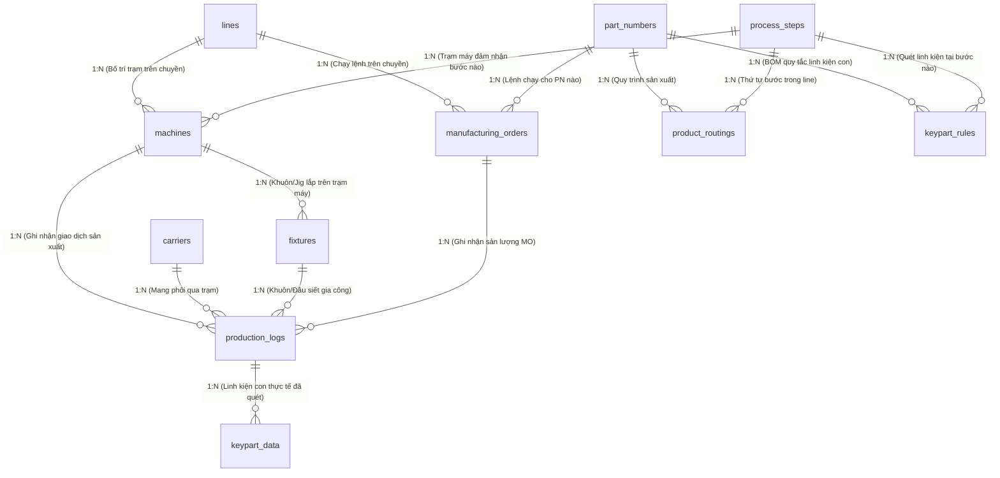

# KẾ HOẠCH & KIẾN TRÚC THIẾT LẬP CẤU HÌNH (MASTER SETUP CONFIG)
## MACHINE, CARRIER, FIXTURE, MO, PN, KEYPART, STEPS
### DỰ ÁN: FOXCONN & NVIDIA STATION MANAGEMENT SYSTEM (SALAMANDRA AUTOMATION LINE)
### ĐẶC TẢ TÍCH HỢP TỪ TÀI LIỆU LỖI THỰC TẾ SẢN XUẤT: `error_code_guide_V4.xlsx`

**Vị trí tài liệu:**
- `md/MASTER_CONFIG_SETUP_PLAN_MACHINE_CARRIER_FIXTURE_MO_PN_KEYPART_STEPS.md`
- `src/main/java/com/example/EnterpriseProject/md/MASTER_CONFIG_SETUP_PLAN_MACHINE_CARRIER_FIXTURE_MO_PN_KEYPART_STEPS.md`

---

## 1. TỔNG QUAN & KẾT LUẬN ĐÁNH GIÁ (EXECUTIVE SUMMARY)

Dựa trên phân tích 46 mã lỗi thực tế của nhà máy (**AutoLine API Codes 0 - 26** và các mã lỗi liên kết **SFC / SFIS1 MES_10xxx**) trong tài liệu `docs/error_code_guide_V4 (1).xlsx`, hệ thống điều hành sản xuất MES / Shop Floor Control phân định rõ ràng vai trò và cơ chế cấu hình của **7 đối tượng trọng tâm**:

```
┌──────────────────────────────────────────────────────────────────────────────────┐
│                      PHÂN BỔ 3 TẦNG CẤU HÌNH & KIỂM SOÁT                         │
├──────────────────────────────────────────────────────────────────────────────────┤
│ 1. MASTER DATA CONFIG (Danh mục tĩnh nền tảng):                                  │
│    - Machine (Trạm máy): IP trạm, HostName, Step ánh xạ, Trạm song song (Twin)   │
│    - PN (Part Number): Mã bo mạch, Model, Khách hàng, Regex Barcode SN           │
│    - Steps (Quy trình): Mã bước, WIP Group, Điểm gá/nhả phôi, Trạm SFC Station   │
│    - Carrier (Đồ gá phôi): Mã khay, max_cycles, Mốc kiểm định ca (07:30, 19:30) │
│    - Fixture (Khuôn/Jig máy): Mã khuôn, Máy gắn, Giới hạn chu kỳ lực kẹp/ép      │
├──────────────────────────────────────────────────────────────────────────────────┤
│ 2. RULE & MATRIX CONFIG (Ma trận ràng buộc nghiệp vụ & BOM):                     │
│    - Routing Matrix (PN x Steps): Thứ tự bắt buộc, chống nhảy trạm, quy tắc Undo │
│    - Keypart BOM Rules (PN x Step x Keypart): BOM Count, Regex, IsRequired,      │
│      Đối soát xuyên trạm (Cross-Station), Kiểm tra tiền trạm (StockIn/KPS Done)  │
│    - Machine-Fixture Compatibility: Khuôn chỉ được lắp trên đúng trạm chỉ định   │
├──────────────────────────────────────────────────────────────────────────────────┤
│ 3. OPERATIONAL SETUP (Lệnh điều hành thực thi theo ca):                          │
│    - MO (Manufacturing Order): Gán PN vào Line, Target Qty, R107, Rule CONFIG94 │
└──────────────────────────────────────────────────────────────────────────────────┘
```

---

## 2. BẢNG TỔNG HỢP ÁNH XẠ 46 MÃ LỖI TỪ `error_code_guide_V4` SANG THIẾT KẾ ENTITY & CẤU HÌNH

Dưới đây là bảng phân tích toàn bộ các mã lỗi thực tế từ nhà máy, chỉ rõ **đối tượng cấu hình liên quan** và **các trường (fields) cần bổ sung vào Entity**:

| API Code | Mã lỗi SFC (MES) | Mô tả lỗi thực tế tại nhà máy | Đối tượng liên quan | Trường Entity & Cấu hình kiểm soát |
| :---: | :--- | :--- | :---: | :--- |
| **0** | - | Precheck / Link thành công / Xác thực thành công | All | Trạng thái chuẩn, cho phép lưu thông |
| **1** | - | IP hoặc JSON trống; **Lỗi định tuyến: IP máy này thuộc công đoạn X nhưng gọi API ở công đoạn Y!** | **Machine / Steps** | `machines.station_ip`, `machines.mapped_step_code` |
| **2** | - | IP không hợp lệ hoặc chưa cấu hình; Sản phẩm [Model] tại trạm này chưa cấu hình | **Machine / PN** | `machines.station_ip`, `machine_supported_models` |
| **3** | - | Sản phẩm [Model] tại trạm này chưa được cấu hình phím linh kiện (KeyName) trong ProductConfigs | **Keypart / PN** | `keypart_rules` (liên kết `pn_id` + `step_id`) |
| **4** | - | CarrierCode không được để trống! | **Carrier** | `carriers.carrier_code` (NOT NULL, Barcode check) |
| **5** | **MES_10011** | Sản phẩm chưa qua trạm trước hoặc bị FAIL! Quét sai trạm (WIP Group khác trạm hiện tại) | **Steps / Routing** | `product_routings.sequence_order`, `process_steps.wip_group` |
| **6** | - | Sản phẩm đang trong chu trình chưa hoàn thành (quét lại Step 1 cho khay đang chạy dở) | **Carrier / Steps** | `carriers.status = 'BOUND'`, `production_logs.step` |
| **7** | - | Khay chưa qua Precheck tại trạm này (xảy ra khi tiến hành AutoLink) | **Machine / Carrier** | `carrier_sessions.precheck_verified = true` |
| **8** | - | Status hoặc ErrorCode không hợp lệ trong Undo (phải là UNDO hoặc RESET) | **Steps / Execution** | `enums.UndoActionType` (`UNDO`, `RESET`) |
| **9** | - | Trạm Undo không hợp lệ! Không thể Undo về trạm lớn hơn hoặc bằng trạm hiện tại! | **Steps / Routing** | `product_routings.sequence_order` (Target < Current) |
| **0\*** | - | Sản phẩm đã hoàn thành ở trạm trước đó có cùng chức năng (Cơ chế trạm song song Twin Step) | **Machine / Steps** | `machines.is_twin_station`, `machines.twin_group_code` |
| **11** | - | Serial Number không khớp! Carrier này đang liên kết với SN_X nhưng trạm hiện tại truyền SN_Y | **Carrier / PN** | `carriers.current_serial_number`, `carriers.allow_carrier_swap` |
| **12** | **MES_10033** | Thiếu dữ liệu bắt buộc: [KeyName] (có cấu hình `IsRequire = 1`); Chưa quét đủ Keypart | **Keypart** | `keypart_rules.is_required = true`, `keypart_rules.bom_count` |
| **13** | - | **[KeyName] không khớp với trạm trước! Trạm trước: Val_Prev \| Hiện tại: Val_Curr** | **Keypart** | `keypart_rules.cross_station_check = true` |
| **14** | - | Lỗi ngoại lệ hệ thống cơ sở dữ liệu SQL Server / MySQL (Store Procedure exception) | **System** | `api_request_logs.error_message`, DB Transaction Rollback |
| **15** | **MES_10080** | Giá trị [KEY_VALUE] của [KEY_NAME] đã được liên kết trước đó trên R108 (Trùng linh kiện) | **Keypart** | `keypart_rules.prevent_duplicate = true` (Unique check) |
| **16** | - | Sản phẩm gửi kết quả là [FAIL] $\rightarrow$ Chuyển sang khu vực sửa chữa (RE Area) | **Execution** | `production_logs.result = 'FAIL'`, `production_logs.is_repair_flag = true` |
| **17** | - | Cần thực hiện gỡ liên kết (Unlink) các trạm SFC trước đó khi chạy khay lại | **Steps / SFC** | `process_steps.is_sfc_station`, `production_logs.is_sfc_linked` |
| **18** | - | Sản phẩm bị lỗi lực vít (SCREW FAIL)! Lực siết (Torque) hoặc góc quay (Angle) không đạt | **Fixture / Tooling** | `screw_data` (Torque, Angle, Position), `fixtures.max_usage_count` |
| **19** | - | **Không thể Undo vượt quá công đoạn SFC gần nhất đã hoàn thành / Rào cản đổi khay lật mặt** | **Steps / Carrier** | `process_steps.allow_undo_past_sfc = false`, `carriers.parent_carrier_code` |
| **20** | - | **Trùng lặp giá trị quét [VALUE] giữa [KEY_A] và [KEY_B] trong cùng một lượt payload!** | **Keypart** | `keypart_rules.intra_payload_duplicate_check = true` |
| **21** | - | **Giá trị key [KeyName] tại AutoLink [LinkVal] không khớp với PreCheck [PreCheckVal]!** | **Keypart** | `keypart_rules.verify_precheck_match = true` |
| **22** | - | Precheck đã được xác thực trước đó (Double-call cảnh báo gọi đúp) | **Machine / Carrier** | `carrier_sessions.precheck_verified`, bỏ qua cho phép gia công |
| **23** | - | Sản phẩm chưa hoàn thành chu trình sản xuất! Đang ở STEP X / MAX STEP Y | **Routing** | `production_logs.current_step`, `product_routings.max_step` |
| **24** | - | SAN PHAM BI LOI LUC NHAN (PRESSFIT FAIL)! Lực ép (Force) hoặc hành trình không đạt | **Fixture / Tooling** | `pressfit_data` (Force, Distance, Time), `fixtures.max_usage_count` |
| **25** | - | **CARRIER ĐÃ HẾT TUỔI THỌ, YÊU CẦU THAY THẾ (CurrentCycleCount >= MaxCycleCount)** | **Carrier** | `carriers.total_cycles`, `carriers.max_cycles` |
| **26** | - | **CARRIER QUÁ HẠN KIỂM ĐỊNH / CHƯA KIỂM ĐỊNH ĐẦU CA (07:30, 19:30) / BỊ KHÓA** | **Carrier** | `carriers.status = 'NEED_INSPECTION'`, `fixed_schedule_times`, `max_interval_hours` |
| **101** | **MES_10120** | KHONG TIM THAY DU LIEU TRONG R107 (Sản phẩm chưa làm Input trạm 1 hoặc chưa tạo MO) | **MO / PN** | `manufacturing_orders.mo_number`, `manufacturing_orders.sfc_r107_status` |
| **101** | **MES_10091** | **KPS CHUA HOAN THANH LUU TRINH / SN_WIP NOT IS STOCKIN (Linh kiện chưa qua tiền trạm)** | **Keypart** | `keypart_rules.require_stockin_verification = true` |
| **101** | **MES_10085** | Dữ liệu quét vào bị trùng lặp nhiều lần trong bảng tạm C_TEMP_KEYPART_T của SFC | **Keypart** | Caching bảng tạm & Deduplication Buffer |
| **101** | **MES_10007** | **SN ĐÃ CÓ DỮ LIỆU R_, VUI LÒNG TÌM RE ĐỂ SỬA CHỮA (Cờ lỗi Repair)** | **Routing** | `production_logs.is_repair_flag = true` (Chặn máy tự động) |
| **101** | **MES_10177** | IE THIẾT LẬP BOM KHÁC VỚI DỮ LIỆU THỰC TẾ | **Keypart / PN** | `keypart_rules.barcode_regex`, `part_numbers.revision` |
| **101** | **MES_10110** | **Chức năng PE-SW trong CONFIG94. MO này chỉ liên kết với MO do PE-SW thiết lập** | **MO** | `manufacturing_orders.config94_mo_binding` |
| **101** | **CHAMELEON** | IP [CHAMELEON_106113] CHƯA ĐƯỢC THIẾT LẬP TRẠM TRÊN HỆ THỐNG SFC | **Machine** | `machines.station_ip`, `machines.host_name` |
| **101** | **BOM_COUNT** | Fail. So luong KPS khong dung. BOM: 4, Input: 3 / PLEASE SCAN FULL ALL KEYPART (0/7) | **Keypart** | `keypart_rules.bom_count` |

---

## 3. THIẾT KẾ CƠ SỞ DỮ LIỆU CHI TIẾT (DATABASE SCHEMAS)

Hệ thống cơ sở dữ liệu được nâng cấp toàn diện để đáp ứng 100% các ràng buộc từ tài liệu lỗi thực tế.



---

### 3.1. Bảng `carriers` (Đồ gá phôi tuần hoàn - Nâng cấp toàn diện)
Bổ sung cơ chế quản lý vòng đời cơ khí (Code 25), kiểm định định kỳ đầu ca (Code 26), và hỗ trợ trạm đổi khay/lật mặt (Code 11, 19):

```sql
CREATE TABLE carriers (
    id INT AUTO_INCREMENT PRIMARY KEY,
    carrier_code VARCHAR(50) NOT NULL UNIQUE COMMENT 'Mã Barcode trên khay gá (VD: CARRIER_001)',
    current_serial_number VARCHAR(100) NULL COMMENT 'Mã bo mạch SN đang cõng (NULL nếu khay rỗng)',
    status VARCHAR(30) NOT NULL DEFAULT 'EMPTY' 
        COMMENT 'EMPTY, BOUND, MAINTENANCE, NEED_INSPECTION, LOCKED',
    total_cycles INT NOT NULL DEFAULT 0 COMMENT 'Số chu trình tuần hoàn đã chạy',
    max_cycles INT NOT NULL DEFAULT 5000 COMMENT 'Ngưỡng tuổi thọ tối đa (Code 25)',
    last_station_code VARCHAR(50) NULL COMMENT 'Trạm gần nhất khay vừa đi qua',
    
    -- CÁC TRƯỜNG MỚI ĐÁP ỨNG ERROR CODE 26 (KIỂM ĐỊNH CA) & CODE 19 (ĐỔI KHAY)
    last_inspection_time DATETIME(6) NULL COMMENT 'Thời điểm QA/Tooling kiểm định dung sai lần cuối',
    max_interval_hours INT NOT NULL DEFAULT 24 COMMENT 'Khoảng cách giờ tối đa giữa 2 lần kiểm định',
    fixed_schedule_times VARCHAR(100) NOT NULL DEFAULT '07:30,19:30' 
        COMMENT 'Mốc giờ giao ca cố định bắt buộc phải kiểm định đầu ca (Code 26)',
    allowed_pn_family VARCHAR(100) NOT NULL DEFAULT 'SALAMANDRA' COMMENT 'Dòng sản phẩm cho phép cõng',
    pocket_count INT NOT NULL DEFAULT 1 COMMENT 'Số phôi tối đa cõng trên 1 gá (1 hoặc Multi-cavity)',
    allow_carrier_swap TINYINT(1) NOT NULL DEFAULT 0 
        COMMENT '1: Cho phép đổi khay/lật mặt tại trạm chỉ định, 0: Cấm tráo phôi (Code 11, 19)',
    parent_carrier_code VARCHAR(50) NULL COMMENT 'Lưu vết khay cũ khi thực hiện chuyển đổi khay',
    
    is_active TINYINT(1) NOT NULL DEFAULT 1 COMMENT '1: Bình thường, 0: Khóa cứng đồ gá',
    created_at DATETIME(6) NOT NULL DEFAULT CURRENT_TIMESTAMP(6),
    updated_at DATETIME(6) NOT NULL DEFAULT CURRENT_TIMESTAMP(6) ON UPDATE CURRENT_TIMESTAMP(6),
    INDEX idx_carrier_status (status),
    INDEX idx_carrier_current_sn (current_serial_number)
);
```

---

### 3.2. Bảng `machines` (Cấu hình trạm máy - Nâng cấp)
Bổ sung kiểm soát IP vs Step (Code 1), HostName thiết bị (Code 42 CHAMELEON), và trạm song song Twin Station (Code 0):

```sql
CREATE TABLE machines (
    id INT AUTO_INCREMENT PRIMARY KEY,
    line_id INT NOT NULL COMMENT 'FK -> lines.id',
    group_name VARCHAR(100) NOT NULL COMMENT 'Tên nhóm trạm (VD: ASSY_MGMT, SUB_SA)',
    station_code VARCHAR(50) NOT NULL COMMENT 'Mã trạm (VD: ST01, ST02, ST03A, ST03B)',
    machine_name VARCHAR(100) NOT NULL COMMENT 'Tên máy vật lý',
    station_ip VARCHAR(45) NOT NULL COMMENT 'Địa chỉ IP tĩnh của máy trạm (Code 1, 2)',
    host_name VARCHAR(100) NULL COMMENT 'Tên máy tính IPC (VD: CHAMELEON_106113 - Code 42)',
    sequence_order INT NOT NULL COMMENT 'Thứ tự vị trí vật lý trên chuyền',
    mapped_step_code VARCHAR(50) NOT NULL COMMENT 'Công đoạn bước được phép gọi API (Chống gọi chéo IP - Code 1)',
    
    -- CẤU HÌNH TRẠM SONG SONG (TWIN STATION MECHANISM - CODE 0)
    is_twin_station TINYINT(1) NOT NULL DEFAULT 0 COMMENT '1: Trạm song song, 0: Trạm đơn lẻ',
    twin_group_code VARCHAR(50) NULL COMMENT 'Mã nhóm song song (VD: TWIN_ST03)',
    
    target_uph INT NOT NULL DEFAULT 100 COMMENT 'Năng suất mục tiêu UPH',
    target_cycle_time DECIMAL(6,2) NOT NULL DEFAULT 36.00 COMMENT 'Cycle time định mức (giây)',
    target_upd INT NOT NULL DEFAULT 0 COMMENT 'Mục tiêu ngày',
    is_active TINYINT(1) NOT NULL DEFAULT 1,
    created_at DATETIME(6) NOT NULL DEFAULT CURRENT_TIMESTAMP(6),
    updated_at DATETIME(6) NOT NULL DEFAULT CURRENT_TIMESTAMP(6) ON UPDATE CURRENT_TIMESTAMP(6),
    CONSTRAINT uk_machine_line_station UNIQUE (line_id, station_code),
    INDEX idx_machine_station_ip (station_ip),
    FOREIGN KEY (line_id) REFERENCES lines(id)
);
```

---

### 3.3. Bảng `part_numbers` (Product Master Data - Bổ sung mới)
Định nghĩa mã bo mạch NVIDIA, Model thương phẩm, và quy tắc regex kiểm tra Serial Number:

```sql
CREATE TABLE part_numbers (
    id INT AUTO_INCREMENT PRIMARY KEY,
    pn_code VARCHAR(100) NOT NULL UNIQUE COMMENT 'Mã Part Number (VD: 699-2G136-0000-000)',
    product_name VARCHAR(150) NOT NULL COMMENT 'Tên thương phẩm (VD: NVIDIA Salamandra LC)',
    product_type VARCHAR(50) NOT NULL COMMENT 'Phân loại: GPU, SUB_SA, MAIN_BOARD',
    customer_name VARCHAR(100) DEFAULT 'NVIDIA' COMMENT 'Khách hàng',
    revision VARCHAR(20) DEFAULT 'A' COMMENT 'Phiên bản thiết kế (Rev A, B)',
    sn_regex VARCHAR(255) NULL COMMENT 'Regex kiểm tra Barcode SN (VD: ^NV[0-9]{8}$)',
    standard_cycle_time DECIMAL(6,2) DEFAULT 36.00,
    is_active TINYINT(1) NOT NULL DEFAULT 1,
    created_at DATETIME(6) NOT NULL DEFAULT CURRENT_TIMESTAMP(6),
    updated_at DATETIME(6) NOT NULL DEFAULT CURRENT_TIMESTAMP(6) ON UPDATE CURRENT_TIMESTAMP(6)
);
```

---

### 3.4. Bảng `process_steps` (Step Master Data - Bổ sung mới)
Chuẩn hóa danh mục bước, phân định ranh giới SFC Station (Code 19) và điểm gá/nhả phôi:

```sql
CREATE TABLE process_steps (
    id INT AUTO_INCREMENT PRIMARY KEY,
    step_code VARCHAR(50) NOT NULL UNIQUE COMMENT 'Mã bước (VD: ST01, ST02, ST03, FCT, PACK)',
    step_name VARCHAR(100) NOT NULL COMMENT 'Tên công đoạn (VD: AutoLink, Keyparts, Screw AOI)',
    wip_group VARCHAR(100) NOT NULL COMMENT 'Nhóm WIP trên SFC (VD: ASSY_SA_SWB_HARNESS - Code 32)',
    step_type VARCHAR(50) NOT NULL COMMENT 'ASSEMBLY, FASTENING, INSPECTION, TESTING, PACKING',
    
    -- CÁC CỜ KIỂM SOÁT ĐỒ GÁ VÀ SFC STATION
    is_carrier_binding_point TINYINT(1) DEFAULT 0 COMMENT '1: Trạm kẹp phôi vào Carrier (ST01)',
    is_carrier_unbinding_point TINYINT(1) DEFAULT 0 COMMENT '1: Trạm nhả phôi khỏi Carrier (PACK)',
    is_sfc_station TINYINT(1) DEFAULT 0 COMMENT '1: Trạm đẩy dữ liệu chính thức lên SFC (Code 19)',
    allow_undo_past_sfc TINYINT(1) DEFAULT 0 COMMENT '0: Cấm tuyệt đối Undo vượt quá trạm SFC này (Code 19)',
    
    description VARCHAR(255) NULL,
    is_active TINYINT(1) NOT NULL DEFAULT 1,
    created_at DATETIME(6) NOT NULL DEFAULT CURRENT_TIMESTAMP(6),
    updated_at DATETIME(6) NOT NULL DEFAULT CURRENT_TIMESTAMP(6) ON UPDATE CURRENT_TIMESTAMP(6)
);
```

---

### 3.5. Bảng `product_routings` (Routing / Sequence Configuration - Bổ sung mới)
Ma trận quy trình công nghệ bắt buộc giữa Part Number và chuỗi Steps, chống nhảy cóc trạm (Code 5, 23):

```sql
CREATE TABLE product_routings (
    id INT AUTO_INCREMENT PRIMARY KEY,
    pn_id INT NOT NULL COMMENT 'FK -> part_numbers.id',
    step_id INT NOT NULL COMMENT 'FK -> process_steps.id',
    sequence_order INT NOT NULL COMMENT 'Thứ tự bước (1, 2, 3...) - Chống nhảy trạm (Code 5)',
    is_mandatory TINYINT(1) NOT NULL DEFAULT 1 COMMENT '1: Bắt buộc phải PASS, 0: Tùy chọn',
    allow_skip TINYINT(1) NOT NULL DEFAULT 0 COMMENT '1: Cho phép bỏ qua nếu có trạm song song PASS',
    created_at DATETIME(6) NOT NULL DEFAULT CURRENT_TIMESTAMP(6),
    CONSTRAINT uk_pn_step UNIQUE (pn_id, step_id),
    CONSTRAINT uk_pn_sequence UNIQUE (pn_id, sequence_order),
    FOREIGN KEY (pn_id) REFERENCES part_numbers(id) ON DELETE CASCADE,
    FOREIGN KEY (step_id) REFERENCES process_steps(id) ON DELETE RESTRICT
);
```

---

### 3.6. Bảng `keypart_rules` (Keypart BOM Binding Configuration - Nâng cấp toàn diện)
Kiểm soát toàn bộ các ràng buộc linh kiện con từ tài liệu lỗi: Đối soát xuyên trạm (Code 13), Chống quét trùng cùng payload (Code 20), Chống tráo linh kiện PreCheck-Link (Code 21), Định lượng BOM Count (Code 31, 44), và Kiểm tra tiền trạm Stock-In (Code 35):

```sql
CREATE TABLE keypart_rules (
    id INT AUTO_INCREMENT PRIMARY KEY,
    pn_id INT NOT NULL COMMENT 'FK -> part_numbers.id',
    step_id INT NOT NULL COMMENT 'FK -> process_steps.id',
    kp_name VARCHAR(100) NOT NULL COMMENT 'Tên linh kiện con (VD: HEATSINK, BRACKET_LEFT, BARCODE_LBL)',
    kp_description VARCHAR(255) NULL,
    barcode_regex VARCHAR(255) NULL COMMENT 'Regex kiểm tra mã vạch (Code 33)',
    
    -- CÁC QUY TẮC RÀNG BUỘC THEO GUIDE V4
    bom_count INT NOT NULL DEFAULT 1 COMMENT 'Số lượng linh kiện quy định trong BOM (Code 31, 44: BOM vs Input)',
    is_required TINYINT(1) NOT NULL DEFAULT 1 COMMENT '1: Bắt buộc (Code 12: IsRequire = 1)',
    prevent_duplicate TINYINT(1) NOT NULL DEFAULT 1 COMMENT '1: Cấm quét trùng với bo mạch khác (Code 15, MES_10080)',
    intra_payload_duplicate_check TINYINT(1) NOT NULL DEFAULT 1 
        COMMENT '1: Cấm quét 1 mã barcode cho 2 vị trí KeyName trong cùng 1 request (Code 20)',
    cross_station_check TINYINT(1) NOT NULL DEFAULT 0 
        COMMENT '1: Bắt buộc đối soát khớp 100% với giá trị đã quét ở trạm trước (Code 13)',
    verify_precheck_match TINYINT(1) NOT NULL DEFAULT 1 
        COMMENT '1: Khóa cứng giá trị giữa PreCheck và AutoLink không được sai lệch (Code 21)',
    require_stockin_verification TINYINT(1) NOT NULL DEFAULT 0 
        COMMENT '1: Kiểm tra KPS đã hoàn thành lưu trình tiền trạm/nhập kho Stock-in (Code 35: MES_10091)',
        
    scan_sequence INT NOT NULL DEFAULT 1 COMMENT 'Thứ tự ưu tiên quét',
    created_at DATETIME(6) NOT NULL DEFAULT CURRENT_TIMESTAMP(6),
    CONSTRAINT uk_pn_step_kpname UNIQUE (pn_id, step_id, kp_name),
    FOREIGN KEY (pn_id) REFERENCES part_numbers(id) ON DELETE CASCADE,
    FOREIGN KEY (step_id) REFERENCES process_steps(id) ON DELETE RESTRICT
);
```

---

### 3.7. Bảng `fixtures` (Fixture Tooling Master Data - Bổ sung mới)
Quản lý khuôn ép cơ khí (Pressfit Mold) và cụm mũi siết ốc (Screw Head), kiểm soát lực ép/siết (Code 18, 24):

```sql
CREATE TABLE fixtures (
    id INT AUTO_INCREMENT PRIMARY KEY,
    fixture_code VARCHAR(100) NOT NULL UNIQUE COMMENT 'Mã barcode đồ gá (VD: FIX_ST03_SCREW_01)',
    fixture_name VARCHAR(150) NOT NULL COMMENT 'Tên đồ gá / Khuôn kẹp',
    fixture_type VARCHAR(50) NOT NULL COMMENT 'SCREW_HEAD, PRESSFIT_MOLD, AOI_MASK',
    compatible_machine_id INT NOT NULL COMMENT 'FK -> machines.id (Máy gắn cố định đồ gá)',
    total_usage_count INT NOT NULL DEFAULT 0 COMMENT 'Số lần kẹp/ép thực tế đã thực hiện',
    max_usage_count INT NOT NULL DEFAULT 10000 COMMENT 'Ngưỡng tuổi thọ kẹp tối đa trước khi mòn',
    status VARCHAR(30) NOT NULL DEFAULT 'READY' COMMENT 'READY, IN_USE, MAINTENANCE, LOCKED',
    is_active TINYINT(1) NOT NULL DEFAULT 1,
    last_maintenance_date DATETIME(6) NULL,
    created_at DATETIME(6) NOT NULL DEFAULT CURRENT_TIMESTAMP(6),
    updated_at DATETIME(6) NOT NULL DEFAULT CURRENT_TIMESTAMP(6) ON UPDATE CURRENT_TIMESTAMP(6),
    FOREIGN KEY (compatible_machine_id) REFERENCES machines(id)
);
```

---

### 3.8. Bảng `manufacturing_orders` (MO Setup - Nâng cấp)
Quản lý công lệnh sản xuất, liên kết với PN và ràng buộc cấu hình SFC `CONFIG94` (Code 41):

```sql
CREATE TABLE manufacturing_orders (
    id INT AUTO_INCREMENT PRIMARY KEY,
    mo_number VARCHAR(100) NOT NULL UNIQUE COMMENT 'Mã công lệnh sản xuất (VD: MO_20261019_001)',
    line_id INT NOT NULL COMMENT 'FK -> lines.id',
    pn_id INT NOT NULL COMMENT 'FK -> part_numbers.id',
    part_number VARCHAR(50) NOT NULL COMMENT 'Mã PN text hiển thị nhanh',
    product_name VARCHAR(100) NOT NULL,
    product_type VARCHAR(50) NOT NULL,
    target_qty INT NOT NULL COMMENT 'Sản lượng mục tiêu',
    status VARCHAR(20) NOT NULL DEFAULT 'OPEN' COMMENT 'OPEN, RUNNING, PAUSED, DONE, CANCELLED',
    
    -- CÁC TRƯỜNG ĐÁP ỨNG RÀNG BUỘC SFC (CODE 29, 41)
    sfc_r107_status VARCHAR(50) NOT NULL DEFAULT 'SYNCED' COMMENT 'Trạng thái đồng bộ bảng R107 (Code 29)',
    config94_mo_binding VARCHAR(100) NULL COMMENT 'Mã MO đối ứng quy định bởi PE trong CONFIG94 (Code 41)',
    
    start_time DATETIME(6) NULL,
    end_time DATETIME(6) NULL,
    created_at DATETIME(6) NOT NULL DEFAULT CURRENT_TIMESTAMP(6),
    updated_at DATETIME(6) NOT NULL DEFAULT CURRENT_TIMESTAMP(6) ON UPDATE CURRENT_TIMESTAMP(6),
    FOREIGN KEY (line_id) REFERENCES lines(id),
    FOREIGN KEY (pn_id) REFERENCES part_numbers(id)
);
```

---

## 4. THUẬT TOÁN INTERLOCKING ENGINE TOÀN DIỆN (CHẶN LỖI THỜI GIAN THỰC)

Khi máy trạm gọi API `PRECHECK`, `AUTOLINK`, hoặc `SUBMIT DATA`, hệ thống thực thi ma trận thẩm định 8 bước tự động trong $\le 5\text{ ms}$:

```mermaid
flowchart TD
    Start([Trạm máy gọi API]) --> Step1{1. Thẩm định Trạm & IP\n(Code 1, 2, 42)}
    Step1 -- Sai IP / Sai Step --> Err1[Trả lỗi Code 1: IP_ROUTING_MISMATCH]
    Step1 -- Hợp lệ --> Step2{2. Thẩm định MO Chuyền\n(Code 29, 41)}
    
    Step2 -- Chưa mở MO / Sai CONFIG94 --> Err2[Trả lỗi Code 29/41: NO_ACTIVE_MO_R107]
    Step2 -- MO RUNNING --> Step3{3. Thẩm định Carrier\n(Code 4, 25, 26, 11)}
    
    Step3 -- Quá Max Cycles --> Err3A[Trả lỗi Code 25: CARRIER_LIFECYCLE_EXPIRED]
    Step3 -- Quá hạn / Đầu ca 07:30, 19:30 --> Err3B[Trả lỗi Code 26: CARRIER_INSPECTION_REQUIRED]
    Step3 -- Tráo phôi không phép --> Err3C[Trả lỗi Code 11: SN_CARRIER_MISMATCH]
    Step3 -- Hợp lệ --> Step4{4. Thẩm định Fixture/Khuôn\n(Code 18, 24)}
    
    Step4 -- Khuôn mòn / Hết tuổi thọ --> Err4[Trả lỗi Code 18/24: FIXTURE_EXPIRED_OR_LOCKED]
    Step4 -- Hợp lệ --> Step5{5. Kiểm tra Trạm song song\n(Twin Step - Code 0)}
    
    Step5 -- Đã PASS ở trạm song song --> Bypass([Tự động BYPASS: TWIN_STATION_ALREADY_PASSED])
    Step5 -- Chưa chạy --> Step6{6. Chống nhảy trạm Routing\n(Code 5, 6, 23)}
    
    Step6 -- Chưa qua trạm trước / Cờ RE --> Err6[Trả lỗi Code 5/101: PREV_STATION_FAIL_OR_REPAIR_FLAG]
    Step6 -- Đúng thứ tự --> Step7{7. Thẩm định Keyparts BOM\n(Code 12, 13, 20, 21, 35)}
    
    Step7 -- Thiếu Key / Sai BOM Count --> Err7A[Trả lỗi Code 12: MISSING_MANDATORY_KEYPART]
    Step7 -- Trùng lặp cùng payload --> Err7B[Trả lỗi Code 20: INTRA_PAYLOAD_DUPLICATE_KEYPART]
    Step7 -- Không khớp PreCheck vs Link --> Err7C[Trả lỗi Code 21: KEYPART_PRECHECK_LINK_MISMATCH]
    Step7 -- Sai khác trạm trước --> Err7D[Trả lỗi Code 13: CROSS_STATION_KEYPART_MISMATCH]
    Step7 -- KPS chưa Stock-In --> Err7E[Trả lỗi Code 35: KPS_NOT_STOCKIN]
    Step7 -- Đầy đủ & Hợp lệ --> Pass([Chấp thuận: PASS & Mở chốt máy / Ghi Log])
```

---

## 5. THIẾT KẾ DỮ LIỆU ĐIỀU HÀNH THỜI GIAN THỰC (CARRIER & PRECHECK SESSIONS)

Để giải quyết triệt để lỗi **Code 7 (Khay chưa qua PreCheck tại trạm này)** và **Code 22 (Precheck Double-call)**, hệ thống lưu giữ bảng tạm In-Memory / Redis hoặc bảng phiên làm việc:

```sql
CREATE TABLE carrier_precheck_sessions (
    id BIGINT AUTO_INCREMENT PRIMARY KEY,
    carrier_code VARCHAR(50) NOT NULL,
    station_code VARCHAR(50) NOT NULL,
    serial_number VARCHAR(100) NOT NULL,
    precheck_verified TINYINT(1) NOT NULL DEFAULT 1,
    verified_keyparts_json JSON NULL COMMENT 'Lưu danh sách keyparts đã quét ở pha Precheck để đối soát tại pha Link (Code 21)',
    expires_at DATETIME(6) NOT NULL COMMENT 'Phiên hết hạn sau 5 phút nếu không tiến hành AutoLink',
    created_at DATETIME(6) NOT NULL DEFAULT CURRENT_TIMESTAMP(6),
    INDEX idx_session_carrier_station (carrier_code, station_code)
);
```

---

## 6. LỘ TRÌNH TRIỂN KHAI KỸ THUẬT (ACTIONABLE IMPLEMENTATION ROADMAP)

### Pha 1: Chuẩn hóa Model & DDL Migration
- Cập nhật các Entity hiện tại:
  - `Carrier.java`: Thêm `NEED_INSPECTION`, `lastInspectionTime`, `maxIntervalHours`, `fixedScheduleTimes`, `allowCarrierSwap`.
  - `Machine.java`: Thêm `hostName`, `isTwinStation`, `twinGroupCode`, `mappedStepCode`.
  - `ProductionLog.java`: Thêm `isRepairFlag`.
- Tạo mới 5 Entity:
  1. `PartNumber.java`
  2. `ProcessStep.java`
  3. `ProductRouting.java`
  4. `KeypartRule.java`
  5. `Fixture.java`

### Pha 2: Xây dựng In-Memory Cache Layer (Caffeine / Redis)
- Caching toàn bộ cấu hình máy (`MachineByIp`), cấu hình dòng bo mạch (`PartNumber`), danh mục quy trình (`ProductRoutings`), và quy tắc linh kiện (`KeypartRulesByPnStep`).
- Đảm bảo thời gian tra cứu cấu hình và thẩm định $\le 1\text{ ms}$, phục vụ dây chuyền chạy tốc độ cao.

### Pha 3: Triển khai Bộ lọc Thẩm định liên trạm (Station Interlocking Service)
- Xây dựng 8 Validator chuyên biệt theo đúng mã lỗi:
  - `IpRoutingValidator` (Code 1, 2)
  - `CarrierLifecycleAndShiftInspectionValidator` (Code 25, 26)
  - `TwinStationBypassHandler` (Code 0)
  - `RoutingSequenceAndRepairFlagValidator` (Code 5, 23, 39)
  - `KeypartPayloadDeduplicationValidator` (Code 20)
  - `KeypartCrossStationConsistencyValidator` (Code 13)
  - `KeypartPrecheckLinkConsistencyValidator` (Code 21)
  - `CarrierSwapAndUndoConstraintValidator` (Code 11, 19)

### Pha 4: Xây dựng Bộ REST API Quản trị cấu hình (Admin Management APIs)
- Cung cấp giao diện Web UI cho cán bộ PE, IE, Tooling, QA:
  - Khai báo trạm máy, gán IP và cấu hình trạm song song.
  - Lập trình danh mục linh kiện con (BOM Keyparts) và biểu thức regex.
  - Quản lý hạn kiểm định ca cho khay gá (Carrier Inspection Confirmation).
  - Khai báo khuôn ép và đầu siết ốc (Fixture Management).

### Pha 5: Kiểm thử tự động với Mock Data của 46 kịch bản lỗi
- Viết bộ Test Suite giả lập 46 tình huống lỗi trong file `error_code_guide_V4.xlsx` để đảm bảo hệ thống phản hồi chính xác từng mã lỗi `API Code` và `Description` tương ứng.

---

## 7. TỔNG KẾT

Tài liệu này đã chuyển hóa hoàn chỉnh toàn bộ kinh nghiệm vận hành thực tế và **46 tình huống lỗi sản xuất từ Foxconn & NVIDIA Salamandra Line** thành một kiến trúc phần mềm chuẩn mực. Việc áp dụng đúng mô hình dữ liệu và thuật toán Interlocking này sẽ đảm bảo dây chuyền vận hành mượt mà, ngăn chặn 100% rủi ro mòn gá, nhảy trạm, sai linh kiện hoặc tráo phôi giữa chuyền.
