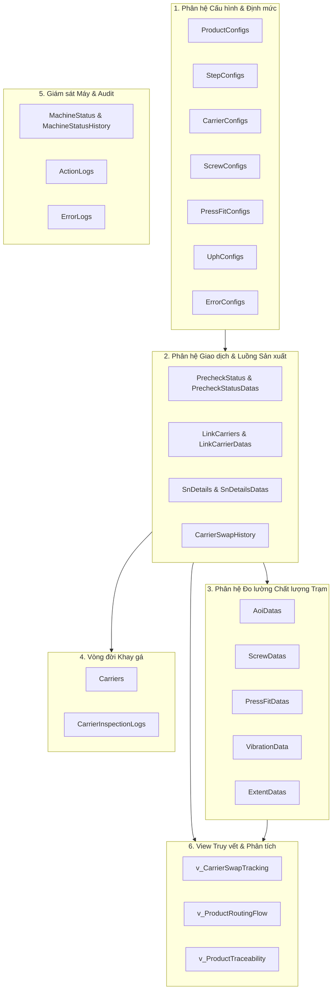
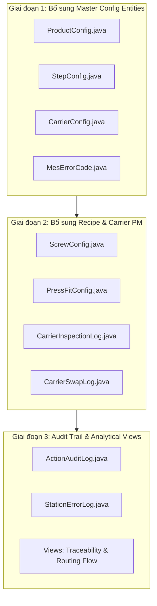

# BÁO CÁO ĐÁNH GIÁ CƠ SỞ DỮ LIỆU DÂY CHUYỀN TỰ ĐỘNG HÓA (`Automation Line Database`) & ĐỐI CHIẾU VỚI DATABASE HIỆN CÓ

> **Dự án:** Foxconn & NVIDIA Smart Factory Management System  
> **Tài liệu phân tích:** Thư mục dữ liệu mẫu `docs/Automation Line Database` (28 file CSV thực tế từ chuyền tự động hóa)  
> **Đối tượng so sánh:** Hệ thống Entity JPA hiện có tại `src/backend/EnterpriseProject/src/main/java/com/example/EnterpriseProject/entity`  
> **Ngày lập:** 23/11/2026  

---

## MỤC LỤC
1. [TỔNG QUAN TẬP DỮ LIỆU `Automation Line Database`](#1-tổng-quan-tập-dữ-liệu-automation-line-database)
2. [PHÂN TÍCH CHI TIẾT 28 BẢNG DỮ LIỆU THEO PHÂN HỆ NGHIỆP VỤ](#2-phân-tích-chi-tiết-28-bảng-dữ-liệu-theo-phân-hệ-nghiệp-vụ)
   - [2.1. Phân hệ Giao dịch Sản xuất & Định tuyến (Production Execution & Routing)](#21-phân-hệ-giao-dịch-sản-xuất--định-tuyến-production-execution--routing)
   - [2.2. Phân hệ Đo lường Chất lượng & Thông số Thiết bị Trạm (Process & Quality Telemetry)](#22-phân-hệ-đo-lường-chất-lượng--thông-số-thiết-bị-trạm-process--quality-telemetry)
   - [2.3. Phân hệ Cấu hình Động & Quy chuẩn Định mức (Master Configuration & Recipe Rules)](#23-phân-hệ-cấu-hình-động--quy-chuẩn-định-mức-master-configuration--recipe-rules)
   - [2.4. Phân hệ Quản lý Tài sản Khay gá & Bảo dưỡng (Carrier Lifecycle & Maintenance)](#24-phân-hệ-quản-lý-tài-sản-khay-gá--bảo-dưỡng-carrier-lifecycle--maintenance)
   - [2.5. Phân hệ Giám sát Trạng thái Trạm máy Thời gian thực (Machine Status Monitoring)](#25-phân-hệ-giám-sát-trạng-thái-trạm-máy-thời-gian-thực-machine-status-monitoring)
   - [2.6. Phân hệ Nhật ký Kiểm toán & Xử lý Sự cố Hệ thống (Audit Trail & Error Logs)](#26-phân-hệ-nhật-ký-kiểm-toán--xử-lý-sự-cố-hệ-thống-audit-trail--error-logs)
   - [2.7. Tầng View Phân tích & Báo cáo Tổng hợp (Analytical Reporting Views)](#27-tầng-view-phân-tích--báo-cáo-tổng-hợp-analytical-reporting-views)
3. [ĐỐI CHIẾU VỚI DATABASE HIỆN CÓ TRONG BACKEND (`com.example.EnterpriseProject.entity`)](#3-đối-chiếu-với-database-hiện-có-trong-backend-comexampleenterpriseprojectentity)
   - [3.1. Ma trận đối chiếu tổng thể (Mapping Matrix)](#31-ma-trận-đối-chiếu-tổng-thể-mapping-matrix)
   - [3.2. Những điểm sáng & Cải tiến vượt bậc của Database hiện có](#32-những-điểm-sáng--cải-tiến-vượt-bậc-của-database-hiện-có)
   - [3.3. Các thành phần quan trọng còn THIẾU trong Database hiện có](#33-các-thành-phần-quan-trọng-còn-thiếu-trong-database-hiện-có)
4. [ĐÁNH GIÁ ƯU ĐIỂM, NHƯỢC ĐIỂM & RỦI RO KIẾN TRÚC](#4-đánh-giá-ưu-điểm-nhược-điểm--rủi-ro-kiến-trúc)
   - [4.1. Đánh giá Database mẫu (`Automation Line Database`)](#41-đánh-giá-database-mẫu-automation-line-database)
   - [4.2. Đánh giá Database hiện tại (`EnterpriseProject`)](#42-đánh-giá-database-hiện-tại-enterpriseproject)
5. [LỘ TRÌNH ĐỀ XUẤT NÂNG CẤP TOÀN DIỆN CHO DỰ ÁN (ACTIONABLE ROADMAP)](#5-lộ-trình-đề-xuất-nâng-cấp-toàn-diện-cho-dự-án-actionable-roadmap)

---

## 1. TỔNG QUAN TẬP DỮ LIỆU `Automation Line Database`

Tập tài liệu `docs/Automation Line Database` gồm **28 file CSV**, đại diện cho cơ sở dữ liệu vận hành thực tế tại các xưởng sản xuất tự động hóa thông minh (Foxconn Smart Factory F07/F12) lắp ráp các sản phẩm công nghệ cao như **GB300**, **SALAMANDRA (LC SWB SUB SA)**, **LUPINE**, **ORCHID**, **CHAMELEON**.

Trong 28 file này, kiến trúc dữ liệu được phân định thành:
- **25 Bảng dữ liệu thực tế (Physical Tables):** Lưu trữ cấu hình danh mục, quy chuẩn kiểm định, phiên làm việc, trạng thái trạm máy và dữ liệu đo lường vật lý.
- **03 Báo cáo / View phân tích (Database Views):** Tiền tố `v_` (`v_CarrierSwapTracking`, `v_ProductRoutingFlow`, `v_ProductTraceability`) được biên dịch sẵn nhằm phục vụ các màn hình truy vết (Traceability) và báo cáo OEE/Routing nhanh chóng.

---

## 2. PHÂN TÍCH CHI TIẾT 28 BẢNG DỮ LIỆU THEO PHÂN HỆ NGHIỆP VỤ

### 2.1. Phân hệ Giao dịch Sản xuất & Định tuyến (Production Execution & Routing)

Đây là xương sống vận hành của dây chuyền sản xuất tự động, thể hiện chu trình 3 pha chuẩn công nghiệp: **Precheck -> Link Carrier -> Finish Step (SnDetails)** cùng với cơ chế đổi khay gá giữa các chặng:

| Tên Bảng | Số Cột | Khóa Chính / Liên kết | Mô tả Nghiệp vụ & Cấu trúc Dữ liệu |
| :--- | :---: | :--- | :--- |
| **`SnDetails`** | 25 | `Id` (PK), `MO`, `SerialNumber`, `CarrierCode`, `Step` | Bảng giao dịch sản xuất hoàn tất tại mỗi trạm máy. Ghi nhận thời điểm vào trạm (`InStationTime`), thời gian chu kỳ (`CycleTime`), kết quả kiểm định (`Status` PASS/FAIL), số lượng đạt (`GoodQty`, `PassQty`, `FailQty`), công nhân phụ trách (`EmployeeID`), mã lỗi (`ErrorCode`), mã máy (`MachineName`), IP (`IpAddress`). |
| **`SnDetailsDatas`** | 5 | `Id` (PK), `IdSnDetail` (FK), `IdKey` (FK) | Bảng chi tiết động dạng EAV (Entity-Attribute-Value). Lưu các giá trị thực tế của từng linh kiện/mã quét tương ứng với `IdKey` được cấu hình trong `ProductConfigs` (Ví dụ: `CARRIER CODE`, `INNER TRAY`, `COOLANT LEAKAGE`, `SA AMD`...). |
| **`PrecheckStatus`** | 11 | `Id` (PK), `IpAddress`, `MachineName`, `CarrierCode` | Bảng ghi nhận phiên xác thực sơ bộ (PreCheck pha 1). Trước khi máy bắt đầu gia công, khay gá và sản phẩm được quét kiểm tra điều kiện tiên quyết (đã hoàn thành trạm trước chưa, khay gá có bị khóa không, sản phẩm có bị lỗi không). |
| **`PrecheckStatusDatas`**| 4 | `Id` (PK), `IdPreCheck` (FK), `IdKey` (FK) | Bảng dữ liệu EAV đi kèm với phiên PreCheck, lưu mã quét thực tế để hệ thống kiểm tra tính hợp lệ trước khi cấp phép máy hoạt động. |
| **`LinkCarriers`** | 14 | `Id` (PK), `CarrierCode`, `SerialNumber`, `Step`, `MO` | Ghi nhận sự kiện liên kết khay gá phôi (Carrier) với Serial Number và Lệnh sản xuất (MO) khi đưa phôi vào chuyền hoặc qua trạm trung chuyển. |
| **`LinkCarrierDatas`** | 4 | `Id` (PK), `IdLinkCarrier` (FK), `IdKey` (FK) | Bảng dữ liệu EAV đi kèm sự kiện liên kết khay gá, lưu giá trị thực tế của các mã key cần bind tại thời điểm ghép khay. |
| **`CarrierSwapHistory`**| 11 | `Id` (PK), `SerialNumber`, `OldCarrierCode`, `NewCarrierCode` | Ghi nhận toàn bộ lịch sử tráo đổi/lật mặt khay gá (Carrier Swap) dọc dây chuyền. Khi sản phẩm hoàn thành chặng khay gá Fix 1-8 hoặc chuyển từ khay bán thành phẩm sang khay lắp ráp chính, việc chuyển đổi từ `OldCarrierCode` sang `NewCarrierCode` tại `Step` cụ thể được ghi vết tuyệt đối. |

### 2.2. Phân hệ Đo lường Chất lượng & Thông số Thiết bị Trạm (Process & Quality Telemetry)

Nhóm này lưu trữ các thông số kỹ thuật đo đạc vật lý từ các đầu dò, cảm biến, camera và controller máy:

| Tên Bảng | Số Cột | Khóa Chính / Liên kết | Mô tả Nghiệp vụ & Cấu trúc Dữ liệu |
| :--- | :---: | :--- | :--- |
| **`AoiDatas`** | 18 | `Id` (PK), `IdSNDetail` (FK), `SerialNumber` | Dữ liệu kiểm tra ngoại quan quang học tự động (AOI). Ghi nhận loại kiểm tra (`Type`: SUMMARY, COMPONENT), Camera (`TOP`/`BOT`), vùng FOV (`Fov`), tên linh kiện (`ComponentName`), vị trí (`Location`), điểm tin cậy (`Score`), giá trị đo (`Measure`), đường dẫn ảnh toàn cảnh (`ImagePath`), ảnh cắt chi tiết linh kiện (`CropImagePath`). |
| **`ScrewDatas`** | 27 | `Id` (PK), `IdSNDetail` (FK), `Position` | Dữ liệu siết ốc tự động từ súng siết điện tử/servo. Đo lường chính xác: Lực siết (`Torque`), Góc quay (`Angle`), Thời gian siết (`Time`), Thể tích keo/ốc (`RealVolume`), Chiều cao nổi của ốc (`RealHeight`), so sánh với giới hạn tiêu chuẩn (`StandardTorque`, `LimitTorque`...). |
| **`PressFitDatas`** | 21 | `Id` (PK), `IdSNDetail` (FK), `Position` | Dữ liệu máy ép nén linh kiện (Press-Fit lực/hành trình cho Connector, Heatpipe, Shielding). Đo lường: Lực ép thực tế (`RealForce`), Thời gian ép (`RealTime`), Hành trình ép thực tế (`RealDistance`), so sánh với ngưỡng cho phép (`StandardForce`, `LimitForce`...). |
| **`VibrationData`** | 12 | `Id` (PK), `IdSNDetail` (FK), `Controller` | Dữ liệu kiểm tra độ rung và động cơ tự động: Điện áp (`Voltage`), Áp suất (`Pressure`), Thời gian test (`Time`), kết quả PASS/FAIL. |
| **`ExtentDatas`** | 12 | `Id` (PK), `IdSNDetail` (FK), `FileName` | Dữ liệu file mở rộng / Datalog thô từ các máy chuyên dụng như máy phun keo (Gluing AOI Datalog), file text/log chi tiết lưu trên ổ mạng nội bộ CCD Machine (`DataPath`, `ServerName`). |

### 2.3. Phân hệ Cấu hình Động & Quy chuẩn Định mức (Master Configuration & Recipe Rules)

Nhóm bảng cấu hình đóng vai trò là "bộ não" điều phối nghiệp vụ của toàn bộ hệ thống, cho phép kỹ sư dây chuyền (PE/ME) tinh chỉnh quy tắc mà không cần sửa code:

| Tên Bảng | Số Cột | Khóa Chính / Cột Nhận diện | Mô tả Nghiệp vụ & Cấu trúc Dữ liệu |
| :--- | :---: | :--- | :--- |
| **`ProductConfigs`** | 13 | `Id` (PK), `ProductName`, `ProductType`, `Step`, `GroupName` | Cấu hình ma trận các khóa kiểm tra động (Dynamic Validation Keys). Định nghĩa tại Bước `Step`, Nhóm `GroupName` thì cần quét những mã nào (`KeyName`, vd: `CARRIER CODE`, `INNER TRAY`, `COOLANT LEAKAGE`), quy định thuộc tính: `IsActive`, `IsRequire`, `IsVerify`, `IsByPass`, `IsSFC`. |
| **`StepConfigs`** | 14 | `ProductName`, `ProductType`, `LineName`, `Step` | Cấu hình quy tắc công đoạn. Quy định: Bước chạy song song (`TwinStep`), Cho phép đổi khay (`AllowCarrierSwap`), Truy vấn khay từ SN (`ResolveCarrierFromSN`), Trạm SFC (`IsSfcStation`), Khóa chính kiểm tra (`MainKey`), Cho phép lỗi (`AllowFail`), Bước kích hoạt gửi dữ liệu SFC (`SfcTriggerStep`), Chế độ upload (`UploadDataMode`). |
| **`CarrierConfigs`** | 15 | `Id` (PK), `ProductName`, `ProductType`, `CarrierType` | Cấu hình vòng đời khay gá. Quy định: Công đoạn kết thúc vòng tuần hoàn (`EndStep`), Số chu kỳ tối đa trước khi khóa (`MaxCycleCount`), Chu kỳ cảnh báo bảo dưỡng (`WarningCycleCount`), Thời gian giãn cách tối đa (`MaxIntervalHours`), Khung giờ kiểm định cố định (`FixedScheduleTimes`: ví dụ "08:30-08:50, 20:30-20:50"). |
| **`ScrewConfigs`** | 23 | `Id` (PK), `ProductName`, `MachineName`, `Step`, `Position` | Công thức & dung sai siết ốc tiêu chuẩn (Recipe). Định mức chuẩn và dung sai tối đa cho từng vị trí ốc: `StandardTorque`, `LimitTorque`, `StandardAngle`, `LimitAngle`, `StandardVolume`, `StandardHeight`... |
| **`PressFitConfigs`**| 20 | `Id` (PK), `ProductName`, `MachineName`, `Step`, `Position` | Công thức & dung sai ép nén tiêu chuẩn. Định mức chuẩn và dung sai cho từng vị trí ép: `StandardForce`, `LimitForce`, `StandardTime`, `LimitTime`, `StandardDistance`, `LimitDistance`... |
| **`UphConfigs`** | 12 | `Id` (PK), `ProductName`, `LineName`, `Step`, `GroupName` | Định mức sản lượng & chu kỳ. Cấu hình mục tiêu năng suất theo giờ (`TargetUph`), Chu kỳ gia công chuẩn (`TargetCycleTime` giây), và ngưỡng cảnh báo quá chu kỳ (`WarningThreshold`). |
| **`ErrorConfigs`** | 3 | `ErrorKey` (PK), `CodeValue`, `Description` | Từ điển mã lỗi chuẩn của hệ thống MES / Automation. Định nghĩa các mã lỗi (200, 400, 403, 404, 411, 412, 413, 414...) và giải thích song ngữ (Việt - Anh - Trung). |

### 2.4. Phân hệ Quản lý Tài sản Khay gá & Bảo dưỡng (Carrier Lifecycle & Maintenance)

| Tên Bảng | Số Cột | Khóa Chính / Liên kết | Mô tả Nghiệp vụ & Cấu trúc Dữ liệu |
| :--- | :---: | :--- | :--- |
| **`Carriers`** | 14 | `CarrierCode` (PK), `CarrierType`, `LineName` | Bảng quản lý hồ sơ và vòng đời khay gá phôi. Theo dõi tổng số chu kỳ đã chạy (`TotalCycleCount`), số chu kỳ hiện tại chưa bảo dưỡng (`CurrentCycleCount`), thời điểm hoàn tất chu kỳ gần nhất (`LastCycleCompletedTime`), thời điểm kiểm định gần nhất (`LastInspectionTime`), người kiểm định (`LastInspectionBy`), kết quả kiểm định (`LastInspectionResult`), trạng thái (`Status`: ACTIVE, LOCKED, MAINTENANCE). |
| **`CarrierInspectionLogs`**| 9 | `Id` (PK), `CarrierCode`, `InspectionType` | Nhật ký bảo dưỡng & kiểm định khay gá định kỳ (PM). Ghi nhận hình thức kiểm tra (`InspectionType`: PERIODIC, INITIAL, DAMAGE), người kiểm tra (`Inspector`), kết quả (`Result`: PASS, FAIL), hành động xử lý (`ActionTaken`: CONTINUE, LOCKED, SCRAP), số chu kỳ lúc kiểm tra (`CycleCountAtInspection`), ghi chú (`Note`). |

### 2.5. Phân hệ Giám sát Trạng thái Trạm máy Thời gian thực (Machine Status Monitoring)

| Tên Bảng | Số Cột | Khóa Chính / Liên kết | Mô tả Nghiệp vụ & Cấu trúc Dữ liệu |
| :--- | :---: | :--- | :--- |
| **`MachineStatus`** | 11 | `Id` (PK), `IpAddress`, `MachineName`, `Step` | Bảng lưu trạng thái tức thời (Snapshot) của từng trạm máy trên chuyền (`Status`: RUN, STOP, IDLE, ERROR). Cung cấp dữ liệu phục vụ hiển thị Dashboard trạng thái máy trực quan cho người vận hành. |
| **`MachineStatusHistory`**| 5 | `Id` (PK), `IdMachineStatus` (FK) | Bảng nhật ký chuyển đổi trạng thái máy. Ghi nhận thời điểm thay đổi trạng thái từ trạng thái cũ (`CurrentStatus`) sang trạng thái mới (`NewStatus`) tại `UpdateDate`. |

### 2.6. Phân hệ Nhật ký Kiểm toán & Xử lý Sự cố Hệ thống (Audit Trail & Error Logs)

| Tên Bảng | Số Cột | Khóa Chính / Liên kết | Mô tả Nghiệp vụ & Cấu trúc Dữ liệu |
| :--- | :---: | :--- | :--- |
| **`ActionLogs`** | 21 | `Id` (PK), `EmployeeId`, `TableName`, `RecordId` | Nhật ký kiểm toán thao tác người dùng (User Action Audit Trail). Ghi vết chi tiết mọi hành vi chỉnh sửa cấu hình (thêm/sửa/xóa key, đổi ngưỡng siết ốc, đổi công đoạn), lưu vết dữ liệu cũ (`OldValues` dạng JSON), dữ liệu mới (`NewValues` dạng JSON), IP người dùng (`ClientIp`), mô tả (`Description`). |
| **`ErrorLogs`** | 15 | `Id` (PK), `ErrorSource`, `Phase`, `IpAddress` | Nhật ký lỗi hệ thống và lỗi trạm máy phát sinh trong quá trình sản xuất. Ghi lại nguồn lỗi (`ErrorSource`: AIOT, SFC, IPC), pha phát sinh (`Phase`: PRECHECK, AUTOLINK, IN_STATION), mã lỗi (`ErrorCode`), thông điệp chi tiết (`LogMessage`). |

### 2.7. Tầng View Phân tích & Báo cáo Tổng hợp (Analytical Reporting Views)

Tài liệu cung cấp 3 View SQL biểu diễn cách tổ hợp dữ liệu phục vụ người dùng cuối:
- **`v_CarrierSwapTracking`:** Truy vết toàn bộ hành trình đổi khay của từng Serial Number, gắn kết `SwapTime`, `SwapIpAddress` và `OldCarrierLastActiveTime`.
- **`v_ProductRoutingFlow`:** Báo cáo lộ trình gia công của từng sản phẩm: đã đi qua những bước nào (`Step 1..n`), qua trạm máy nào (`StationMachine`), kết quả đạt/lỗi ra sao và thời gian xử lý.
- **`v_ProductTraceability`:** Báo cáo gia phả sản phẩm (Full Product Genealogy / Traceability) liên kết toàn bộ: mã máy, công đoạn, số thứ tự trạm, số lượng, khay gá nguồn, khay gá đích và mã lỗi phát sinh.

---

## 3. ĐỐI CHIẾU VỚI DATABASE HIỆN CÓ TRONG BACKEND (`com.example.EnterpriseProject.entity`)

### 3.1. Ma trận đối chiếu tổng thể (Mapping Matrix)

Dưới đây là bảng đối chiếu chi tiết 1-1 giữa 28 bảng trong tài liệu `Automation Line Database` và hệ thống Entity JPA hiện có của dự án:

| STT | Bảng trong `Automation Line Database` | Entity JPA Hiện có trong Backend | Trạng thái Đối chiếu | Nhận xét Chênh lệch Kiến trúc |
| :---: | :--- | :--- | :---: | :--- |
| 1 | `SnDetails` | `ProductionLog` | **Tương đương (Được nâng cấp)** | `ProductionLog` chuẩn hóa thành công giao dịch sản xuất, bổ sung cơ chế Undo/Rework qua `voided_by_log_id`, liên kết chuẩn với `Machine` và `ManufacturingOrder`. |
| 2 | `SnDetailsDatas` | `KeypartData` | **Khác biệt mô hình (EAV vs Keypart)** | `SnDetailsDatas` dùng EAV trỏ đến `ProductConfigs.Id`, trong khi `KeypartData` lưu cặp trực tiếp `(kp_name, kp_value)` gắn với `ProductionLog`. |
| 3 | `AoiDatas` | `AoiData`, `AoiSummaryImage`, `AoiFovInspection`, `AoiComponentInspection` | **Nâng cấp chuẩn hóa 3 tầng** | Bảng mẫu là bảng phẳng chứa cả ảnh và linh kiện. Backend hiện tại đã chuẩn hóa xuất sắc thành 3 cấp quan hệ (Summary -> FOV -> Component), bóc tách ảnh lưu đĩa. |
| 4 | `ScrewDatas` | `ScrewData` | **Tương đương** | Đã map đầy đủ các thông số lực siết, góc quay, thời gian, thể tích và chiều cao ốc, gắn với `ProductionLog`. |
| 5 | `PressFitDatas` | `PressfitData` | **Tương đương** | Đã map đầy đủ lực ép, hành trình, thời gian ép, gắn với `ProductionLog`. |
| 6 | `Carriers` | `Carrier` | **Tương đương (Cần bổ sung thuộc tính)** | Đã có Entity `Carrier` quản lý số chu kỳ, trạng thái `CarrierStatus`. Tuy nhiên còn thiếu một số cột: `last_inspection_time`, `last_inspection_by`, `last_inspection_result`. |
| 7 | `MachineStatus` & `MachineStatusHistory` | `MachineStatusLog` | **Cải tiến vượt trội (Timeline Interval)** | Bảng mẫu lưu trạng thái snapshot và event history. Backend hiện tại lưu dạng chuỗi thời gian liên tục (`start_time`, `end_time`, `duration_seconds`), cực kỳ tối ưu cho biểu đồ Gantt/Timeline OEE. |
| 8 | `UphConfigs` | Các trường trong `Machine` (`target_uph`, `target_cycle_time`) | **Tích hợp vào Machine (Chưa có bảng độc lập)** | Backend hiện tại đưa trực tiếp `targetUph` và `targetCycleTime` vào Entity `Machine`. Trong khi bảng mẫu có thể cấu hình linh hoạt theo từng cặp (Product + Step + Group). |
| 9 | *(Chưa có trong CSV)* | `Line` | **Ưu việt của Backend** | Backend có bảng Master `Line` chuẩn hóa phân đoạn chuyền sản xuất. |
| 10 | *(Chưa có trong CSV)* | `ManufacturingOrder` | **Ưu việt của Backend** | Backend có bảng Master `ManufacturingOrder` (MO) quản lý kế hoạch sản xuất độc lập với máy móc. |
| 11 | *(Chưa có trong CSV)* | `MachineSession` | **Ưu việt của Backend** | Backend có bảng `MachineSession` quản lý phiên đăng nhập trực ca của công nhân tại trạm máy. |
| 12 | *(Chưa có trong CSV)* | `User`, `Role`, `Operator` | **Ưu việt của Backend** | Backend có hệ thống phân quyền IAM (`users`, `roles`, `operators`) theo tiêu chuẩn bảo mật. |
| 13 | *(Chưa có trong CSV)* | `ApiRequestLog` | **Ưu việt của Backend** | Backend có bảng lưu vết toàn bộ payload request/response và latency API từ máy trạm. |
| 14 | `ProductConfigs` | **CHƯA CÓ** | ❌ **Còn thiếu** | Chưa có Entity để cấu hình danh mục Key động cho từng Bước và Nhóm công đoạn. |
| 15 | `StepConfigs` | **CHƯA CÓ** | ❌ **Còn thiếu** | Chưa có Entity để lưu cấu hình luồng công đoạn (`TwinStep`, `AllowCarrierSwap`, `IsSfcStation`...). |
| 16 | `CarrierConfigs` | **CHƯA CÓ** | ❌ **Còn thiếu** | Chưa có Entity cấu hình ngưỡng chu kỳ cảnh báo và lịch bảo dưỡng khay gá. |
| 17 | `CarrierInspectionLogs` | **CHƯA CÓ** | ❌ **Còn thiếu** | Chưa có Entity lưu vết lịch sử kiểm định định kỳ khay gá (phục vụ chức năng Unlock Carrier). |
| 18 | `CarrierSwapHistory` | **CHƯA CÓ** | ❌ **Còn thiếu** | Chưa có Entity chuyên biệt lưu vết tráo đổi khay giữa các chặng công đoạn. |
| 19 | `ScrewConfigs` | **CHƯA CÓ** | ❌ **Còn thiếu** | Chưa có Entity lưu công thức định mức lực siết ốc tiêu chuẩn (Recipe). |
| 20 | `PressFitConfigs` | **CHƯA CÓ** | ❌ **Còn thiếu** | Chưa có Entity lưu công thức định mức lực ép nén tiêu chuẩn (Recipe). |
| 21 | `ErrorConfigs` | **CHƯA CÓ** | ❌ **Còn thiếu** | Chưa có Entity quản lý từ điển mã lỗi MES đa ngôn ngữ. |
| 22 | `PrecheckStatus` & `Datas` | **CHƯA CÓ** | ❌ **Còn thiếu** | Chưa có bảng lưu phiên xác thực PreCheck 2 pha trước khi trạm máy hoạt động. |
| 23 | `LinkCarriers` & `Datas` | **CHƯA CÓ** | ❌ **Còn thiếu** | Chưa có bảng lưu sự kiện liên kết khay gá độc lập với bảng log sản xuất hoàn tất. |
| 24 | `VibrationData` | **CHƯA CÓ** | ❌ **Còn thiếu** | Chưa có Entity lưu dữ liệu rung động cơ trạm máy. |
| 25 | `ExtentDatas` | **CHƯA CÓ** | ❌ **Còn thiếu** | Chưa có Entity lưu đường dẫn file datalog mở rộng (Gluing AOI log...). |
| 26 | `ActionLogs` | **CHƯA CÓ** | ❌ **Còn thiếu** | Chưa có Entity lưu lịch sử thao tác thay đổi cấu hình hệ thống (Old/New values). |
| 27 | `ErrorLogs` | **CHƯA CÓ** | ❌ **Còn thiếu** | Chưa có Entity lưu vết chi tiết lỗi phát sinh từ thiết bị IPC/AIoT. |
| 28 | `v_CarrierSwapTracking`.. (3 Views) | **CHƯA CÓ** | ❌ **Còn thiếu** | Chưa tạo các View hoặc Service tổng hợp dữ liệu phục vụ màn hình Traceability. |

---

### 3.2. Những điểm sáng & Cải tiến vượt bậc của Database hiện có

So với tập dữ liệu thực tế mẫu trong `Automation Line Database`, thiết kế JPA Database hiện tại của dự án thể hiện sự vượt trội về tư duy kiến trúc phần mềm hiện đại:

1. **Chuẩn hóa quan hệ dữ liệu bậc cao (3NF):**
   - Trong bảng CSV mẫu, các trường chuỗi như `ProductName`, `ProductType`, `LineName`, `MachineName`, `GroupName`, `Step` bị lặp lại vô tội vạ trên hầu hết 28 bảng, gây lãng phí bộ nhớ khủng khiếp và nguy cơ bất nhất dữ liệu (Data Inconsistency) khi đổi tên hoặc cập nhật.
   - Database hiện tại đã cô lập các đối tượng thực thể: `Line`, `Machine`, `ManufacturingOrder` riêng biệt. `ProductionLog` chỉ cần lưu khóa ngoại `machine_id` và `mo_id`, đảm bảo tính toàn vẹn dữ liệu chuẩn mực.

2. **Kiến trúc bóc tách dữ liệu kiểm tra quang học AOI tối ưu:**
   - Trong bảng `AoiDatas.csv`, dữ liệu ảnh và vi sai linh kiện bị nén chung trong một bảng phẳng khổng lồ, gây chậm trễ khi truy vấn bảng kê sản xuất.
   - Database hiện tại đã bóc tách khoa học thành cấu trúc phân tầng 3 cấp:
     `AoiData` (Tổng quan chu kỳ) -> `AoiSummaryImage` (Ảnh toàn cảnh) & `AoiFovInspection` (Ảnh vùng kiểm tra FOV) -> `AoiComponentInspection` (Từng linh kiện chi tiết). Chỉ lưu trữ đường dẫn ảnh, giải phóng hoàn toàn dung lượng database.

3. **Mô hình trạng thái máy dạng khoảng thời gian liên tục (`MachineStatusLog`):**
   - Thay vì lưu sự kiện chuyển đổi trạng thái rời rạc như `MachineStatus` & `MachineStatusHistory` trong CSV (phải viết hàm Window Function hoặc câu lệnh SQL rất phức tạp để tính thời lượng máy chạy/dừng), Entity `MachineStatusLog` của dự án đã tính toán sẵn `start_time`, `end_time` và `duration_seconds`. Điều này giúp các truy vấn vẽ biểu đồ Gantt OEE / Machine Timeline trên Frontend đạt tốc độ hiển thị tức thì.

4. **Quản lý phiên trực ca (`MachineSession`) & Kiểm toán API (`ApiRequestLog`):**
   - Dự án đã tính trước nghiệp vụ phân quyền ca kíp (`MachineSession`), gắn kết công nhân trực tiếp với trạm máy theo từng ca làm việc (`ShiftType`).
   - Có cơ chế kiểm toán lỗi truyền thông công nghiệp qua `ApiRequestLog`, ghi vết toàn bộ Payload JSON và Latency từng request, phục vụ việc đối soát khi trạm máy gặp sự cố.

---

### 3.3. Các thành phần quan trọng còn THIẾU trong Database hiện có

Mặc dù phần lõi giao dịch sản xuất của Database hiện tại rất vững chắc, nhưng khi đối chiếu với các kế hoạch giao diện Frontend đã lập trong thư mục `md/*.md`, Database hiện có đang **thiếu hẳn toàn bộ Phân hệ Cấu hình Master & Quy chuẩn Vận hành**:

1. **Thiếu Phân hệ Cấu hình Master động (Master Dynamic Configuration Engine):**
   - Màn hình `/config/product/nvidia` (theo `PRODUCT_CONFIG_PLAN.md`): Cần bảng `ProductConfigs` để kỹ sư định cấu hình danh sách mã cần quét tại từng trạm (VD: `CARRIER CODE`, `INNER TRAY`...). Hiện Backend chưa có bảng này.
   - Màn hình `/config/autoline-operations` (theo `AUTOLINE_OPERATIONS_PLAN.md`): Cần bảng `StepConfigs` để cấu hình quy tắc chuyển bước, trạm tráo khay, trạm SFC. Hiện Backend chưa có.
   - Màn hình `/config/carrier` (theo `CARRIER_CONFIG_PLAN.md`): Cần bảng `CarrierConfigs` để đặt ngưỡng vòng đời tối đa, chu kỳ cảnh báo bảo dưỡng khay. Hiện tại Entity `Carrier` chỉ có trường cứng `maxCycles = 5000` mà không có bảng quy tắc cấu hình theo dòng sản phẩm.
   - Màn hình `/config/mes-error-code` (theo `MES_ERROR_CODE_LIST_PLAN.md`): Cần bảng `ErrorConfigs` để quản trị danh mục mã lỗi, mã xử lý và mô tả song ngữ.

2. **Thiếu Quản lý Vòng đời & Mở khóa Khay gá (Carrier Lifecycle & Unlock):**
   - Màn hình `/config/unlock-carrier` (theo `UNLOCK_CARRIER_PLAN.md`): Cần bảng `CarrierInspectionLogs` để lưu nhật ký kiểm định khay, ai là người kiểm tra, kết quả PASS/FAIL, hành động mở khóa tiếp tục hay loại bỏ khay. Hiện Backend chưa có Entity này.
   - Khi khay đi qua các chặng lật mặt (như trạm S1-5, S1-18 trong tài liệu Slamandra), cần ghi nhận lịch sử tráo khay `CarrierSwapHistory` để phục vụ truy vết khi sản phẩm lỗi.

3. **Thiếu Bảng Cấu hình Công thức Đo lường (Recipe Configs):**
   - `ScrewConfigs`: Cần để xác định ngưỡng lực siết tiêu chuẩn (Standard Torque, Limit Torque) cho từng loại ốc tại từng vị trí.
   - `PressFitConfigs`: Cần để xác định ngưỡng lực ép và cự ly tiêu chuẩn (Standard Force, Distance) cho máy ép.

4. **Thiếu Kiểm toán Thao tác Người dùng (Action Audit Trail):**
   - `ActionLogs`: Khi kỹ sư thay đổi một tham số cấu hình trên Frontend, hệ thống cần ghi lại bản ghi cũ (`old_values`) và bản ghi mới (`new_values`) để đảm bảo tuân thủ tiêu chuẩn chất lượng nghiêm ngặt của Foxconn & NVIDIA.

---

## 4. ĐÁNH GIÁ ƯU ĐIỂM, NHƯỢC ĐIỂM & RỦI RO KIẾN TRÚC

### 4.1. Đánh giá Database mẫu (`Automation Line Database`)

#### Ưu điểm:
- **Khả năng thích ứng động cực cao (High Flexibility):** Nhờ áp dụng mô hình EAV (`ProductConfigs` kết hợp `SnDetailsDatas`), khi nhà máy bổ sung thêm linh kiện con mới hoặc thay đổi mã quét ở một trạm nào đó, kỹ sư chỉ việc chèn thêm một dòng cấu hình vào bảng `ProductConfigs` mà không phải chạy câu lệnh `ALTER TABLE` làm gián đoạn dây chuyền.
- **Dễ xuất báo cáo phẳng (Flat Reporting):** Vì hầu hết các bảng đều lặp lại thông tin `ProductName`, `ProductType`, `LineName`, `Step` nên việc trích xuất báo cáo Excel/CSV cho ban quản lý diễn ra rất nhanh mà không cần viết các câu lệnh `JOIN` phức tạp.

#### Nhược điểm & Rủi ro:
- **Dư thừa dữ liệu (Data Redundancy) nghiêm trọng:** Việc lưu lặp lại các chuỗi ký tự tên chuyền, tên máy, tên sản phẩm trên hàng chục triệu bản ghi log sẽ khiến cơ sở dữ liệu phình to nhanh chóng, tốn kém chi phí lưu trữ và bộ đệm RAM (Buffer Pool).
- **Rủi ro hiệu năng truy vấn với mô hình EAV:** Bảng `SnDetailsDatas` có thể đạt quy mô hàng chục triệu đến hàng trăm triệu dòng trong vài tháng sản xuất. Khi cần truy vấn tổng hợp một sản phẩm gồm 10 linh kiện con, hệ thống phải thực hiện nhiều phép `JOIN` hoặc `PIVOT`, dẫn đến nghẽn cổ chai CPU.
- **Không đảm bảo ràng buộc toàn vẹn dữ liệu (Lack of Referential Integrity):** Nhiều bảng liên kết thông qua chuỗi ký tự thay vì khóa ngoại cứng (Foreign Key), dẫn đến nguy cơ dữ liệu "mồ côi" nếu có trạm máy gửi sai chính tả hoặc dữ liệu rác.

---

### 4.2. Đánh giá Database hiện tại (`EnterpriseProject`)

#### Ưu điểm:
- **Kiến trúc hướng đối tượng chuẩn mực (Clean DDD / Relational Architecture):** Thiết kế bảng khớp hoàn hảo với các mô hình Spring Data JPA, Hibernate, tối ưu hóa bộ nhớ và hỗ trợ Lazy Loading hiệu quả.
- **Toàn vẹn dữ liệu tuyệt đối:** Sử dụng khóa ngoại cứng (`line_id`, `machine_id`, `mo_id`) cùng các ràng buộc duy nhất (`UniqueConstraint`) và chỉ mục (`Index`) được thiết kế tỉ mỉ, ngăn chặn triệt để lỗi trùng lặp dữ liệu trong môi trường sản xuất đa luồng.
- **Tối ưu hóa chuyên sâu cho biểu đồ và phân tích thời gian thực:** Các bảng `MachineStatusLog`, `ProductionLog` với cơ chế `run_sequence` và `voided_by_log_id` giải quyết xuất sắc bài toán truy vết sản phẩm làm lại (Rework) và hiển thị biểu đồ OEE.

#### Nhược điểm & Khoảng trống cần bù đắp:
- **Chưa có tầng Cấu hình Động (Configuration Engine):** Hiện tại hệ thống chưa thể lưu trữ các ma trận kiểm tra linh hoạt của từng công đoạn, khiến cho việc mở rộng sang các dòng sản phẩm mới gặp hạn chế nếu không viết thêm Entity cấu hình.
- **Chưa phủ hết các màn hình nghiệp vụ đã thiết kế trên Frontend:** Các trang như Carrier Config, Unlock Carrier, MES Error Code, NVIDIA Product Config đang thiếu các Entity và REST API tương ứng ở tầng Backend.

---

## 5. LỘ TRÌNH ĐỀ XUẤT NÂNG CẤP TOÀN DIỆN CHO DỰ ÁN (ACTIONABLE ROADMAP)

Để đưa hệ thống lên mức hoàn thiện tối đa, vừa giữ vững ưu điểm về chuẩn hóa quan hệ và hiệu năng của Backend hiện có, vừa hấp thu trọn vẹn sức mạnh cấu hình linh hoạt của tập dữ liệu mẫu `Automation Line Database`, lộ trình triển khai gồm 3 giai đoạn như sau:

### Giai đoạn 1: Bổ sung các Entity Cấu hình Động (Phục vụ trực tiếp Frontend Config Menu)
1. **Tạo `ProductConfig.java`:**
   - Quản lý danh mục Key động (`key_name`, `display_name`, `value_type`, `is_require`, `is_verify`, `is_sfc`) liên kết với `Line`, `Step`, `GroupName`.
   - Phục vụ trực tiếp cho màn hình `/config/product/nvidia`.
2. **Tạo `StepConfig.java`:**
   - Quản lý quy tắc công đoạn (`step_number`, `twin_step`, `allow_carrier_swap`, `is_sfc_station`, `upload_data_mode`).
   - Phục vụ trực tiếp cho màn hình `/config/autoline-operations`.
3. **Tạo `CarrierConfig.java`:**
   - Quản lý định mức chu kỳ (`max_cycle_count`, `warning_cycle_count`, `fixed_schedule_times`).
   - Phục vụ trực tiếp cho màn hình `/config/carrier`.
4. **Tạo `MesErrorCode.java`:**
   - Quản lý từ điển lỗi (`error_key`, `code_value`, `description_vi`, `description_en`, `description_cn`).
   - Phục vụ trực tiếp cho màn hình `/config/mes-error-code`.

### Giai đoạn 2: Hoàn thiện Nghiệp vụ Bảo dưỡng Khay & Công thức Định mức (Recipe)
1. **Tạo `CarrierInspectionLog.java`:**
   - Lưu trữ lịch sử kiểm định khay, phục vụ tính năng mở khóa khay tại màn hình `/config/unlock-carrier`.
2. **Tạo `CarrierSwapLog.java`:**
   - Ghi vết tráo đổi khay phôi (`old_carrier_code`, `new_carrier_code`, `swap_step`, `serial_number`), phục vụ truy vết xuyên suốt quy trình sản xuất.
3. **Tạo `ScrewConfig.java` & `PressFitConfig.java`:**
   - Cung cấp định mức Recipe chuẩn cho súng siết ốc tự động và máy ép linh kiện.

### Giai đoạn 3: Tích hợp Nhật ký Kiểm toán & Xây dựng Tầng View Báo cáo
1. **Tạo `ActionAuditLog.java`:**
   - Tích hợp Hibernate Interceptor hoặc Spring AOP để tự động ghi log mọi thao tác sửa đổi cấu hình (`old_values`, `new_values` dạng JSON).
2. **Tạo `StationErrorLog.java`:**
   - Ghi vết mọi sự cố thiết bị từ tầng IPC/AIoT để tổng hợp thống kê Top lỗi thường gặp (Pareto Chart).
3. **Xây dựng các Database Views hoặc Repository Native Queries:**
   - Triển khai `v_ProductTraceability` và `v_ProductRoutingFlow` dưới dạng Spring Data Projection hoặc Database View để Frontend hiển thị sơ đồ hành trình sản phẩm (Timeline Routing Visualizer) đạt tốc độ tối đa.

---

## TỔNG KẾT

Tập dữ liệu `Automation Line Database` (28 file CSV) là tài liệu tham chiếu thực tế vô cùng quý giá từ nhà máy Foxconn & NVIDIA. Nó cung cấp bức tranh hoàn chỉnh về các khía cạnh nghiệp vụ thực tế như: cơ chế xác thực Precheck 2 pha, ma trận khóa kiểm tra động, quy trình đổi khay gá, chu kỳ bảo dưỡng khay và quy chuẩn đo lường vật lý.

Hệ thống cơ sở dữ liệu hiện tại của dự án (`EnterpriseProject`) đã xây dựng phần **Giao dịch Sản xuất & Giám sát Máy móc (Core Transaction & Telemetry)** rất chuẩn mực, khoa học và vượt trội hơn dữ liệu mẫu về tính toàn vẹn và tối ưu hiệu năng.

Bằng việc bổ sung các Entity thuộc **Phân hệ Cấu hình Master & Nhật ký Bảo dưỡng Khay** theo đúng lộ trình khuyến nghị trên, dự án sẽ đạt được sự hoàn thiện tuyệt đối, sẵn sàng đáp ứng 100% mọi yêu cầu từ cả tầng thiết bị công nghiệp nhà máy lẫn giao diện vận hành thông minh của người dùng.

