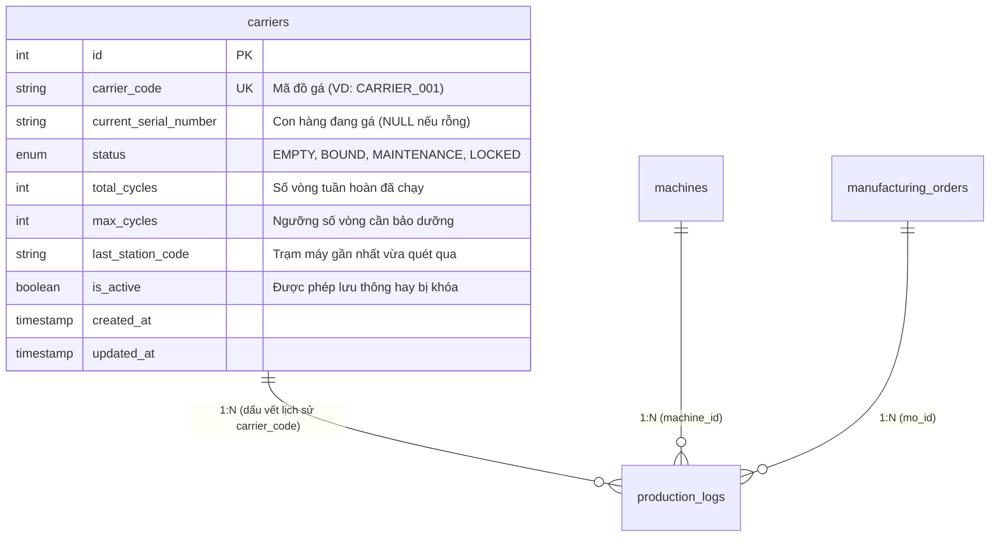
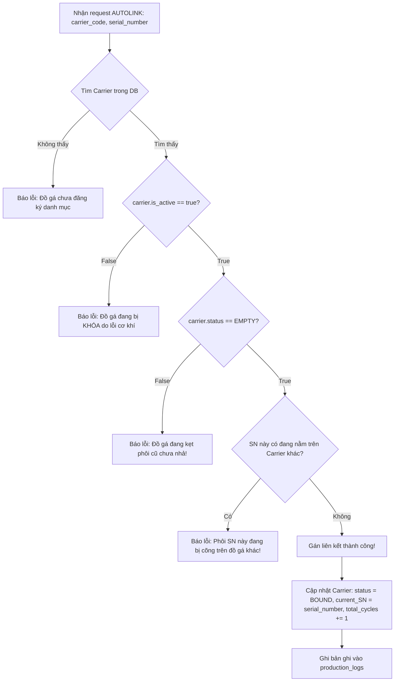

# THIẾT KẾ QUẢN LÝ ĐỒ GÁ (CARRIER), RÀNG BUỘC PHÔI (SN BINDING) VÀ BẮT LỖI LỆCH PHÔI THỜI GIAN THỰC

## DỰ ÁN: FOXCONN & NVIDIA STATION MANAGEMENT SYSTEM (SALAMANDRA AUTOMATION LINE)

**Vị trí lưu trữ:** `src/backend/EnterpriseProject/src/main/java/com/example/EnterpriseProject/md/CARRIER_MANAGEMENT_AND_SN_BINDING_WORKFLOW.md`

---

## 1. BỐI CẢNH VÀ VẤN ĐỀ CỐT LÕI (PROBLEM STATEMENT)

### 1.1. Bản chất của đồ gá (Carrier / Jig / Fixture) trong nhà máy

- Trong dây chuyền sản xuất tự động hóa mạch điện tử Salamandra LC SWB SUB SA:
  - **Carrier (Đồ gá):** Là khay định vị gia công chính xác (bằng nhôm/thép CNC) di chuyển tuần hoàn trên băng tải khép kín. Một chuyền thường có số lượng hữu hạn đồ gá (ví dụ: $50$ đến $100$ đồ gá, mã định danh `CARRIER_001` đến `CARRIER_100`).
  - **Serial Number (SN):** Là mã vạch khắc laser duy nhất của từng bo mạch sản phẩm xuất xưởng (ví dụ: `NV26090001`).
- **Mỗi ngày 1 đồ gá quay vòng lặp lại từ 50 đến 80 lần.**

### 1.2. Hạn chế nếu CHỈ DÙNG bảng nhật ký `production_logs`

Nếu hệ thống chỉ có bảng `production_logs` mà không có bảng quản lý trạng thái đồ gá:

1. **Lỗi chặn oan khi đồ gá quay vòng (False Positive Alarms):**  
   Khi `CARRIER_001` cõng con `SN_A` xong vòng 1, quay lại đầu chuyền cõng con `SN_B` ở vòng 2. Nếu truy vấn bản ghi mới nhất của `CARRIER_001` trong `production_logs`, hệ thống vẫn thấy con `SN_A` cũ và lầm tưởng rằng `CARRIER_001` đang bị xung đột với `SN_B`.
2. **Lỗi "Hồn Trương Ba, da hàng thịt" khi phôi lỗi gắp tay (Ghost Binding):**  
   Nếu bo mạch bị lỗi ở trạm giữa (ST2), công nhân nhặt bo mạch bỏ vào khay phế liệu/rework mà không quét máy, đồ gá rỗng quay lại đầu chuyền sẽ bị "kẹt ma" vĩnh viễn với bo mạch cũ.
3. **Mất kiểm soát độ mòn cơ khí (Jig Degradation):**  
   Đồ gá siết ốc sau $5,000$ lần kẹp sẽ bị rơ chốt, mòn ren, làm lệch mũi siết gây trầy xước bo mạch NVIDIA. Nếu không có bảng quản lý đồ gá, hệ thống không thể đếm số vòng tuần hoàn (`usage_count`) để cảnh báo bảo trì.
4. **Không có cơ chế khóa đồ gá hỏng (Fixture Locking):**  
   Không thể bấm nút khóa từ phần mềm để ngăn một đồ gá cong vênh tiếp tục lưu thông vào máy.

---

## 2. KIẾN TRÚC GIẢI PHÁP 2 TẦNG (TWO-TIER ARCHITECTURE)

Hệ thống phân định ranh giới rõ ràng giữa **Nhật ký quá khứ (History)** và **Trạng thái hiện tại (State)**:

```
┌────────────────────────────────────────────────────────────────────────┐
│                        TRẠM MÁY TỰ ĐỘNG HÓA                            │
│           (ST1: Autolink  ──>  ST2: Keyparts  ──>  ST3: Screw/AOI)     │
└────────────────────────────────────┬───────────────────────────────────┘
                                     │
                 ┌───────────────────┴───────────────────┐
                 ▼                                       ▼
┌─────────────────────────────────┐   ┌──────────────────────────────────┐
│      BẢNG QUẢN LÝ HIỆN HÀNH     │   │      BẢNG NHẬT KÝ LỊCH SỬ        │
│          (`carriers`)           │   │      (`production_logs`)         │
├─────────────────────────────────┤   ├──────────────────────────────────┤
│ - Trả lời: BÂY GIỜ đồ gá này    │   │ - Trả lời: TRONG QUÁ KHỨ, phôi  │
│   đang RỖNG hay CÕNG con nào?   │   │   này đã đi qua máy nào, lực     │
│ - Dung lượng: CỐ ĐỊNH (50-100   │   │   siết bao nhiêu, ảnh AOI sao?   │
│   dòng, cập nhật liên tục)      │   │ - Dung lượng: PHÌNH TO LIÊN TỤC  │
│ - Tốc độ kiểm tra: O(1) < 1ms   │   │   (hàng triệu dòng, lưu mãi mãi) │
└─────────────────────────────────┘   └──────────────────────────────────┘
```

---

## 3. THIẾT KẾ CƠ SỞ DỮ LIỆU BẢNG `carriers`

### 3.1. Sơ đồ thực thể ERD



### 3.2. Cấu trúc chi tiết các cột

| Tên cột                 | Kiểu dữ liệu   | Ràng buộc                   | Ý nghĩa / Mục đích                                                                                    |
| :---------------------- | :------------- | :-------------------------- | :---------------------------------------------------------------------------------------------------- |
| `id`                    | `INT`          | `PK, AUTO_INCREMENT`        | Khóa chính tự tăng                                                                                    |
| `carrier_code`          | `VARCHAR(50)`  | `NOT NULL, UNIQUE`          | Mã Barcode trên đồ gá (VD: `CARRIER_001`)                                                             |
| `current_serial_number` | `VARCHAR(100)` | `NULL, INDEX`               | Mã SN của bo mạch đang kẹp trên gá. Đặt là `NULL` khi đồ gá rỗng                                      |
| `status`                | `VARCHAR(20)`  | `NOT NULL, DEFAULT 'EMPTY'` | Trạng thái: `EMPTY` (rỗng), `BOUND` (đang cõng phôi), `MAINTENANCE` (bảo dưỡng), `LOCKED` (khóa hỏng) |
| `total_cycles`          | `INT`          | `NOT NULL, DEFAULT 0`       | Bộ đếm số lần quay vòng để cảnh báo bảo dưỡng cơ khí                                                  |
| `max_cycles`            | `INT`          | `DEFAULT 5000`              | Định mức tuổi thọ đồ gá (sau 5,000 lần phải kiểm tra độ rơ)                                           |
| `last_station_code`     | `VARCHAR(50)`  | `NULL`                      | Trạm gần nhất đồ gá đi qua (VD: `ST01`, `ST03`)                                                       |
| `is_active`             | `TINYINT(1)`   | `NOT NULL, DEFAULT 1`       | `1`: Bình thường, `0`: Khóa cứng đồ gá không cho máy nhận                                             |
| `created_at`            | `DATETIME(6)`  | `NOT NULL`                  | Thời điểm đưa đồ gá vào chuyền                                                                        |
| `updated_at`            | `DATETIME(6)`  | `NOT NULL`                  | Thời điểm cập nhật trạng thái gần nhất                                                                |

---

## 4. THUẬT TOÁN BẮT LỖI & QUY TRÌNH XÁC THỰC TẠI TỪNG TRẠM

### 4.1. Luồng 1: Trạm nạp đầu chuyền (ST1 - AUTOLINK / Gán phôi)

Khi sản phẩm bắt đầu vào chuyền, công nhân/robot đặt bo mạch vào đồ gá và quét cả 2 mã (`carriercode`, `serialnumber`):



---

### 4.2. Luồng 2: Trạm gia công & kiểm tra giữa chuyền (ST2, ST3, ST4... - PRECHECK & WORK)

Khi đồ gá chạy vào trạm (ví dụ trạm siết ốc ST3), trạm gửi gói tin kiểm tra:

#### Kịch bản A: Trạm chỉ quét được mã `carriercode` (Camera chỉ nhìn thấy khay đỡ)

- Server tra cứu nhanh bảng `carriers` theo `carrier_code`:
  - Nếu `status != BOUND` hoặc `current_serial_number == null`: **BÁO LỖI: Đồ gá rỗng chưa qua trạm gán phôi ST1!**
  - Nếu `status == BOUND`: Server lấy ra ngay con `current_serial_number` đang nằm trên đồ gá $\rightarrow$ Kiểm tra lịch sử `production_logs` xem con SN này ở trạm trước (ST2) có đạt `PASS` không. Nếu `PASS` $\rightarrow$ Cho phép máy kẹp phôi và siết ốc.

#### Kịch bản B: Trạm quét được cả `carriercode` VÀ `serialnumber` (Trạm có 2 camera quét như ST3)

- Server thực hiện phép kiểm tra chéo (Cross-check):
  ```java
  if (!carrier.getCurrentSerialNumber().equals(requestSerialNumber)) {
      // PHÁT HIỆN LỖI TRÁO ĐỒ GÁ HOẶC QUÉT LỆCH
      return APIResponse.error("LỖI LỆCH PHÔI: Đồ gá " + carrierCode
          + " đang được đăng ký chở phôi " + carrier.getCurrentSerialNumber()
          + ", nhưng máy lại quét thấy phôi " + requestSerialNumber);
  }
  ```
- **Lợi ích:** Ngăn chặn tuyệt đối việc công nhân tráo mạch giữa các khay đỡ hoặc cảm biến quét nhầm vạch barcode của khay bên cạnh.

#### Kịch bản C: Phát hiện đi lậu trạm / Nhảy cóc công đoạn

- Nếu `carrier.last_station_code == "ST01"` mà đột ngột xuất hiện ở `"ST04"` (bỏ qua trạm siết ốc ST3) $\rightarrow$ Server chặn máy ngay lập tức và báo còi cảnh báo lỗi quy trình chuyền (Skip Station Error).

---

### 4.3. Luồng 3: Trạm dỡ phôi cuối chuyền (ST6 / UNLINK / PACKING)

Khi bo mạch hoàn thiện và chuẩn bị đóng thùng:

1. Trạm quét đồ gá $\rightarrow$ Kiểm tra tất cả các trạm từ ST1 đến ST5 đều đã `PASS`.
2. Robot/công nhân nhấc bo mạch ra khỏi đồ gá để đóng gói.
3. Server thực hiện giải phóng đồ gá:
   - `carrier.setCurrentSerialNumber(null);`
   - `carrier.setStatus(CarrierStatus.EMPTY);`
   - `carrier.setLastStationCode("UNLINK");`
4. Đồ gá `CARRIER_001` giờ đã hoàn toàn **RỖNG VÀ SẠCH SẼ**, sẵn sàng quay về đầu chuyền đón bo mạch mới mà không bao giờ bị lỗi dữ liệu cũ.

---

### 4.4. Luồng 4: Xử lý ngoại lệ phôi lỗi nhặt tay (MANUAL RELEASE / REWORK)

Nếu bo mạch bị lỗi giữa chuyền và công nhân nhặt tay ra ngoài:

- Trên Web Admin (Frontend React), cung cấp màn hình **Quản lý Đồ gá (Carrier Management)**:
  - Công nhân/quản lý quét mã đồ gá `CARRIER_005`.
  - Nhấn nút **"Giải phóng đồ gá (Unbind)"**: Hệ thống lập tức xóa trắng `current_serial_number` và đưa `status` về `EMPTY`.
  - Nhấn nút **"Khóa đồ gá (Lock)"**: Khi phát hiện đồ gá bị cong vênh, đổi `is_active = false`. Mọi trạm trên chuyền sẽ tự động từ chối đồ gá này.
  - Nhấn nút **"Hoàn tất bảo trì (Reset Maintenance)"**: Sau khi thợ cơ khí cân chỉnh lại ren, reset `total_cycles = 0`.

---

## 5. MÃ NGUỒN TRIỂN KHAI JAVA SPRING BOOT MẪU

### 5.1. Enum `CarrierStatus.java`

Tạo tại `com.example.EnterpriseProject.enums.CarrierStatus`:

```java
package com.example.EnterpriseProject.enums;

public enum CarrierStatus {
    EMPTY,        // Đồ gá rỗng, sẵn sàng nhận phôi
    BOUND,        // Đang kẹp/chở một phôi sản phẩm
    MAINTENANCE,  // Đang bảo dưỡng định kỳ
    LOCKED        // Bị khóa do lỗi cơ khí / cong vênh
}
```

### 5.2. Entity `Carrier.java`

Tạo tại `com.example.EnterpriseProject.entity.Carrier`:

```java
package com.example.EnterpriseProject.entity;

import com.example.EnterpriseProject.entity.base.BaseTimeEntity;
import com.example.EnterpriseProject.enums.CarrierStatus;
import jakarta.persistence.*;
import lombok.*;

/**
 * Bảng carriers: Quản lý danh mục và trạng thái thời gian thực của đồ gá tuần hoàn
 */
@Entity
@Table(
    name = "carriers",
    uniqueConstraints = {
        @UniqueConstraint(name = "uk_carrier_code", columnNames = {"carrier_code"})
    },
    indexes = {
        @Index(name = "idx_carrier_status", columnList = "status"),
        @Index(name = "idx_carrier_current_sn", columnList = "current_serial_number")
    }
)
@Getter
@Setter
@NoArgsConstructor
@AllArgsConstructor
@Builder
public class Carrier extends BaseTimeEntity {

    @Id
    @GeneratedValue(strategy = GenerationType.IDENTITY)
    private Integer id;

    @Column(name = "carrier_code", length = 50, nullable = false, unique = true)
    private String carrierCode;

    @Column(name = "current_serial_number", length = 100)
    private String currentSerialNumber;

    @Builder.Default
    @Enumerated(EnumType.STRING)
    @Column(length = 20, nullable = false)
    private CarrierStatus status = CarrierStatus.EMPTY;

    @Builder.Default
    @Column(name = "total_cycles", nullable = false)
    private Integer totalCycles = 0;

    @Builder.Default
    @Column(name = "max_cycles", nullable = false)
    private Integer maxCycles = 5000;

    @Column(name = "last_station_code", length = 50)
    private String lastStationCode;

    @Builder.Default
    @Column(name = "is_active", nullable = false)
    private Boolean isActive = true;
}
```

## 6. KẾT LUẬN & GIÁ TRỊ ĐẠT ĐƯỢC

1. **Khắc phục 100% rủi ro vòng lặp đồ gá:** Không bao giờ bị nhầm lẫn giữa chu kỳ chạy cũ và chu kỳ chạy mới của cùng một đồ gá.
2. **Bắt lỗi lệch phôi tức thì trong $O(1)$:** Phát hiện ngay khi phôi bị đặt sai đồ gá, bị tráo đổi, hoặc đồ gá rỗng đi lạc vào máy.
3. **Quản trị chuẩn mực nhà máy thông minh (Industry 4.0):** Hỗ trợ đếm vòng đời bảo dưỡng đồ gá và khóa đồ gá hỏng từ xa qua giao diện web.
