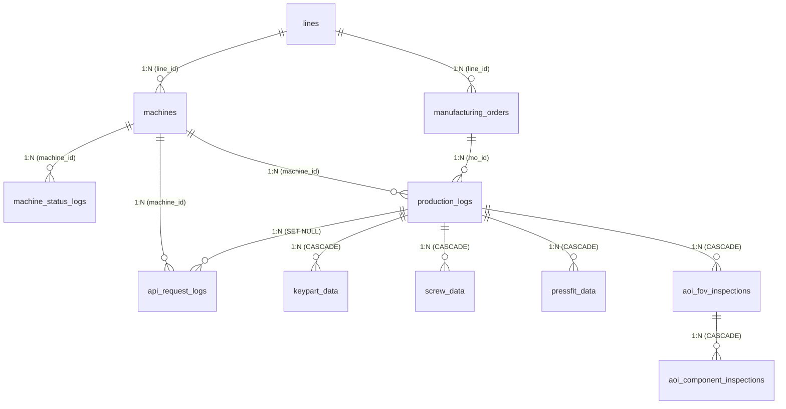

# ĐÁNH GIÁ THIẾT KẾ DATABASE & KẾ HOẠCH TRIỂN KHAI SOURCE CODE

## DỰ ÁN: FOXCONN & NVIDIA STATION MANAGEMENT SYSTEM (SALAMANDRA AUTOMATION LINE)

---

## 1. KẾT LUẬN ĐÁNH GIÁ TỔNG QUAN (EXECUTIVE VERDICT)

> **KẾT LUẬN: THIẾT KẾ ĐẠT CHUẨN XUẤT SẮC - HOÀN TOÀN ĐỦ ĐIỀU KIỆN ĐỂ TRIỂN KHAI VÀO SOURCE CODE.**

Bản thiết kế cơ sở dữ liệu trong tài liệu `Official database.docx` được xây dựng rất bài bản, chặt chẽ và bám sát tuyệt đối vào quy trình thực tế của dây chuyền tự động hóa công nghiệp **Foxconn & NVIDIA Salamandra LC SWB SUB SA**.

### Các điểm sáng vượt trội của thiết kế:

1. **Phân định rõ ranh giới nghiệp vụ (Separation of Concerns):**
   - Đã tách hoàn toàn thông tin sản phẩm (`part_number`, `product_name`, `product_type`) ra khỏi bảng trạm máy `machines` và chuyển về bảng công lệnh `manufacturing_orders`. Đây là chuẩn mực quan trọng trong sản xuất: _Máy móc là tài sản cố định của chuyền, còn sản phẩm thay đổi linh hoạt theo từng ca/lệnh sản xuất_.
2. **Khớp 100% với đặc tả API thực tế từ nhà máy (Slide PPTX Specification):**
   - Bao quát toàn bộ các hành động: `precheck`, `autolink`, `undo`, `reset`, `status`.
   - Lưu trữ đầy đủ các luồng dữ liệu chuyên biệt: Keyparts linh kiện con (`keypart_data`), Siết ốc tự động (`screw_data`), Ép lực khí nén/servo (`pressfit_data`), và Kiểm tra ngoại quan quang học AOI (`aoi_fov_inspections`, `aoi_component_inspections`).
3. **Chiến lược xử lý ảnh AOI tối ưu:**
   - Đã giải quyết triệt để nguy cơ phình to database bằng cách: **Bóc tách ảnh Base64 lưu ra file hệ thống / NAS, trong DB chỉ lưu đường dẫn (`TEXT`)**.
4. **Hỗ trợ đầy đủ cho giám sát thời gian thực & vẽ biểu đồ (OEE, UPH, Cycle Time, Runtime):**
   - Thiết kế bảng `machine_status_logs` dạng chuỗi thời gian liên tục (`start_time`, `end_time`, `duration_seconds`) cho phép vẽ biểu đồ thanh trạng thái máy Gantt/Timeline (RUN, IDLE, STOP, ERROR) với hiệu năng truy vấn tức thì.
   - Bảng `production_logs` hỗ trợ truy vết hủy/làm lại (`run_sequence`, `is_void`, `voided_by_log_id`).

---

## 2. KIẾN TRÚC THỰC THỂ & SƠ ĐỒ QUAN HỆ (ERD)

---

## 3. LƯU Ý KHI ÁNH XẠ KIỂU DỮ LIỆU TỪ THIẾT KẾ SANG MYSQL & SPRING BOOT JPA

Tài liệu thiết kế gốc sử dụng cú pháp chuẩn của **PostgreSQL** (`TIMESTAMPTZ`, `JSONB`, `BOOLEAN`, `IDENTITY`). Tuy nhiên, dự án hiện tại đang kết nối với **MySQL 8.x** qua `mysql-connector-j`. Dưới đây là bảng ánh xạ chuẩn xác:

| Kiểu trong thiết kế     | Kiểu dữ liệu MySQL             | Kiểu dữ liệu Java / JPA Entity | Lưu ý & Annotation                                        |
| :---------------------- | :----------------------------- | :----------------------------- | :-------------------------------------------------------- |
| `INT PK IDENTITY`       | `INT AUTO_INCREMENT`           | `Integer`                      | `@Id @GeneratedValue(strategy = GenerationType.IDENTITY)` |
| `BIGINT PK IDENTITY`    | `BIGINT AUTO_INCREMENT`        | `Long`                         | `@Id @GeneratedValue(strategy = GenerationType.IDENTITY)` |
| `VARCHAR(n)`            | `VARCHAR(n)`                   | `String`                       | `@Column(length = n, nullable = ...)`                     |
| `BOOLEAN`               | `TINYINT(1)` / `BOOLEAN`       | `Boolean`                      | `@Column(nullable = false)`                               |
| `TIMESTAMPTZ`           | `DATETIME(6)` / `TIMESTAMP(6)` | `Instant` hoặc `LocalDateTime` | Khuyên dùng `Instant` cho thời gian chuẩn UTC             |
| `DECIMAL(p, s)`         | `DECIMAL(p, s)`                | `BigDecimal`                   | `@Column(precision = p, scale = s)`                       |
| `TEXT`                  | `TEXT` / `LONGTEXT`            | `String`                       | `@Column(columnDefinition = "TEXT")`                      |
| `JSONB`                 | `JSON`                         | `String` (hoặc JsonNode)       | `@Column(columnDefinition = "json")`                      |
| `CHECK (status IN ...)` | `VARCHAR(20)` / `ENUM`         | `Enum Java`                    | `@Enumerated(EnumType.STRING)`                            |

---

## 4. CHI TIẾT DANH MỤC 10 BẢNG & ĐỀ XUẤT CẢI TIẾN NHỎ

### Bảng 1: `lines` (Chuyền sản xuất)

- **Mục đích:** Danh mục các chuyền (Line 01, Line 02, Salamandra Sub SA...).
- **Cột:** `id`, `line_code` (Unique), `line_name`, `is_active`, `created_at`, `updated_at`.
- **Đánh giá:** Rất chuẩn. Có trigger hoặc JPA `@UpdateTimestamp` để tự cập nhật `updated_at`.

### Bảng 2: `manufacturing_orders` (Công lệnh)

- **Mục đích:** Quản lý mã công lệnh MO, chỉ định chuyền, số lượng kế hoạch, thời gian chạy và thông tin sản phẩm theo BOM.
- **Cột:** `id`, `mo_number` (Unique), `line_id` (FK), `part_number`, `product_name`, `product_type`, `target_qty`, `status`, `start_time`, `end_time`, `created_at`, `updated_at`.
- **Enum trạng thái:** `OPEN`, `RUNNING`, `PAUSED`, `DONE`, `CANCELLED`.
- **Đánh giá:** Chuẩn xác. Cho phép liên kết nhiều giao dịch sản xuất về cùng một đợt lệnh.

### Bảng 3: `machines` (Cấu hình & Danh mục trạm máy)

- **Mục đích:** Quản lý trạm trên dây chuyền, IP trạm, thứ tự chạy (`sequence_order`), các chỉ số KPI mục tiêu (`target_uph`, `target_cycle_time`, `target_upd`).
- **Cột:** `id`, `line_id` (FK), `group_name`, `station_code`, `machine_name`, `station_ip`, `sequence_order`, `target_uph`, `target_cycle_time`, `target_upd`, `is_active`, `created_at`, `updated_at`.
- **Index:** `UNIQUE (line_id, station_code)`, `INDEX (station_ip)`.
- **Đánh giá:** Tối ưu. Khi API nhận request từ một IP trạm, hệ thống có thể tra cứu nhanh ra ID máy trong O(1).

### Bảng 4: `machine_status_logs` (Nhật ký trạng thái máy)

- **Mục đích:** Phục vụ vẽ biểu đồ Machine Runtime (RUN, IDLE, STOP, ERROR) dạng timeline liên tục.
- **Cột:** `id`, `machine_id` (FK), `status`, `error_code`, `start_time`, `end_time`, `duration_seconds`, `created_at`.
- **Đánh giá:** Rất tối ưu. Khắc phục được bài toán query nặng nếu lưu trạng thái theo từng giây kiểu polling.

### Bảng 5: `production_logs` (Giao dịch sản xuất trung tâm)

- **Mục đích:** Ghi nhận từng phôi đi qua từng trạm (precheck, autolink, undo, reset, status).
- **Cột:** `id`, `machine_id` (FK), `mo_id` (FK), `carrier_code`, `serial_number`, `step`, `run_sequence`, `data_type`, `result`, `error_code`, `cycle_time`, `operator_user`, `is_void`, `voided_at`, `voided_by_log_id`, `created_at`.
- **Đánh giá:** Thiết kế rất chuyên nghiệp cho môi trường sản xuất có nghiệp vụ làm lại (rework) và hoàn tác (undo/reset).

### Bảng 6: `keypart_data` (Linh kiện con lắp ráp - Keyparts)

- **Mục đích:** Lưu trữ mảng `kps` (COOLING_PLATE, COVER, HOLDER, FPC...).
- **Cột:** `id`, `log_id` (FK CASCADE), `kp_name`, `kp_value`, `created_at`.
- **Index:** `INDEX (kp_value)` để hỗ trợ truy vết ngược từ mã vạch linh kiện con về sản phẩm mẹ.

### Bảng 7: `screw_data` (Dữ liệu siết ốc tự động)

- **Mục đích:** Lưu trữ mảng `screwdata` (torque, angle, time, volume, height, result...).
- **Cột:** `id`, `log_id` (FK CASCADE), `screw_position`, `action`, `torque`, `angle`, `screw_time`, `standard_volume`, `limit_volume`, `real_volume`, `standard_height`, `limit_height`, `real_height`, `result`, `error_code`, `created_at`.

### Bảng 8: `pressfit_data` (Dữ liệu ép lực máy dập/hàn)

- **Mục đích:** Lưu trữ mảng `pressfitdata` (force, distance, time, result...).
- **Cột:** `id`, `log_id` (FK CASCADE), `press_position`, `action`, `press_force`, `press_distance`, `press_time`, `result`, `error_code`, `created_at`.

### Bảng 9A & 9B: `aoi_fov_inspections` & `aoi_component_inspections` (Kiểm tra quang học AOI)

- **Mục đích:** Tách 2 tầng chuẩn mực: Tầng chụp ảnh vùng FOV/Camera (`TOP`/`BOT`) và Tầng đo lường vi sai chi tiết linh kiện (R1, R2, IC1...).
- **Đường dẫn ảnh:** `fov_image_path`, `summary_image_path`, `crop_image_path`.

### Bảng 10: `api_request_logs` (Nhật ký giao tiếp máy chủ - Audit Trail)

- **Mục đích:** Lưu trữ request/response thô để phòng ngừa tranh chấp dữ liệu giữa trạm máy và hệ thống SFC, đo latency xử lý.
- **Cột:** `id`, `endpoint`, `http_method`, `station_ip`, `machine_id`, `log_id`, `request_payload`, `response_payload`, `status_code`, `latency_ms`, `error_message`, `created_at`.

---

## 5. KẾ HOẠCH TRIỂN KHAI VÀO SOURCE CODE (IMPLEMENTATION PLAN)

Dự án hiện có cấu trúc Spring Boot tại:
`src/backend/EnterpriseProject/src/main/java/com/example/EnterpriseProject`

### Giai đoạn 1: Khởi tạo các Enum và Base Audit Entity

- Add vao thu muc enums/
  1. `DataType.java`: `AUTOLINK`, `PRECHECK`, `UNDO`, `RESET`, `STATUS`.
  2. `TestResult.java`: `PASS`, `FAIL`, `NA`.
  3. `MachineState.java`: `RUN`, `IDLE`, `STOP`, `ERROR`.
  4. `OrderStatus.java`: `OPEN`, `RUNNING`, `PAUSED`, `DONE`, `CANCELLED`.
  5. `AoiCamera.java`: `TOP`, `BOT`.
- **Base Entity:** `entity/base/BaseTimeEntity.java` (`createdAt`, `updatedAt` với `@CreatedDate`, `@LastModifiedDate`).

### Giai đoạn 2: Tạo các JPA Entities

- **Thư mục:** `entity/`
  1. `Line.java`
  2. `ManufacturingOrder.java`
  3. `Machine.java`
  4. `MachineStatusLog.java`
  5. `ProductionLog.java`
  6. `KeypartData.java`
  7. `ScrewData.java`
  8. `PressfitData.java`
  9. `AoiFovInspection.java`
  10. `AoiComponentInspection.java`
  11. `ApiRequestLog.java`

> Tài liệu này được tạo và lưu trữ tại thư mục `/md` để làm căn cứ triển khai chính thức cho đội ngũ phát triển.
