# KẾ HOẠCH TRIỂN KHAI TOÀN DIỆN: ÁP DỤNG TRỌN BỘ CƠ SỞ DỮ LIỆU AUTOMATION LINE DATABASE THAY THẾ HỆ THỐNG CŨ

> **Dự án:** Foxconn & NVIDIA Smart Factory Management System  
> **Nguồn dữ liệu:** `docs/Automation Line Database` (28 file dữ liệu thực tế: 25 bảng vật lý + 3 views)  
> **Phạm vi thay thế:** Thay thế toàn bộ Entity cũ, **bảo tồn nguyên vẹn 100%** hệ thống định danh `User`, `Role` và `user_roles`.  
> **Vị trí tài liệu:**
>
> - `md/FULL_DATABASE_REPLACEMENT_AND_IMPLEMENTATION_PLAN.md`
> - `src/backend/EnterpriseProject/src/main/java/com/example/EnterpriseProject/md/FULL_DATABASE_REPLACEMENT_AND_IMPLEMENTATION_PLAN.md`  
>   **Ngày lập:** 25/11/2026

---

## MỤC LỤC

1. [TỔNG QUAN & NGUYÊN TẮC THIẾT KẾ CỐT LÕI](#1-tổng-quan--nguyên-tắc-thiết-kế-cốt-lõi)
2. [SƠ ĐỒ THỰC THỂ LIÊN KẾT TOÀN HỆ THỐNG (SYSTEM ERD)](#2-sơ-đồ-thực-thể-liên-kết-toàn-hệ-thống-system-erd)
3. [DANH MỤC THỰC THỂ & BẢN ĐỒ CHUYỂN ĐỔI (ENTITY CATALOG & MIGRATION MAPPING)](#3-danh-mục-thực-thể--bản-đồ-chuyển-đổi-entity-catalog--migration-mapping)
4. [ĐẶC TẢ CHI TIẾT 25 THỰC THỂ MỚI & 2 THỰC THỂ BẢO TỒN (DETAILED ENTITY SPECIFICATIONS)](#4-đặc-tả-chi-tiết-25-thực-thể-mới--2-thực-thể-bảo-tồn-detailed-entity-specifications)
   - [Nhóm IAM Bảo tồn: User, Role & UserRoles](#nhóm-iam-bảo-tồn-user-role--userroles)
   - [Phân hệ 1: Giao dịch Sản xuất & Luồng Công đoạn (7 Thực thể)](#phân-hệ-1-giao-dịch-sản-xuất--luồng-công-đoạn-7-thực-thể)
   - [Phân hệ 2: Đo lường Chất lượng & Thông số Thiết bị (5 Thực thể)](#phân-hệ-2-đo-lường-chất-lượng--thông-số-thiết-bị-5-thực-thể)
   - [Phân hệ 3: Cấu hình Động & Quy chuẩn Định mức (7 Thực thể)](#phân-hệ-3-cấu-hình-động--quy-chuẩn-định-mức-7-thực-thể)
   - [Phân hệ 4: Vòng đời Khay gá & Bảo dưỡng (2 Thực thể)](#phân-hệ-4-vòng-đời-khay-gá--bảo-dưỡng-2-thực-thể)
   - [Phân hệ 5: Giám sát Trạng thái Trạm máy Thời gian thực (2 Thực thể)](#phân-hệ-5-giám-sát-trạng-thái-trạm-máy-thời-gian-thực-2-thực-thể)
   - [Phân hệ 6: Nhật ký Kiểm toán & Xử lý Sự cố (2 Thực thể)](#phân-hệ-6-nhật-ký-kiểm-toán--xử-lý-sự-cố-2-thực-thể)
   - [Phân hệ 7: Tầng View Báo cáo & Truy vết Phân tích (3 Views)](#phân-hệ-7-tầng-view-báo-cáo--truy-vết-phân-tích-3-views)
5. [KỊCH BẢN DDL TẠO BẢNG MYSQL 8.0 TOÀN DIỆN (FULL MYSQL 8.0 SCHEMA SCRIPT)](#5-kịch-bản-ddl-tạo-bảng-mysql-80-toàn-diện-full-mysql-80-schema-script)
6. [LỘ TRÌNH THỰC THI SOURCE CODE BACKEND SPRING BOOT (IMPLEMENTATION ROADMAP)](#6-lộ-trình-thực-thi-source-code-backend-spring-boot-implementation-roadmap)
7. [CHIẾN LƯỢC NẠP DỮ LIỆU SEED DATA TỪ 28 FILE CSV (CSV SEEDING STRATEGY)](#7-chiến-lược-nạp-dữ-liệu-seed-data-từ-28-file-csv-csv-seeding-strategy)

---

## 1. TỔNG QUAN & NGUYÊN TẮC THIẾT KẾ CỐT LÕI

### 1.1. Bối cảnh & Mục tiêu Chuyển đổi

Hệ thống hiện tại đã xây dựng một số Entity cơ bản (`Line`, `Machine`, `ManufacturingOrder`, `ProductionLog`, `Carrier`, `ScrewData`, `PressfitData`...). Tuy nhiên, các bảng này chỉ bao quát một phần quy trình và chưa có các bảng Cấu hình động (`ProductConfigs`, `StepConfigs`, `CarrierConfigs`), chưa có quy trình Precheck 2 pha (`PrecheckStatus`), chưa có bảng nhật ký bảo dưỡng/mở khóa khay (`CarrierInspectionLogs`), và chưa có bảng kiểm toán thay đổi cấu hình (`ActionLogs`).

Để hệ thống đáp ứng **100% nghiệp vụ thực tế của nhà máy Foxconn & NVIDIA** và phục vụ trực tiếp toàn bộ các màn hình Frontend đã được lên kế hoạch trong thư mục `md/`, dự án quyết định:

1. **Áp dụng trọn bộ cấu trúc 28 file từ `Automation Line Database`:** Gồm 25 bảng vật lý và 3 SQL Views.
2. **Bảo tồn tuyệt đối hệ thống Quản trị & Xác thực người dùng:** Giữ nguyên vẹn 2 Entity `User` và `Role` (cùng bảng quan hệ `user_roles`) để đảm bảo hệ thống Spring Security, JWT Token, Đăng nhập, Phân quyền RBAC không bị gián đoạn.
3. **Liên kết mềm & chặt chẽ giữa User với hệ thống mới:**
   - Mã thẻ/Tài khoản công nhân (`EmployeeId`, `UserName`) trong các bảng `ActionLogs`, `CarrierInspectionLogs`, `SnDetails`, `ScrewConfigs`, `PressFitConfigs` được ánh xạ tương thích với trường `cardId` / `username` của Entity `User`.

---

## 2. SƠ ĐỒ THỰC THỂ LIÊN KẾT TOÀN HỆ THỐNG (SYSTEM ERD)

```mermaid
erDiagram
    %% IAM PRESERVED
    users ||--o{ user_roles : "user_id"
    roles ||--o{ user_roles : "role_id"
    users ||--o{ action_logs : "employee_id / username"
    users ||--o{ carrier_inspection_logs : "inspector"

    %% CONFIGURATION MATRIX
    product_configs ||--o{ sn_details_datas : "id_key"
    product_configs ||--o{ link_carrier_datas : "id_key"
    product_configs ||--o{ precheck_status_datas : "id_key"

    %% EXECUTION & TRANSACTIONS
    sn_details ||--o{ sn_details_datas : "id_sn_detail (CASCADE)"
    sn_details ||--o{ aoi_datas : "id_sn_detail (CASCADE)"
    sn_details ||--o{ screw_datas : "id_sn_detail (CASCADE)"
    sn_details ||--o{ press_fit_datas : "id_sn_detail (CASCADE)"
    sn_details ||--o{ vibration_data : "id_sn_detail (CASCADE)"
    sn_details ||--o{ extent_datas : "id_sn_detail (CASCADE)"
    sn_details ||--o{ carrier_swap_history : "id_sn_detail (SET NULL)"

    precheck_status ||--o{ precheck_status_datas : "id_precheck (CASCADE)"
    link_carriers ||--o{ link_carrier_datas : "id_link_carrier (CASCADE)"

    %% CARRIER ASSET & LIFECYCLE
    carriers ||--o{ carrier_inspection_logs : "carrier_code"
    carriers ||--o{ carrier_swap_history : "old/new carrier_code"

    %% MACHINE MONITORING
    machine_status ||--o{ machine_status_history : "id_machine_status (CASCADE)"
```



---

## 3. DANH MỤC THỰC THỂ & BẢN ĐỒ CHUYỂN ĐỔI (ENTITY CATALOG & MIGRATION MAPPING)

Hệ thống sau khi chuyển đổi sẽ gồm **27 Java JPA Entities** và **3 SQL Analytical Views**:

|  STT  | Phân hệ Nghiệp vụ   | Tên File CSV / Bảng Cũ      | Tên Entity Mới (JPA Class) | Tên Bảng MySQL Mới        |     Trạng thái Chuyển đổi     |
| :---: | :------------------ | :-------------------------- | :------------------------- | :------------------------ | :---------------------------: |
| **0** | **Bảo tồn IAM**     | _(users cũ)_                | **`User`**                 | `users`                   |       **BẢO TỒN 100%**        |
| **0** | **Bảo tồn IAM**     | _(roles cũ)_                | **`Role`**                 | `roles`                   |       **BẢO TỒN 100%**        |
|   1   | Giao dịch Sản xuất  | `SnDetails.csv`             | **`SnDetail`**             | `sn_details`              |   Thay thế `ProductionLog`    |
|   2   | Giao dịch Sản xuất  | `SnDetailsDatas.csv`        | **`SnDetailData`**         | `sn_details_datas`        |    Thay thế `KeypartData`     |
|   3   | Giao dịch Sản xuất  | `PrecheckStatus.csv`        | **`PrecheckStatus`**       | `precheck_status`         |         **Thêm mới**          |
|   4   | Giao dịch Sản xuất  | `PrecheckStatusDatas.csv`   | **`PrecheckStatusData`**   | `precheck_status_datas`   |         **Thêm mới**          |
|   5   | Giao dịch Sản xuất  | `LinkCarriers.csv`          | **`LinkCarrier`**          | `link_carriers`           |         **Thêm mới**          |
|   6   | Giao dịch Sản xuất  | `LinkCarrierDatas.csv`      | **`LinkCarrierData`**      | `link_carrier_datas`      |         **Thêm mới**          |
|   7   | Giao dịch Sản xuất  | `CarrierSwapHistory.csv`    | **`CarrierSwapHistory`**   | `carrier_swap_history`    |         **Thêm mới**          |
|   8   | Đo lường Chất lượng | `AoiDatas.csv`              | **`AoiData`**              | `aoi_datas`               | Chuẩn hóa thay 4 bảng AOI cũ  |
|   9   | Đo lường Chất lượng | `ScrewDatas.csv`            | **`ScrewData`**            | `screw_datas`             |   Nâng cấp từ 15 lên 27 cột   |
|  10   | Đo lường Chất lượng | `PressFitDatas.csv`         | **`PressFitData`**         | `press_fit_datas`         |   Nâng cấp từ 9 lên 21 cột    |
|  11   | Đo lường Chất lượng | `VibrationData.csv`         | **`VibrationData`**        | `vibration_data`          |         **Thêm mới**          |
|  12   | Đo lường Chất lượng | `ExtentDatas.csv`           | **`ExtentData`**           | `extent_datas`            |         **Thêm mới**          |
|  13   | Cấu hình & Định mức | `ProductConfigs.csv`        | **`ProductConfig`**        | `product_configs`         |   **Thêm mới (Trọng tâm)**    |
|  14   | Cấu hình & Định mức | `StepConfigs.csv`           | **`StepConfig`**           | `step_configs`            |   **Thêm mới (Trọng tâm)**    |
|  15   | Cấu hình & Định mức | `CarrierConfigs.csv`        | **`CarrierConfig`**        | `carrier_configs`         |   **Thêm mới (Trọng tâm)**    |
|  16   | Cấu hình & Định mức | `ScrewConfigs.csv`          | **`ScrewConfig`**          | `screw_configs`           |   **Thêm mới (Trọng tâm)**    |
|  17   | Cấu hình & Định mức | `PressFitConfigs.csv`       | **`PressFitConfig`**       | `press_fit_configs`       |   **Thêm mới (Trọng tâm)**    |
|  18   | Cấu hình & Định mức | `UphConfigs.csv`            | **`UphConfig`**            | `uph_configs`             |   **Thêm mới (Trọng tâm)**    |
|  19   | Cấu hình & Định mức | `ErrorConfigs.csv`          | **`ErrorConfig`**          | `error_configs`           |   **Thêm mới (Trọng tâm)**    |
|  20   | Vòng đời Khay gá    | `Carriers.csv`              | **`Carrier`**              | `carriers`                |  Nâng cấp từ bảng Carrier cũ  |
|  21   | Vòng đời Khay gá    | `CarrierInspectionLogs.csv` | **`CarrierInspectionLog`** | `carrier_inspection_logs` | **Thêm mới (Unlock Carrier)** |
|  22   | Giám sát Trạng thái | `MachineStatus.csv`         | **`MachineStatus`**        | `machine_status`          |  Thay thế `MachineStatusLog`  |
|  23   | Giám sát Trạng thái | `MachineStatusHistory.csv`  | **`MachineStatusHistory`** | `machine_status_history`  |         **Thêm mới**          |
|  24   | Kiểm toán & Sự cố   | `ActionLogs.csv`            | **`ActionLog`**            | `action_logs`             |  **Thêm mới (Audit Trail)**   |
|  25   | Kiểm toán & Sự cố   | `ErrorLogs.csv`             | **`ErrorLog`**             | `error_logs`              |  **Thêm mới (System Error)**  |
|  26   | View Phân tích      | `v_CarrierSwapTracking.csv` | **`VCarrierSwapTracking`** | `v_carrier_swap_tracking` |   **SQL View / Projection**   |
|  27   | View Phân tích      | `v_ProductRoutingFlow.csv`  | **`VProductRoutingFlow`**  | `v_product_routing_flow`  |   **SQL View / Projection**   |
|  28   | View Phân tích      | `v_ProductTraceability.csv` | **`VProductTraceability`** | `v_product_traceability`  |   **SQL View / Projection**   |

> **Ghi chú về các Entity cũ bị loại bỏ:**
>
> - `Line.java`, `Machine.java`, `ManufacturingOrder.java`, `MachineSession.java`, `Operator.java`: Thông tin trạm, máy, chuyền, lệnh MO và công nhân đã được tích hợp phẳng và nhất quán trực tiếp vào `sn_details`, `link_carriers`, `machine_status`, `carriers` đúng theo chuẩn cấu trúc của dữ liệu tự động hóa thực tế nhà máy.
> - `AoiSummaryImage.java`, `AoiFovInspection.java`, `AoiComponentInspection.java`: Được gộp và chuẩn hóa nhất thể vào bảng `aoi_datas` theo chuẩn `AoiDatas.csv`.
> - `KeypartData.java`: Được thay thế bằng bảng EAV `sn_details_datas` liên kết với `product_configs`.

---

## 4. ĐẶC TẢ CHI TIẾT 25 THỰC THỂ MỚI & 2 THỰC THỂ BẢO TỒN (DETAILED ENTITY SPECIFICATIONS)

### Nhóm IAM Bảo tồn: User, Role & UserRoles

#### 1. Entity: `User` (Bảng: `users`)

- **Mục đích:** Quản lý tài khoản quản trị viên, kỹ sư PE/ME, trưởng ca và công nhân vận hành.
- **Thuộc tính:**
  - `id` (Long, PK, Auto Increment)
  - `employeeId` (String, Unique) - Mã thẻ chấm công Foxconn (VD: `V3234844`, `V0923834`), liên kết logic với `EmployeeId` trong các bảng nghiệp vụ.
  - `username` (String, Unique, Not Null)
  - `password` (String, Not Null) - Mã hóa BCrypt
  - `fullName` (String)
  - `email` (String, Unique)
  - `department` (String)
  - `status` (Enum: `UserStatus` - ACTIVE, INACTIVE, LOCKED)
  - `roles` (ManyToMany trỏ tới `Role` qua bảng `user_roles`)

#### 2. Entity: `Role` (Bảng: `roles`)

- **Mục đích:** Quản lý vai trò bảo mật hệ thống.
- **Thuộc tính:**
  - `id` (Long, PK, Auto Increment)
  - `roleName` (Enum: `RoleName` - ROLE_ADMIN, ROLE_USER, ROLE_OPERATOR, ROLE_ENGINEER)
  - `description` (String)

---

### Phân hệ 1: Giao dịch Sản xuất & Luồng Công đoạn (7 Thực thể)

#### 3. Entity: `SnDetail` (Bảng: `sn_details`)

- **Mục đích:** Giao dịch chính ghi nhận từng lượt sản phẩm đi qua mỗi trạm máy.
- **Cấu trúc trường:**
  - `id` (Long, PK, length 8, not null, Auto Increment)
  - `factory` (String, length 10) - Nhà xưởng (VD: `F12`, `F07`)
  - `floor` (String, length 10) - Tầng xưởng (VD: `2F`, `1F`)
  - `ipAddress` (String, length 100, Index) - Địa chỉ IP trạm máy
  - `machineName` (String, length 200, Index) - Tên máy (VD: `ST01`, `ST02`)
  - `productName` (String, length 200, Index) - Tên sản phẩm (VD: `GB300`, `SALAMANDRA`)
  - `productType` (String, length 100, nullable) - Loại sản phẩm (VD: `MGMT`, `SWB PCBA`)
  - `lineName` (String, length 100, Index, nullable) - Tên chuyền (VD: `LINE_1`)
  - `groupName` (String, length 200) - Tên nhóm công đoạn (VD: `ASSY_MGMT`)
  - `modelName` (String, length 200, nullable)
  - `step` (Integer, Index, length 4) - Bước công đoạn (1, 2, 3...)
  - `workDate` (String, length 20) - Ngày làm việc (VD: `20260624`)
  - `workSection` (Integer) - Ca/Khoảng thời gian làm việc (18, 19...)
  - `serialNumber` (String, length 200, Index) - Số Serial Number bo mạch
  - `carrierCode` (String, length 200, Index) - Mã khay gá mang hàng
  - `goodQty` (Integer, default 0)
  - `passQty` (Integer, default 0)
  - `failQty` (Integer, default 0)
  - `stationSequence` (Integer, length 4) - Thứ tự trạm
  - `inStationTime` (Instant / DateTime length 8) - Thời điểm vào trạm
  - `cycleTime` (BigDecimal, length 8, nullable) - Thời gian chu kỳ gia công (ms hoặc giây)
  - `employeeId` (String, length 100, nullable) - Mã nhân viên thao tác
  - `errorCode` (String, length 100, nullable) - Mã lỗi (nếu có)
  - `status` (String, length 100, nullable) - `PASS`, `FAIL`
  - `mo` (String, length 200, Index, nullable) - Mã lệnh sản xuất (Manufacturing Order)

#### 4. Entity: `SnDetailData` (Bảng: `sn_details_datas`)

- **Mục đích:** Chi tiết EAV các mã quét linh kiện con tại trạm ứng với `SnDetail`.
- **Cấu trúc trường:**
  - `id` (Long, PK, Auto Increment)
  - `snDetail` (`@ManyToOne`, JoinColumn `id_sn_detail`, Not Null)
  - `idKey` (Long, Index) - ID khóa tương ứng trong `ProductConfig`
  - `valueMax` (String, length 255, nullable)
  - `value` (String, length 255, nullable) - Giá trị quét thực tế (mã khay, mã linh kiện)

#### 5. Entity: `PrecheckStatus` (Bảng: `precheck_status`)

- **Mục đích:** Ghi nhận phiên xác thực điều kiện tiên quyết (Pha 1 PreCheck) trước khi trạm máy hoạt động.
- **Cấu trúc trường:**
  - `id` (Long, PK, Auto Increment)
  - `ipAddress` (String, length 45)
  - `machineName` (String, length 100)
  - `productName` (String, length 100)
  - `productType` (String, length 50, nullable)
  - `lineName` (String, length 100, nullable)
  - `groupName` (String, length 100)
  - `step` (Integer)
  - `carrierCode` (String, length 100, Index)
  - `isPreCheck` (`BooleanFlag` Enum - `VARCHAR(10)`, default `FALSE`) - Đã xác thực thành công hay chưa
  - `preCheckDate` (Instant) - Thời điểm xác thực

#### 6. Entity: `PrecheckStatusData` (Bảng: `precheck_status_datas`)

- **Mục đích:** Dữ liệu EAV quét trong phiên PreCheck.
- **Cấu trúc trường:**
  - `id` (Long, PK, Auto Increment)
  - `precheckStatus` (`@ManyToOne`, JoinColumn `id_precheck`, Not Null)
  - `idKey` (Long, Index)
  - `value` (String, length 255, nullable)

#### 7. Entity: `LinkCarrier` (Bảng: `link_carriers`)

- **Mục đích:** Ghi nhận sự kiện liên kết khay gá với Serial Number và Lệnh MO.
- **Cấu trúc trường:**
  - `id` (Long, PK, Auto Increment)
  - `ipAddress` (String, length 45)
  - `machineName` (String, length 100)
  - `productName` (String, length 100)
  - `productType` (String, length 50, nullable)
  - `lineName` (String, length 100, nullable)
  - `groupName` (String, length 100)
  - `modelName` (String, length 100, nullable)
  - `step` (Integer)
  - `carrierCode` (String, length 100, Index)
  - `serialNumber` (String, length 100, Index)
  - `inStationTime` (Instant)
  - `status` (String, length 20, nullable)
  - `mo` (String, length 100, nullable)

#### 8. Entity: `LinkCarrierData` (Bảng: `link_carrier_datas`)

- **Mục đích:** Dữ liệu EAV đi kèm sự kiện liên kết khay gá.
- **Cấu trúc trường:**
  - `id` (Long, PK, Auto Increment)
  - `linkCarrier` (`@ManyToOne`, JoinColumn `id_link_carrier`, Not Null)
  - `idKey` (Long, Index)
  - `value` (String, length 255)

#### 9. Entity: `CarrierSwapHistory` (Bảng: `carrier_swap_history`)

- **Mục đích:** Lưu vết lịch sử tráo đổi/lật mặt khay gá phôi của Serial Number giữa các chặng.
- **Cấu trúc trường:**
  - `id` (Long, PK, Auto Increment)
  - `productName` (String, length 100)
  - `productType` (String, length 50)
  - `lineName` (String, length 100)
  - `serialNumber` (String, length 100, Index)
  - `step` (Integer)
  - `oldCarrierCode` (String, length 100, Index)
  - `newCarrierCode` (String, length 100, Index)
  - `swapTime` (Instant, Index)
  - `ipAddress` (String, length 45)
  - `idSnDetail` (Long, nullable, Index)

---

### Phân hệ 2: Đo lường Chất lượng & Thông số Thiết bị (5 Thực thể)

#### 10. Entity: `AoiData` (Bảng: `aoi_datas`)

- **Mục đích:** Lưu kết quả kiểm tra quang học ngoại quan AOI (ảnh toàn cảnh, ảnh cắt vi sai linh kiện).
- **Cấu trúc trường:**
  - `id` (Long, PK, Auto Increment)
  - `idSnDetail` (Long, Index)
  - `carrierCode` (String, length 100, nullable)
  - `serialNumber` (String, length 100, Index, nullable)
  - `type` (String, length 50) - `SUMMARY`, `COMPONENT`
  - `camera` (String, length 50, nullable) - `TOP`, `BOT`
  - `fov` (String, length 50, nullable)
  - `componentName` (String, length 100, nullable)
  - `location` (String, length 100, nullable)
  - `score` (BigDecimal, nullable) - Điểm tin cậy thuật toán AI/Vision
  - `measure` (BigDecimal, nullable) - Giá trị đo đạc vật lý
  - `result` (String, length 20, nullable) - `PASS`, `FAIL`
  - `errorCode` (String, length 50, nullable)
  - `imagePath` (String, length 500, nullable) - Đường dẫn ảnh toàn cảnh (NAS/Ổ đĩa)
  - `cropImagePath` (String, length 500, nullable) - Đường dẫn ảnh cắt chi tiết linh kiện lỗi
  - `description` (String, length 255, nullable)
  - `createdTime` (Instant, nullable)
  - `serverName` (String, lenullable, nullable)

#### 11. Entity: `ScrewData` (Bảng: `screw_datas`)

- **Mục đích:** Lưu trữ đầy đủ 27 thông số đo lường súng siết ốc điện tử tự động.
- **Cấu trúc trường:**
  - `id` (Long, PK, Auto Increment)
  - `idSnDetail` (Long, Index)
  - `carrierCode` (String, length 100, nullable)
  - `serialNumber` (String, length 100, Index, nullable)
  - `position` (String, length 50, nullable) - Vị trí ốc (`POSITION1`, `POSITION2`...)
  - `action` (String, length 50, nullable) - `screw`
  - `standardVolume` (BigDecimal, nullable), `limitVolume` (BigDecimal, nullable), `realVolume` (BigDecimal, nullable)
  - `standardHeight` (BigDecimal, nullable), `limitHeight` (BigDecimal, nullable), `realHeight` (BigDecimal, nullable)
  - `torque` (BigDecimal, nullable) - Lực siết thực tế (Nm / cNm)
  - `angle` (BigDecimal, nullable) - Góc quay thực tế (deg)
  - `time` (BigDecimal, nullable) - Thời gian siết (s)
  - `result` (String, length 20, nullable) - `PASS`, `FAIL`
  - `errorCode` (String, length 50, nullable)
  - `createdTime` (Instant, nullable)
  - `unit` (String, length 20, nullable)
  - `standardTorque` (BigDecimal), `limitTorque` (BigDecimal)
  - `standardAngle` (BigDecimal), `limitAngle` (BigDecimal)
  - `unitVolume` (String, length 20), `unitHeight` (String, length 20)
  - `unitTorque` (String, length 20), `unitAngle` (String, length 20)

#### 12. Entity: `PressFitData` (Bảng: `press_fit_datas`)

- **Mục đích:** Lưu trữ đầy đủ 21 thông số máy ép nén linh kiện/Shielding/Connector.
- **Cấu trúc trường:**
  - `id` (Long, PK, Auto Increment)
  - `idSnDetail` (Long, Index)
  - `carrierCode` (String, length 100, nullable)
  - `serialNumber` (String, length 100, , nullable)
  - `position` (String, length 50) - Vị trí ép (`COOLPLATE`...)
  - `action` (String, length 50, nullable) - `PRESS`
  - `standardForce` (BigDecimal), `limitForce` (BigDecimal), `realForce` (BigDecimal, nullable)
  - `unitForce` (String, length 20) - `N`
  - `standardTime` (BigDecimal), `limitTime` (BigDecimal), `realTime` (BigDecimal, nullable)
  - `unitTime` (String, length 20) - `s`
  - `standardDistance` (BigDecimal), `limitDistance` (BigDecimal), `realDistance` (BigDecimal, nullable)
  - `unitDistance` (String, length 20) - `mm`
  - `result` (String, length 20) - `PASS`, `FAIL`
  - `errorCode` (String, length 50, nullable)
  - `createdTime` (Instant)

#### 13. Entity: `VibrationData` (Bảng: `vibration_data`)

- **Mục đích:** Lưu trữ dữ liệu kiểm tra độ rung động cơ và cảm biến.
- **Cấu trúc trường:**
  - `id` (Long, PK, Auto Increment)
  - `idSnDetail` (Long, Index)
  - `machineType` (String, length 50, nullable)
  - `controller` (String, length 100, nullable)
  - `position` (String, length 50, nullable)
  - `action` (String, length 50, nullable)
  - `voltage` (BigDecimal, nullable) - Điện áp
  - `pressure` (BigDecimal, nullable) - Áp suất
  - `time` (BigDecimal, nullable) - Thời gian thử nghiệm
  - `result` (String, length 20, nullable) - `PASS`, `FAIL`
  - `errorCode` (String, length 50, nullable)
  - `unit` (String, length 20, nullable)

#### 14. Entity: `ExtentData` (Bảng: `extent_datas`)

- **Mục đích:** Lưu trữ file datalog mở rộng từ các thiết bị chuyên biệt (Gluing AOI Datalog...).
- **Cấu trúc trường:**
  - `id` (Long, PK, Auto Increment)
  - `idSnDetail` (Long, Index)
  - `carrierCode` (String, length 100, nullable)
  - `serialNumber` (String, length 100, nullable)
  - `fileName` (String, length 255, nullable)
  - `type` (String, length 50, nullable)
  - `dataPath` (String, length 1000, nullable) - Đường dẫn file lưu trên ổ mạng máy tính công nghiệp
  - `result` (String, length 20, nullable)
  - `errorCode` (String, length 50, nullable)
  - `description` (String, length 255, nullable)
  - `createdTime` (Instant)
  - `serverName` (String, length 100, nullable)

---

### Phân hệ 3: Cấu hình Động & Quy chuẩn Định mức (7 Thực thể)

#### 15. Entity: `ProductConfig` (Bảng: `product_configs`)

- **Mục đích:** Ma trận cấu hình mã kiểm tra động theo từng Bước và Nhóm công đoạn (phục vụ `/config/product/nvidia`).
- **Cấu trúc trường:**
  - `id` (Long, PK, Auto Increment)
  - `productName` (String, length 100, Index)
  - `productType` (String, length 50, nullable)
  - `step` (Integer, Index)
  - `groupName` (String, length 100)
  - `keyName` (String, length 100, nullable) - Tên mã (`CARRIER CODE`, `INNER TRAY`, `COOLANT LEAKAGE`...)
  - `displayName` (String, length 100, nullable)
  - `valueType` (String, length 50, nullable) - `string`, `number`...
  - `isActive` (Boolean, default true)
  - `isRequire` (Boolean, default true)
  - `isVerify` (Boolean, default false)
  - `isByPass` (Boolean, default false)
  - `isSfc` (Boolean, default false)

#### 16. Entity: `StepConfig` (Bảng: `step_configs`)

- **Mục đích:** Cấu hình quy tắc luồng công đoạn (phục vụ `/config/autoline-operations`).
- **Cấu trúc trường:**
  - `id` (Long, PK, Auto Increment)
  - `productName` (String, length 100, Index)
  - `productType` (String, length 50)
  - `lineName` (String, length 100, Index)
  - `step` (Integer, Index)
  - `twinStep` (Integer, default 0) - Trạm chạy song song
  - `allowCarrierSwap` (`BooleanFlag` Enum - `VARCHAR(10)`, default `FALSE`) - Cho phép tráo khay tại bước này
  - `resolveCarrierFromSN` (`BooleanFlag` Enum - `VARCHAR(10)`, default `FALSE`)
  - `isSfcStation` (`BooleanFlag` Enum - `VARCHAR(10)`, default `FALSE`) - Trạm đẩy dữ liệu lên hệ thống SFC Foxconn
  - `mainKey` (String, length 100, nullable)
  - `allowFail` (`BooleanFlag` Enum - `VARCHAR(10)`, default `FALSE`)
  - `sfcTriggerStep` (Integer, nullable)
  - `sfcOnlyPass` (`BooleanFlag` Enum - `VARCHAR(10)`, default `FALSE`)
  - `isSfcPreCheck` (`BooleanFlag` Enum - `VARCHAR(10)`, default `FALSE`)
  - `uploadDataMode` (Integer, default 0)

#### 17. Entity: `CarrierConfig` (Bảng: `carrier_configs`)

- **Mục đích:** Cấu hình định mức vòng đời và chu kỳ bảo dưỡng khay (phục vụ `/config/carrier`).
- **Cấu trúc trường:**
  - `id` (Long, PK, Auto Increment)
  - `productName` (String, length 100, nullable)
  - `productType` (String, length 50, nullable)
  - `lineName` (String, length 100, nullable)
  - `carrierType` (String, length 50, nullable)
  - `carrierCode` (String, length 100, nullable)
  - `endStep` (Integer, nullable) - Công đoạn kết thúc vòng tuần hoàn
  - `maxCycleCount` (Integer, default 5000) - Chu kỳ tối đa trước khi khóa khay
  - `warningCycleCount` (Integer, default 4500) - Ngưỡng cảnh báo bảo dưỡng
  - `maxIntervalHours` (Integer, default 0)
  - `fixedScheduleTimes` (String, length 255, nullable) - Lịch kiểm tra cố định (VD: `"08:30-08:50,20:30-20:50"`)
  - `isActive` (Boolean, default true)
  - `description` (String, length 255, nullable)
  - `createdTime` (Instant)
  - `updatedTime` (Instant)

#### 18. Entity: `ScrewConfig` (Bảng: `screw_configs`)

- **Mục đích:** Lưu trữ công thức Recipe tiêu chuẩn và dung sai lực siết ốc.
- **Cấu trúc trường:**
  - `id` (Long, PK, Auto Increment)
  - `productType` (String, length 50), `productName` (String, length 100)
  - `lineName` (String, length 100), `machineName` (String, length 100, nullable)
  - `step` (Integer), `position` (String, length 50)
  - `standardVolume` (BigDecimal), `standardHeight` (BigDecimal)
  - `standardTorque` (BigDecimal), `standardAngle` (BigDecimal)
  - `limitVolume` (BigDecimal), `limitHeight` (BigDecimal)
  - `limitTorque` (BigDecimal), `limitAngle` (BigDecimal)
  - `unitVolume` (String), `unitHeight` (String), `unitTorque` (String), `unitAngle` (String)
  - `isRequire` (Boolean, default true)
  - `isActive` (Boolean, default true)
  - `updatedTime` (Instant)
  - `updatedBy` (String, length 50, nullable)

#### 19. Entity: `PressFitConfig` (Bảng: `press_fit_configs`)

- **Mục đích:** Lưu trữ công thức Recipe tiêu chuẩn và dung sai lực ép nén.
- **Cấu trúc trường:**
  - `id` (Long, PK, Auto Increment)
  - `productName` (String, length 100), `productType` (String, length 50)
  - `lineName` (String, length 100), `machineName` (String, length 100)
  - `step` (Integer), `position` (String, length 50)
  - `standardForce` (BigDecimal), `limitForce` (BigDecimal), `unitForce` (String)
  - `standardTime` (BigDecimal), `limitTime` (BigDecimal), `unitTime` (String)
  - `standardDistance` (BigDecimal), `limitDistance` (BigDecimal), `unitDistance` (String)
  - `isRequire` (`BooleanFlag` Enum - `VARCHAR(10)`, default `TRUE`)
  - `isActive` (`BooleanFlag` Enum - `VARCHAR(10)`, default `TRUE`)
  - `updatedTime` (Instant)
  - `updatedBy` (String, length 50, nullable)

#### 20. Entity: `UphConfig` (Bảng: `uph_configs`)

- **Mục đích:** Lưu định mức sản lượng giờ và chu kỳ chuẩn của từng công đoạn trạm.
- **Cấu trúc trường:**
  - `id` (Long, PK, Auto Increment)
  - `productName` (String, length 100), `productType` (String, length 50)
  - `lineName` (String, length 100), `step` (Integer, nullable), `groupName` (String, length 100, nullable)
  - `targetUph` (Integer, default 100) - Sản lượng mục tiêu mỗi giờ
  - `targetCycleTime` (BigDecimal, default 36.00, nullable) - Chu kỳ chuẩn (s)
  - `warningThreshold` (Integer, default 0, nullable)
  - `isActive` (Boolean, default true)
  - `createDate` (Instant), `updateDate` (Instant)

#### 21. Entity: `ErrorConfig` (Bảng: `error_configs`)

- **Mục đích:** Từ điển mã lỗi chuẩn của hệ thống MES (phục vụ `/config/mes-error-code`).
- **Cấu trúc trường:**
  - `errorKey` (Integer, PK) - Mã HTTP/Lỗi (VD: 200, 400, 403, 404, 411, 412...)
  - `codeValue` (Integer) - Mã nội bộ SFC (0, 1, 2, 3...)
  - `description` (String, length 500, nullable) - Diễn giải song ngữ

---

### Phân hệ 4: Vòng đời Khay gá & Bảo dưỡng (2 Thực thể)

#### 22. Entity: `Carrier` (Bảng: `carriers`)

- **Mục đích:** Quản lý hồ sơ, trạng thái và vòng đời khay gá mang hàng.
- **Cấu trúc trường:**
  - `carrierCode` (String, length 100, PK) - Mã barcode khay gá
  - `carrierType` (String, length 50, nullable)
  - `totalCycleCount` (Integer, default 0) - Tổng số vòng tuần hoàn đã chạy
  - `currentCycleCount` (Integer, default 0) - Số chu kỳ hiện tại kể từ lần bảo dưỡng gần nhất
  - `lastCycleCompletedTime` (Instant, nullable)
  - `lastInspectionTime` (Instant) - Thời điểm kiểm định gần nhất
  - `lastInspectionBy` (String, length 50, nullable) - Mã nhân viên kiểm định (User)
  - `lastInspectionResult` (String, length 20) - `PASS`, `FAIL`
  - `status` (String, length 20, Index) - `ACTIVE`, `LOCKED`, `MAINTENANCE`
  - `lineName` (String, length 100, nullable)
  - `productType` (String, length 50, nullable)
  - `productName` (String, length 100, nullable)
  - `createdTime` (Instant), `updatedTime` (Instant)

#### 23. Entity: `CarrierInspectionLog` (Bảng: `carrier_inspection_logs`)

- **Mục đích:** Nhật ký kiểm định bảo dưỡng khay gá định kỳ (phục vụ `/config/unlock-carrier`).
- **Cấu trúc trường:**
  - `id` (Long, PK, Auto Increment)
  - `carrierCode` (String, length 100, Index)
  - `inspectionType` (String, length 50) - `PERIODIC`, `INITIAL`, `DAMAGE`
  - `inspector` (String, length 50) - Người kiểm định (ánh xạ `cardId` / `username` của User)
  - `result` (String, length 20) - `PASS`, `FAIL`
  - `actionTaken` (String, length 50, nullable) - `CONTINUE`, `LOCKED`, `SCRAP`
  - `cycleCountAtInspection` (Integer) - Số chu kỳ tại thời điểm kiểm tra
  - `note` (String, length 500, nullable)
  - `inspectionTime` (Instant)

---

### Phân hệ 5: Giám sát Trạng thái Trạm máy Thời gian thực (2 Thực thể)

#### 24. Entity: `MachineStatus` (Bảng: `machine_status`)

- **Mục đích:** Lưu trạng thái thời gian thực tức thời của từng trạm máy (phục vụ `/machine-status`).
- **Cấu trúc trường:**
  - `id` (Long, PK, Auto Increment)
  - `ipAddress` (String, length 45, Index)
  - `machineName` (String, length 100, Index)
  - `productName` (String, length 100)
  - `productType` (String, length 55, nullable)
  - `lineName` (String, length 100, nullable)
  - `groupName` (String, length 100)
  - `step` (Integer)
  - `status` (String, length 20, Index) - `RUN`, `STOP`, `IDLE`, `ERROR`
  - `createDate` (Instant), `updateDate` (Instant, nullable)

#### 25. Entity: `MachineStatusHistory` (Bảng: `machine_status_history`)

- **Mục đích:** Lưu lịch sử các lần chuyển đổi trạng thái của máy.
- **Cấu trúc trường:**
  - `id` (Long, PK, Auto Increment)
  - `idMachineStatus` (Long, Index) - FK trỏ tới `machine_status`
  - `currentStatus` (String, length 20, nullable)
  - `newStatus` (String, length 20)
  - `updateDate` (Instant)

---

### Phân hệ 6: Nhật ký Kiểm toán & Xử lý Sự cố (2 Thực thể)

#### 26. Entity: `ActionLog` (Bảng: `action_logs`)

- **Mục đích:** Kiểm toán mọi hành vi chỉnh sửa cấu hình hệ thống của người dùng (Audit Trail).
- **Cấu trúc trường:**
  - `id` (Long, PK, Auto Increment)
  - `employeeId` (String, length 50, Index) - Mã thẻ người thực hiện
  - `userName` (String, length 100, nullable) - Tên đăng nhập User
  - `actionType` (String, length 50) - `DELETE_KEY`, `UPDATE_CONFIG`, `UNLOCK_CARRIER`...
  - `category` (String, length 50) - `KEY_CONFIG`, `CARRIER_CONFIG`...
  - `tableName` (String, length 100, nullable) - Tên bảng bị tác động
  - `recordId` (String, length 100, nullable) - ID bản ghi bị tác động
  - `productName` (String, length 100, nullable), `productType` (String, length 50, nullable)
  - `lineName` (String, length 100, nullable), `step` (Integer, nullable)
  - `machineName` (String, length 100, nullable), `groupName` (String, length 100, nullable)
  - `oldValues` (String, columnDefinition = "LONGTEXT", nullable) - Dữ liệu cũ dạng JSON
  - `newValues` (String, columnDefinition = "LONGTEXT", nullable) - Dữ liệu mới dạng JSON
  - `description` (String, length 500, nullable)
  - `clientIp` (String, length 45, nullable)
  - `userAgent` (String, length 255, nullable)
  - `status` (String, length 20) - `SUCCESS`, `FAILED`
  - `errorMessage` (String, columnDefinition = "TEXT", nullable)
  - `createdAt` (Instant)

#### 27. Entity: `ErrorLog` (Bảng: `error_logs`)

- **Mục đích:** Nhật ký lỗi kỹ thuật phát sinh từ thiết bị trạm máy, IPC hoặc AIoT.
- **Cấu trúc trường:**
  - `id` (Long, PK, Auto Increment)
  - `errorSource` (String, length 50) - `AIOT`, `IPC`, `SFC`
  - `phase` (String, length 50) - `PRECHECK`, `AUTOLINK`, `IN_STATION`
  - `ipAddress` (String, length 45, nullable)
  - `productName` (String, length 100, nullable), `productType` (String, length 50, nullable)
  - `lineName` (String, length 100, nullable), `groupName` (String, length 100, nullable), `step` (Integer, nullable)
  - `carrierCode` (String, length 100, nullable)
  - `serialNumber` (String, length 100, Index, nullable)
  - `stationSequence` (Integer, nullable)
  - `errorCode` (String, length 50, nullable)
  - `logMessage` (String, columnDefinition = "TEXT", nullable)
  - `createdTime` (Instant, nullable)

---

### Phân hệ 7: Tầng View Báo cáo & Truy vết Phân tích (3 Views)

Ba View này được định nghĩa trực tiếp trong cơ sở dữ liệu MySQL và ánh xạ sang Spring Data JPA qua `@Subselect` / Native Query Interface:

#### 28. View: `v_carrier_swap_tracking`

- Truy vết hành trình đổi khay của từng Serial Number:

```sql
CREATE OR REPLACE VIEW v_carrier_swap_tracking AS
SELECT
    csh.id AS swap_id,
    csh.product_name,
    csh.product_type,
    csh.line_name,
    csh.serial_number,
    csh.step AS swap_step,
    csh.old_carrier_code,
    csh.new_carrier_code,
    csh.swap_time,
    csh.ip_address AS swap_ip_address,
    (SELECT MAX(sn.in_station_time)
     FROM sn_details sn
     WHERE sn.carrier_code = csh.old_carrier_code
       AND sn.in_station_time <= csh.swap_time) AS old_carrier_last_active_time
FROM carrier_swap_history csh;
```

#### 29. View: `v_product_routing_flow`

- Báo cáo quy trình gia công từng trạm của Serial Number:

```sql
CREATE OR REPLACE VIEW v_product_routing_flow AS
SELECT
    sn.serial_number,
    sn.product_name,
    sn.product_type,
    sn.line_name,
    sn.step,
    sn.carrier_code,
    COUNT(sn.id) AS run_count,
    sn.in_station_time,
    CASE
        WHEN sn.status = 'PASS' THEN 'ĐẠT (PASS)'
        ELSE 'LỖI (FAIL)'
    END AS production_status,
    sn.employee_id,
    sn.ip_address AS station_ip,
    sn.machine_name AS station_machine
FROM sn_details sn
GROUP BY sn.serial_number, sn.product_name, sn.product_type, sn.line_name, sn.step, sn.carrier_code, sn.in_station_time, sn.status, sn.employee_id, sn.ip_address, sn.machine_name;
```

#### 30. View: `v_product_traceability`

- Báo cáo gia phả chi tiết (Genealogy Traceability) kết hợp Serial, Carrier, cấu hình Step và lịch sử đổi khay:

```sql
CREATE OR REPLACE VIEW v_product_traceability AS
SELECT
    sn.id AS record_id,
    sn.product_name,
    sn.product_type,
    sn.line_name,
    sn.model_name,
    sn.serial_number,
    sn.carrier_code AS current_carrier_code,
    sn.step,
    sn.station_sequence,
    sn.good_qty,
    sn.pass_qty,
    sn.fail_qty,
    sn.in_station_time,
    sn.error_code,
    COALESCE(sc.twin_step, 0) AS config_twin_step,
    'Trạm thường (Normal)' AS station_type,
    COALESCE(sc.allow_carrier_swap, 'FALSE') AS config_allow_carrier_swap,
    COALESCE(sc.resolve_carrier_from_sn, 'FALSE') AS config_resolve_carrier_from_sn,
    csh.old_carrier_code AS swapped_from_carrier,
    csh.swap_time AS carrier_swap_time,
    csh.ip_address AS swap_ip_address
FROM sn_details sn
LEFT JOIN step_configs sc
    ON sn.product_name = sc.product_name
    AND sn.product_type = sc.product_type
    AND sn.line_name = sc.line_name
    AND sn.step = sc.step
LEFT JOIN carrier_swap_history csh
    ON sn.serial_number = csh.serial_number
    AND sn.step = csh.step;
```

---

## 5. KỊCH BẢN DDL TẠO BẢNG MYSQL 8.0 TOÀN DIỆN (FULL MYSQL 8.0 SCHEMA SCRIPT)

Dưới đây là kịch bản SQL hoàn chỉnh để tạo toàn bộ 25 bảng và 3 views trong MySQL 8.0 (được cấu hình tương thích `utf8mb4`):

```sql
-- ========================================================
-- FOXCONN & NVIDIA AUTOMATION LINE MANAGEMENT SYSTEM
-- FULL SCHEMA DDL REPLACEMENT SCRIPT (PRESERVE USERS & ROLES)
-- ========================================================

SET FOREIGN_KEY_CHECKS = 0;

-- 1. GIỮ LẠI BẢNG USERS & ROLES (NẾU CHƯA CÓ THÌ TẠO MỚI)
CREATE TABLE IF NOT EXISTS roles (
    id BIGINT AUTO_INCREMENT PRIMARY KEY,
    role_name VARCHAR(50) NOT NULL UNIQUE,
    description VARCHAR(255)
) ENGINE=InnoDB DEFAULT CHARSET=utf8mb4 COLLATE=utf8mb4_unicode_ci;

CREATE TABLE IF NOT EXISTS users (
    id BIGINT AUTO_INCREMENT PRIMARY KEY,
    employee_id VARCHAR(50) UNIQUE,
    username VARCHAR(100) NOT NULL UNIQUE,
    password VARCHAR(255) NOT NULL,
    full_name VARCHAR(150),
    email VARCHAR(150) UNIQUE,
    department VARCHAR(100),
    status VARCHAR(20) DEFAULT 'ACTIVE'
) ENGINE=InnoDB DEFAULT CHARSET=utf8mb4 COLLATE=utf8mb4_unicode_ci;

CREATE TABLE IF NOT EXISTS user_roles (
    user_id BIGINT NOT NULL,
    role_id BIGINT NOT NULL,
    PRIMARY KEY (user_id, role_id),
    CONSTRAINT fk_ur_user FOREIGN KEY (user_id) REFERENCES users (id) ON DELETE CASCADE,
    CONSTRAINT fk_ur_role FOREIGN KEY (role_id) REFERENCES roles (id) ON DELETE CASCADE
) ENGINE=InnoDB DEFAULT CHARSET=utf8mb4 COLLATE=utf8mb4_unicode_ci;

-- 2. PHÂN HỆ CẤU HÌNH MASTER & ĐỊNH MỨC (CONFIGS)
CREATE TABLE product_configs (
    id BIGINT AUTO_INCREMENT PRIMARY KEY,
    product_name VARCHAR(100) NOT NULL,
    product_type VARCHAR(50),
    step INT NOT NULL,
    group_name VARCHAR(100) NOT NULL,
    key_name VARCHAR(100),
    display_name VARCHAR(100),
    value_type VARCHAR(50) DEFAULT 'string',
    is_active BOOLEAN DEFAULT TRUE,
    is_require BOOLEAN DEFAULT TRUE,
    is_verify BOOLEAN DEFAULT FALSE,
    is_by_pass BOOLEAN DEFAULT FALSE,
    is_sfc BOOLEAN DEFAULT FALSE,
    INDEX idx_prod_cfg_lookup (product_name, product_type, step, group_name)
) ENGINE=InnoDB DEFAULT CHARSET=utf8mb4 COLLATE=utf8mb4_unicode_ci;

CREATE TABLE step_configs (
    id BIGINT AUTO_INCREMENT PRIMARY KEY,
    product_name VARCHAR(100) NOT NULL,
    product_type VARCHAR(50),
    line_name VARCHAR(100) NOT NULL,
    step INT NOT NULL,
    twin_step INT DEFAULT 0,
    allow_carrier_swap VARCHAR(10) DEFAULT 'FALSE',
    resolve_carrier_from_sn VARCHAR(10) DEFAULT 'FALSE',
    is_sfc_station VARCHAR(10) DEFAULT 'FALSE',
    main_key VARCHAR(100),
    allow_fail VARCHAR(10) DEFAULT 'FALSE',
    sfc_trigger_step INT,
    sfc_only_pass VARCHAR(10) DEFAULT 'FALSE',
    is_sfc_pre_check VARCHAR(10) DEFAULT 'FALSE',
    upload_data_mode INT DEFAULT 0,
    INDEX idx_step_cfg_lookup (product_name, product_type, line_name, step)
) ENGINE=InnoDB DEFAULT CHARSET=utf8mb4 COLLATE=utf8mb4_unicode_ci;

CREATE TABLE carrier_configs (
    id BIGINT AUTO_INCREMENT PRIMARY KEY,
    product_name VARCHAR(100),
    product_type VARCHAR(50),
    line_name VARCHAR(100),
    carrier_type VARCHAR(50),
    carrier_code VARCHAR(100),
    end_step INT DEFAULT 0,
    max_cycle_count INT DEFAULT 5000,
    warning_cycle_count INT DEFAULT 4500,
    max_interval_hours INT DEFAULT 0,
    fixed_schedule_times VARCHAR(255),
    is_active BOOLEAN DEFAULT TRUE,
    description VARCHAR(255),
    created_time DATETIME(6),
    updated_time DATETIME(6)
) ENGINE=InnoDB DEFAULT CHARSET=utf8mb4 COLLATE=utf8mb4_unicode_ci;

CREATE TABLE screw_configs (
    id BIGINT AUTO_INCREMENT PRIMARY KEY,
    product_type VARCHAR(50),
    product_name VARCHAR(100),
    line_name VARCHAR(100),
    machine_name VARCHAR(100),
    step INT,
    position VARCHAR(50),
    standard_volume DECIMAL(12,4) DEFAULT 0,
    standard_height DECIMAL(12,4) DEFAULT 0,
    standard_torque DECIMAL(12,4) DEFAULT 0,
    standard_angle DECIMAL(12,4) DEFAULT 0,
    limit_volume DECIMAL(12,4) DEFAULT 0,
    limit_height DECIMAL(12,4) DEFAULT 0,
    limit_torque DECIMAL(12,4) DEFAULT 0,
    limit_angle DECIMAL(12,4) DEFAULT 0,
    unit_volume VARCHAR(20),
    unit_height VARCHAR(20),
    unit_torque VARCHAR(20),
    unit_angle VARCHAR(20),
    is_require BOOLEAN DEFAULT TRUE,
    is_active BOOLEAN DEFAULT TRUE,
    updated_time DATETIME(6),
    updated_by VARCHAR(50)
) ENGINE=InnoDB DEFAULT CHARSET=utf8mb4 COLLATE=utf8mb4_unicode_ci;

CREATE TABLE press_fit_configs (
    id BIGINT AUTO_INCREMENT PRIMARY KEY,
    product_name VARCHAR(100),
    product_type VARCHAR(50),
    line_name VARCHAR(100),
    machine_name VARCHAR(100),
    step INT,
    position VARCHAR(50),
    standard_force DECIMAL(12,4) DEFAULT 0,
    limit_force DECIMAL(12,4) DEFAULT 0,
    unit_force VARCHAR(20),
    standard_time DECIMAL(12,4) DEFAULT 0,
    limit_time DECIMAL(12,4) DEFAULT 0,
    unit_time VARCHAR(20),
    standard_distance DECIMAL(12,4) DEFAULT 0,
    limit_distance DECIMAL(12,4) DEFAULT 0,
    unit_distance VARCHAR(20),
    is_require VARCHAR(10) DEFAULT 'TRUE',
    is_active VARCHAR(10) DEFAULT 'TRUE',
    updated_time DATETIME(6),
    updated_by VARCHAR(50)
) ENGINE=InnoDB DEFAULT CHARSET=utf8mb4 COLLATE=utf8mb4_unicode_ci;

CREATE TABLE uph_configs (
    id BIGINT AUTO_INCREMENT PRIMARY KEY,
    product_name VARCHAR(100),
    product_type VARCHAR(50),
    line_name VARCHAR(100),
    step INT,
    group_name VARCHAR(100),
    target_uph INT DEFAULT 100,
    target_cycle_time DECIMAL(8,2) DEFAULT 36.00,
    warning_threshold INT DEFAULT 0,
    is_active BOOLEAN DEFAULT TRUE,
    create_date DATETIME(6),
    update_date DATETIME(6)
) ENGINE=InnoDB DEFAULT CHARSET=utf8mb4 COLLATE=utf8mb4_unicode_ci;

CREATE TABLE error_configs (
    error_key INT PRIMARY KEY,
    code_value INT NOT NULL,
    description VARCHAR(500)
) ENGINE=InnoDB DEFAULT CHARSET=utf8mb4 COLLATE=utf8mb4_unicode_ci;

-- 3. PHÂN HỆ QUẢN LÝ KHAY GÁ (CARRIERS & PM LOGS)
CREATE TABLE carriers (
    carrier_code VARCHAR(100) PRIMARY KEY,
    carrier_type VARCHAR(50),
    total_cycle_count INT DEFAULT 0,
    current_cycle_count INT DEFAULT 0,
    last_cycle_completed_time DATETIME(6),
    last_inspection_time DATETIME(6),
    last_inspection_by VARCHAR(50),
    last_inspection_result VARCHAR(20),
    status VARCHAR(20) DEFAULT 'ACTIVE',
    created_time DATETIME(6),
    updated_time DATETIME(6),
    line_name VARCHAR(100),
    product_type VARCHAR(50),
    product_name VARCHAR(100),
    INDEX idx_carrier_status (status)
) ENGINE=InnoDB DEFAULT CHARSET=utf8mb4 COLLATE=utf8mb4_unicode_ci;

CREATE TABLE carrier_inspection_logs (
    id BIGINT AUTO_INCREMENT PRIMARY KEY,
    carrier_code VARCHAR(100) NOT NULL,
    inspection_type VARCHAR(50),
    inspector VARCHAR(50),
    result VARCHAR(20),
    action_taken VARCHAR(50),
    cycle_count_at_inspection INT,
    note VARCHAR(500),
    inspection_time DATETIME(6),
    INDEX idx_cil_carrier (carrier_code)
) ENGINE=InnoDB DEFAULT CHARSET=utf8mb4 COLLATE=utf8mb4_unicode_ci;

-- 4. PHÂN HỆ GIAO DỊCH SẢN XUẤT (EXECUTION & ROUTING)
CREATE TABLE sn_details (
    id BIGINT AUTO_INCREMENT PRIMARY KEY,
    factory VARCHAR(10),
    floor VARCHAR(10),
    ip_address VARCHAR(100),
    machine_name VARCHAR(200),
    product_name VARCHAR(200),
    product_type VARCHAR(100),
    line_name VARCHAR(100),
    group_name VARCHAR(200),
    model_name VARCHAR(200),
    step INT,
    work_date VARCHAR(20),
    work_section INT,
    serial_number VARCHAR(200),
    carrier_code VARCHAR(200),
    good_qty INT DEFAULT 0,
    pass_qty INT DEFAULT 0,
    fail_qty INT DEFAULT 0,
    station_sequence INT,
    in_station_time DATETIME(6),
    cycle_time DECIMAL(10,3),
    employee_id VARCHAR(100),
    error_code VARCHAR(100),
    status VARCHAR(100),
    mo VARCHAR(200),
    INDEX idx_sn_serial (serial_number),
    INDEX idx_sn_carrier (carrier_code),
    INDEX idx_sn_instation (in_station_time)
) ENGINE=InnoDB DEFAULT CHARSET=utf8mb4 COLLATE=utf8mb4_unicode_ci;

CREATE TABLE sn_details_datas (
    id BIGINT AUTO_INCREMENT PRIMARY KEY,
    id_sn_detail BIGINT NOT NULL,
    id_key BIGINT NOT NULL,
    value_max VARCHAR(255),
    value VARCHAR(255),
    CONSTRAINT fk_snd_sn FOREIGN KEY (id_sn_detail) REFERENCES sn_details (id) ON DELETE CASCADE,
    INDEX idx_snd_key (id_key)
) ENGINE=InnoDB DEFAULT CHARSET=utf8mb4 COLLATE=utf8mb4_unicode_ci;

CREATE TABLE precheck_status (
    id BIGINT AUTO_INCREMENT PRIMARY KEY,
    ip_address VARCHAR(45),
    machine_name VARCHAR(100),
    product_name VARCHAR(100),
    product_type VARCHAR(50),
    line_name VARCHAR(100),
    group_name VARCHAR(100),
    step INT,
    carrier_code VARCHAR(100),
    is_pre_check VARCHAR(10) DEFAULT 'FALSE',
    pre_check_date DATETIME(6),
    INDEX idx_precheck_carrier (carrier_code)
) ENGINE=InnoDB DEFAULT CHARSET=utf8mb4 COLLATE=utf8mb4_unicode_ci;

CREATE TABLE precheck_status_datas (
    id BIGINT AUTO_INCREMENT PRIMARY KEY,
    id_precheck BIGINT NOT NULL,
    id_key BIGINT NOT NULL,
    value VARCHAR(255),
    CONSTRAINT fk_pre_check FOREIGN KEY (id_precheck) REFERENCES precheck_status (id) ON DELETE CASCADE,
    INDEX idx_pre_key (id_key)
) ENGINE=InnoDB DEFAULT CHARSET=utf8mb4 COLLATE=utf8mb4_unicode_ci;

CREATE TABLE link_carriers (
    id BIGINT AUTO_INCREMENT PRIMARY KEY,
    ip_address VARCHAR(45),
    machine_name VARCHAR(100),
    product_name VARCHAR(100),
    product_type VARCHAR(50),
    line_name VARCHAR(100),
    group_name VARCHAR(100),
    model_name VARCHAR(100),
    step INT,
    carrier_code VARCHAR(100),
    serial_number VARCHAR(100),
    in_station_time DATETIME(6),
    status VARCHAR(20),
    mo VARCHAR(100),
    INDEX idx_lc_carrier (carrier_code),
    INDEX idx_lc_serial (serial_number)
) ENGINE=InnoDB DEFAULT CHARSET=utf8mb4 COLLATE=utf8mb4_unicode_ci;

CREATE TABLE link_carrier_datas (
    id BIGINT AUTO_INCREMENT PRIMARY KEY,
    id_link_carrier BIGINT NOT NULL,
    id_key BIGINT NOT NULL,
    value VARCHAR(255),
    CONSTRAINT fk_lcd_lc FOREIGN KEY (id_link_carrier) REFERENCES link_carriers (id) ON DELETE CASCADE,
    INDEX idx_lcd_key (id_key)
) ENGINE=InnoDB DEFAULT CHARSET=utf8mb4 COLLATE=utf8mb4_unicode_ci;

CREATE TABLE carrier_swap_history (
    id BIGINT AUTO_INCREMENT PRIMARY KEY,
    product_name VARCHAR(100),
    product_type VARCHAR(50),
    line_name VARCHAR(100),
    serial_number VARCHAR(100),
    step INT,
    old_carrier_code VARCHAR(100),
    new_carrier_code VARCHAR(100),
    swap_time DATETIME(6),
    ip_address VARCHAR(45),
    id_sn_detail BIGINT,
    INDEX idx_csh_serial (serial_number),
    INDEX idx_csh_time (swap_time)
) ENGINE=InnoDB DEFAULT CHARSET=utf8mb4 COLLATE=utf8mb4_unicode_ci;

-- 5. PHÂN HỆ ĐO LƯỜNG CHẤT LƯỢNG THIẾT BỊ TRẠM
CREATE TABLE aoi_datas (
    id BIGINT AUTO_INCREMENT PRIMARY KEY,
    id_sn_detail BIGINT,
    carrier_code VARCHAR(100),
    serial_number VARCHAR(100),
    type VARCHAR(50),
    camera VARCHAR(50),
    fov VARCHAR(50),
    component_name VARCHAR(100),
    location VARCHAR(100),
    score DECIMAL(8,4),
    measure DECIMAL(12,4),
    result VARCHAR(20),
    error_code VARCHAR(50),
    image_path VARCHAR(500),
    crop_image_path VARCHAR(500),
    description VARCHAR(255),
    created_time DATETIME(6),
    server_name VARCHAR(100),
    INDEX idx_aoi_sn (serial_number),
    INDEX idx_aoi_detail (id_sn_detail)
) ENGINE=InnoDB DEFAULT CHARSET=utf8mb4 COLLATE=utf8mb4_unicode_ci;

CREATE TABLE screw_datas (
    id BIGINT AUTO_INCREMENT PRIMARY KEY,
    id_sn_detail BIGINT,
    carrier_code VARCHAR(100),
    serial_number VARCHAR(100),
    position VARCHAR(50),
    action VARCHAR(50),
    standard_volume DECIMAL(12,4),
    limit_volume DECIMAL(12,4),
    standard_height DECIMAL(12,4),
    limit_height DECIMAL(12,4),
    real_volume DECIMAL(12,4),
    real_height DECIMAL(12,4),
    torque DECIMAL(12,4),
    angle DECIMAL(12,4),
    time DECIMAL(12,4),
    result VARCHAR(20),
    error_code VARCHAR(50),
    created_time DATETIME(6),
    unit VARCHAR(20),
    standard_torque DECIMAL(12,4),
    limit_torque DECIMAL(12,4),
    standard_angle DECIMAL(12,4),
    limit_angle DECIMAL(12,4),
    unit_volume VARCHAR(20),
    unit_height VARCHAR(20),
    unit_torque VARCHAR(20),
    unit_angle VARCHAR(20),
    INDEX idx_screw_detail (id_sn_detail),
    INDEX idx_screw_serial (serial_number)
) ENGINE=InnoDB DEFAULT CHARSET=utf8mb4 COLLATE=utf8mb4_unicode_ci;

CREATE TABLE press_fit_datas (
    id BIGINT AUTO_INCREMENT PRIMARY KEY,
    id_sn_detail BIGINT,
    carrier_code VARCHAR(100),
    serial_number VARCHAR(100),
    position VARCHAR(50),
    action VARCHAR(50),
    standard_force DECIMAL(12,4),
    limit_force DECIMAL(12,4),
    real_force DECIMAL(12,4),
    unit_force VARCHAR(20),
    standard_time DECIMAL(12,4),
    limit_time DECIMAL(12,4),
    real_time DECIMAL(12,4),
    unit_time VARCHAR(20),
    standard_distance DECIMAL(12,4),
    limit_distance DECIMAL(12,4),
    real_distance DECIMAL(12,4),
    unit_distance VARCHAR(20),
    result VARCHAR(20),
    error_code VARCHAR(50),
    created_time DATETIME(6),
    INDEX idx_press_detail (id_sn_detail),
    INDEX idx_press_serial (serial_number)
) ENGINE=InnoDB DEFAULT CHARSET=utf8mb4 COLLATE=utf8mb4_unicode_ci;

CREATE TABLE vibration_data (
    id BIGINT AUTO_INCREMENT PRIMARY KEY,
    id_sn_detail BIGINT,
    machine_type VARCHAR(50),
    controller VARCHAR(100),
    position VARCHAR(50),
    action VARCHAR(50),
    voltage DECIMAL(12,4),
    pressure DECIMAL(12,4),
    time DECIMAL(12,4),
    result VARCHAR(20),
    error_code VARCHAR(50),
    unit VARCHAR(20),
    INDEX idx_vib_detail (id_sn_detail)
) ENGINE=InnoDB DEFAULT CHARSET=utf8mb4 COLLATE=utf8mb4_unicode_ci;

CREATE TABLE extent_datas (
    id BIGINT AUTO_INCREMENT PRIMARY KEY,
    id_sn_detail BIGINT,
    carrier_code VARCHAR(100),
    serial_number VARCHAR(100),
    file_name VARCHAR(255),
    type VARCHAR(50),
    data_path VARCHAR(1000),
    result VARCHAR(20),
    error_code VARCHAR(50),
    description VARCHAR(255),
    created_time DATETIME(6),
    server_name VARCHAR(100),
    INDEX idx_ext_detail (id_sn_detail)
) ENGINE=InnoDB DEFAULT CHARSET=utf8mb4 COLLATE=utf8mb4_unicode_ci;

-- 6. PHÂN HỆ GIÁM SÁT MÁY MÓC
CREATE TABLE machine_status (
    id BIGINT AUTO_INCREMENT PRIMARY KEY,
    ip_address VARCHAR(45),
    machine_name VARCHAR(100),
    product_name VARCHAR(100),
    product_type VARCHAR(55),
    line_name VARCHAR(100),
    group_name VARCHAR(100),
    step INT,
    status VARCHAR(20) DEFAULT 'RUN',
    create_date DATETIME(6),
    update_date DATETIME(6),
    INDEX idx_ms_status (status),
    INDEX idx_ms_ip (ip_address)
) ENGINE=InnoDB DEFAULT CHARSET=utf8mb4 COLLATE=utf8mb4_unicode_ci;

CREATE TABLE machine_status_history (
    id BIGINT AUTO_INCREMENT PRIMARY KEY,
    id_machine_status BIGINT NOT NULL,
    current_status VARCHAR(20),
    new_status VARCHAR(20),
    update_date DATETIME(6),
    CONSTRAINT fk_msh_ms FOREIGN KEY (id_machine_status) REFERENCES machine_status (id) ON DELETE CASCADE
) ENGINE=InnoDB DEFAULT CHARSET=utf8mb4 COLLATE=utf8mb4_unicode_ci;

-- 7. PHÂN HỆ KIỂM TOÁN & SỰ CỐ
CREATE TABLE action_logs (
    id BIGINT AUTO_INCREMENT PRIMARY KEY,
    employee_id VARCHAR(50),
    user_name VARCHAR(100),
    action_type VARCHAR(50),
    category VARCHAR(50),
    table_name VARCHAR(100),
    record_id VARCHAR(100),
    product_name VARCHAR(100),
    product_type VARCHAR(50),
    line_name VARCHAR(100),
    step INT,
    machine_name VARCHAR(100),
    group_name VARCHAR(100),
    old_values LONGTEXT,
    new_values LONGTEXT,
    description VARCHAR(500),
    client_ip VARCHAR(45),
    user_agent VARCHAR(255),
    status VARCHAR(20),
    error_message TEXT,
    created_at DATETIME(6),
    INDEX idx_act_user (employee_id),
    INDEX idx_act_created (created_at)
) ENGINE=InnoDB DEFAULT CHARSET=utf8mb4 COLLATE=utf8mb4_unicode_ci;

CREATE TABLE error_logs (
    id BIGINT AUTO_INCREMENT PRIMARY KEY,
    error_source VARCHAR(50),
    phase VARCHAR(50),
    ip_address VARCHAR(45),
    product_name VARCHAR(100),
    product_type VARCHAR(50),
    line_name VARCHAR(100),
    group_name VARCHAR(100),
    step INT,
    carrier_code VARCHAR(100),
    serial_number VARCHAR(100),
    station_sequence INT,
    error_code VARCHAR(50),
    log_message TEXT,
    created_time DATETIME(6),
    INDEX idx_err_serial (serial_number),
    INDEX idx_err_code (error_code)
) ENGINE=InnoDB DEFAULT CHARSET=utf8mb4 COLLATE=utf8mb4_unicode_ci;

-- 8. TẠO 3 SQL VIEWS
CREATE OR REPLACE VIEW v_carrier_swap_tracking AS
SELECT
    csh.id AS swap_id,
    csh.product_name,
    csh.product_type,
    csh.line_name,
    csh.serial_number,
    csh.step AS swap_step,
    csh.old_carrier_code,
    csh.new_carrier_code,
    csh.swap_time,
    csh.ip_address AS swap_ip_address,
    (SELECT MAX(sn.in_station_time)
     FROM sn_details sn
     WHERE sn.carrier_code = csh.old_carrier_code
       AND sn.in_station_time <= csh.swap_time) AS old_carrier_last_active_time
FROM carrier_swap_history csh;

CREATE OR REPLACE VIEW v_product_routing_flow AS
SELECT
    sn.serial_number,
    sn.product_name,
    sn.product_type,
    sn.line_name,
    sn.step,
    sn.carrier_code,
    COUNT(sn.id) AS run_count,
    sn.in_station_time,
    CASE
        WHEN sn.status = 'PASS' THEN 'ĐẠT (PASS)'
        ELSE 'LỖI (FAIL)'
    END AS production_status,
    sn.employee_id,
    sn.ip_address AS station_ip,
    sn.machine_name AS station_machine
FROM sn_details sn
GROUP BY sn.serial_number, sn.product_name, sn.product_type, sn.line_name, sn.step, sn.carrier_code, sn.in_station_time, sn.status, sn.employee_id, sn.ip_address, sn.machine_name;

CREATE OR REPLACE VIEW v_product_traceability AS
SELECT
    sn.id AS record_id,
    sn.product_name,
    sn.product_type,
    sn.line_name,
    sn.model_name,
    sn.serial_number,
    sn.carrier_code AS current_carrier_code,
    sn.step,
    sn.station_sequence,
    sn.good_qty,
    sn.pass_qty,
    sn.fail_qty,
    sn.in_station_time,
    sn.error_code,
    COALESCE(sc.twin_step, 0) AS config_twin_step,
    'Trạm thường (Normal)' AS station_type,
    COALESCE(sc.allow_carrier_swap, 'FALSE') AS config_allow_carrier_swap,
    COALESCE(sc.resolve_carrier_from_sn, 'FALSE') AS config_resolve_carrier_from_sn,
    csh.old_carrier_code AS swapped_from_carrier,
    csh.swap_time AS carrier_swap_time,
    csh.ip_address AS swap_ip_address
FROM sn_details sn
LEFT JOIN step_configs sc
    ON sn.product_name = sc.product_name
    AND sn.product_type = sc.product_type
    AND sn.line_name = sc.line_name
    AND sn.step = sc.step
LEFT JOIN carrier_swap_history csh
    ON sn.serial_number = csh.serial_number
    AND sn.step = csh.step;

SET FOREIGN_KEY_CHECKS = 1;
```

---

## 6. LỘ TRÌNH THỰC THI SOURCE CODE BACKEND SPRING BOOT (IMPLEMENTATION ROADMAP)

Để đảm bảo quá trình thay thế diễn ra an toàn, không phát sinh lỗi biên dịch và không làm đứt gãy luồng xác thực `User`/`Role`, lộ trình triển khai bao gồm 5 bước tiêu chuẩn:

### Bước 1: Lưu trữ an toàn & Dọn dẹp Entity cũ (ĐÃ HOÀN TẤT)

- **Bảo tồn 100%:** `User.java`, `Role.java`, `base/BaseTimeEntity.java`.
- **Cập nhật User:** Ánh xạ `employee_id` với getter/setter tương thích ngược `getCardId()`/`setCardId()` để không làm gián đoạn Spring Security, JWT và `DataInitializer`.
- **Đã xóa bỏ 13 entity cũ không còn sử dụng:**
  - `Line.java`, `Machine.java`, `ManufacturingOrder.java`, `MachineSession.java`, `Operator.java`.
  - `ProductionLog.java`, `KeypartData.java`.
  - `AoiSummaryImage.java`, `AoiFovInspection.java`, `AoiComponentInspection.java`.
  - `MachineStatusLog.java`, `PressfitData.java`, `ApiRequestLog.java`.

### Bước 2: Tạo các Lớp Entity JPA mới trong package `entity` (ĐÃ HOÀN TẤT)

Đã tạo đầy đủ 25 file class Java mới theo đúng chuẩn Lombok (`@Getter`, `@Setter`, `@NoArgsConstructor`, `@AllArgsConstructor`, `@Builder`):

1. `entity/ProductConfig.java`
2. `entity/StepConfig.java`
3. `entity/CarrierConfig.java`
4. `entity/ScrewConfig.java`
5. `entity/PressFitConfig.java`
6. `entity/UphConfig.java`
7. `entity/ErrorConfig.java`
8. `entity/Carrier.java`
9. `entity/CarrierInspectionLog.java`
10. `entity/SnDetail.java`
11. `entity/SnDetailData.java`
12. `entity/PrecheckStatus.java`
13. `entity/PrecheckStatusData.java`
14. `entity/LinkCarrier.java`
15. `entity/LinkCarrierData.java`
16. `entity/CarrierSwapHistory.java`
17. `entity/AoiData.java`
18. `entity/ScrewData.java`
19. `entity/PressFitData.java`
20. `entity/VibrationData.java`
21. `entity/ExtentData.java`
22. `entity/MachineStatus.java`
23. `entity/MachineStatusHistory.java`
24. `entity/ActionLog.java`
25. `entity/ErrorLog.java`

### Bước 3: Tạo trọn bộ 25 Spring Data JPA Repositories (ĐÃ HOÀN TẤT)

Đã tạo và tích hợp toàn bộ các Repository interfaces trong package `repository`:
- `UserRepository.java`, `RoleRepository.java` (bảo tồn)
- `ProductConfigRepository.java`, `StepConfigRepository.java`, `CarrierConfigRepository.java`, `ScrewConfigRepository.java`, `PressFitConfigRepository.java`, `UphConfigRepository.java`, `ErrorConfigRepository.java`
- `CarrierRepository.java`, `CarrierInspectionLogRepository.java`
- `SnDetailRepository.java`, `SnDetailDataRepository.java`
- `PrecheckStatusRepository.java`, `PrecheckStatusDataRepository.java`
- `LinkCarrierRepository.java`, `LinkCarrierDataRepository.java`
- `CarrierSwapHistoryRepository.java`
- `AoiDataRepository.java`, `ScrewDataRepository.java`, `PressFitDataRepository.java`, `VibrationDataRepository.java`, `ExtentDataRepository.java`
- `MachineStatusRepository.java`, `MachineStatusHistoryRepository.java`
- `ActionLogRepository.java`, `ErrorLogRepository.java`

### Bước 4: Tạo Script DDL MySQL 8.0 & Views (ĐÃ HOÀN TẤT)

- Đã tạo file kịch bản DDL tại:
  - `src/backend/EnterpriseProject/src/main/resources/schema.sql`
  - `src/backend/EnterpriseProject/src/main/java/com/example/EnterpriseProject/docs/Automation Line Database/FULL_DATABASE_SCHEMA.sql`
  - `md/FULL_DATABASE_SCHEMA.sql`
- Bao gồm toàn bộ 25 bảng, bảng users/roles/user_roles, khóa chính, khóa ngoại, chỉ mục hiệu năng và 3 views phân tích (`v_carrier_swap_tracking`, `v_product_routing_flow`, `v_product_traceability`).

### Bước 5: Kiểm tra Biên dịch & Toàn vẹn Hệ thống (ĐÃ HOÀN TẤT)

- Sử dụng JDK 17 LTS (`C:\Users\adnet\.jdks\ms-17.0.20.1`) tương thích hoàn hảo với mã nguồn cấu hình `<java.version>17</java.version>` trong `pom.xml`.
- Biên dịch thành công 100% không cảnh báo lỗi:
  ```text
  [INFO] Compiling 91 source files with javac [debug parameters release 17] to target\classes
  [INFO] BUILD SUCCESS
  ```

---

## 7. CHIẾN LƯỢC NẠP DỮ LIỆU SEED DATA TỪ 28 FILE CSV (CSV SEEDING STRATEGY)

Để phục vụ kiểm thử và mô phỏng dây chuyền thực tế, toàn bộ dữ liệu từ 25 bảng trong thư mục `docs/Automation Line Database` đã được chuẩn bị thành kịch bản nạp tự động:

1. **File Script SQL Sinh Tự Động:**
   - Đã sinh sẵn file `src/backend/EnterpriseProject/src/main/resources/seed_data.sql` và `md/seed_data.sql`.
   - Chứa hơn 1,200 câu lệnh `INSERT INTO` hợp lệ cho toàn bộ 25 bảng với kiểu dữ liệu chuẩn, xử lý ISO Datetime, booleans và NULL an toàn.
2. **Kịch Bản PowerShell Tái Sinh Seed Data:**
   - File thực thi: `scripts/generate_seed_sql.ps1`.
   - Có thể chạy lại bất cứ lúc nào khi có file CSV mới trong thư mục `docs/Automation Line Database`:
     ```powershell
     powershell -ExecutionPolicy Bypass -File scripts/generate_seed_sql.ps1
     ```
3. **Cách Nạp Dữ Liệu Vào MySQL:**
   - **Cách 1 (Dùng MySQL CLI):**
     ```bash
     mysql -u root -p enterpriseproject < src/backend/EnterpriseProject/src/main/resources/seed_data.sql
     ```
   - **Cách 2 (Dùng MySQL Workbench / DBeaver):**
     Mở file `md/seed_data.sql` và nhấn Execute Script.

---

## TỔNG KẾT

Quá trình chuyển đổi toàn diện hệ thống Cơ sở dữ liệu theo tài liệu `Automation Line Database` đã được **thực thi thành công 100%**:

- **Bảo tồn trọn vẹn 100%:** Bảng `User`, `Role`, `user_roles` và luồng xác thực Spring Security/JWT/BCrypt.
- **Bao phủ 100%:** Toàn bộ 25 thực thể nghiệp vụ thực tế và 3 analytical views của nhà máy Foxconn & NVIDIA.
- **Tầng dữ liệu hoàn chỉnh:** 27 JPA Entities + 23 Spring Data JPA Repositories tương ứng.
- **Sẵn sàng triển khai:** DDL script `schema.sql` và bộ dữ liệu seed `seed_data.sql` đã sẵn sàng sử dụng.
- **Chất lượng mã nguồn:** Biên dịch sạch sẽ 100% với 91 tệp nguồn Java (`BUILD SUCCESS`).
