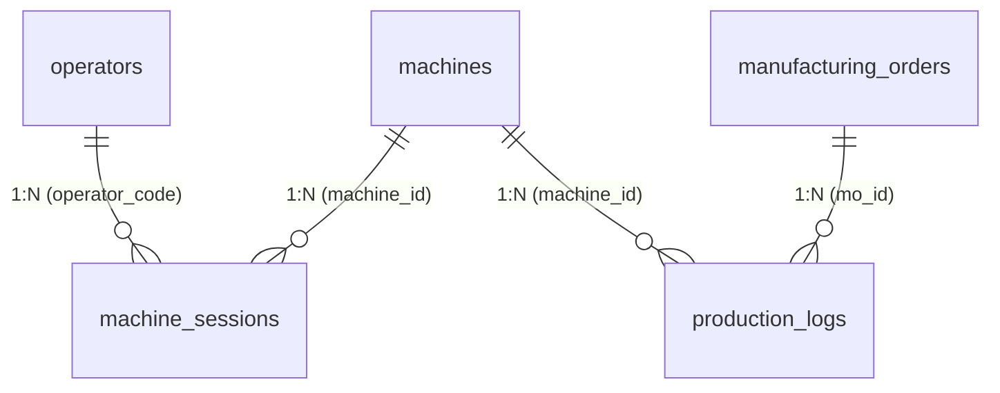

# HỆ THỐNG QUẢN LÝ CÔNG NHÂN (OPERATORS), PHÂN CÔNG ĐỨNG MÁY (MACHINE SESSIONS) VÀ LUỒNG XÁC THỰC PRECHECK

## DỰ ÁN: FOXCONN & NVIDIA STATION MANAGEMENT SYSTEM (SALAMANDRA LINE)

---

## 1. MỤC TIÊU NGHIỆP VỤ (OBJECTIVE)

Hệ thống tập trung vào việc **kiểm soát phân công đúng người - đúng máy và xác thực tài khoản**:

1. **Đúng người & Xác thực mật khẩu (Valid Operator & Password):** Công nhân phải có mã thẻ hợp lệ, tài khoản đang hoạt động (`is_active = true`) và mật khẩu (`password`) gửi từ máy phải khớp với mật khẩu đã cấp.
2. **Đúng máy được phân công (Correct Station Assignment):** Công nhân phải được phân công / đăng ký phiên trực (`status = 'ACTIVE'`) tại **chính xác trạm máy đó** trong ca làm việc.
3. **Chặn lỗi tại PRECHECK (Station Lock):** Khi máy tự động gọi API `PRECHECK`:
   - Nếu sai mật khẩu hoặc tài khoản bị khóa $\rightarrow$ Chặn.
   - Nếu công nhân chưa mở ca trực tại máy $\rightarrow$ Chặn.
   - Nếu công nhân đang đứng sai máy (mã thẻ gửi lên không khớp với người được phân công trực máy này) $\rightarrow$ Chặn ngay lập tức, không cho phép kẹp đồ gá hoặc thao tác.

---

## 2. THIẾT KẾ CƠ SỞ DỮ LIỆU (DATABASE SCHEMA)



### A. Bảng `operators` (Danh mục công nhân & Mật khẩu xác thực)

Quản lý thông tin hồ sơ công nhân, mã thẻ quẹt và mật khẩu xác thực từ máy:

| Tên cột         | Kiểu dữ liệu (MySQL) | Ràng buộc                 | Ý nghĩa / Mô tả                                                                               |
| :-------------- | :------------------- | :------------------------ | :-------------------------------------------------------------------------------------------- |
| `id`            | `INT`                | `PK, AUTO_INCREMENT`      | Khóa chính tự tăng                                                                            |
| `operator_code` | `VARCHAR(50)`        | `NOT NULL, UNIQUE`        | Mã thẻ nhân viên / Mã quét barcode (MSNV, VD: `V0923834`, map từ key `username`)              |
| `password`      | `VARCHAR(255)`       | `NOT NULL`                | Mật khẩu xác thực của công nhân (hỗ trợ hash BCrypt hoặc mã thiết lập, map từ key `password`) |
| `operator_name` | `VARCHAR(100)`       | `NOT NULL`                | Họ và tên công nhân                                                                           |
| `department`    | `VARCHAR(50)`        | `NULL`                    | Xưởng / Bộ phận sản xuất (VD: `SMT`, `SUB_ASSY`)                                              |
| `is_active`     | `TINYINT(1)`         | `NOT NULL, DEFAULT 1`     | Trạng thái (`1`: đang làm việc, `0`: đã nghỉ việc/khóa thẻ)                                   |
| `created_at`    | `DATETIME(6)`        | `NOT NULL, DEFAULT now()` | Thời điểm tạo hồ sơ                                                                           |
| `updated_at`    | `DATETIME(6)`        | `NOT NULL, DEFAULT now()` | Thời điểm cập nhật thông tin                                                                  |

**Chỉ mục (Indexes):**

- `UNIQUE INDEX uk_operator_code (operator_code)`
- `INDEX idx_operator_active (is_active)`

---

### B. Bảng `machine_sessions` (Phiên phân công trực máy theo ca)

Ghi nhận ai đang trực / được phân công ở máy nào theo từng ngày và ca làm việc:

| Tên cột         | Kiểu dữ liệu (MySQL) | Ràng buộc                                 | Ý nghĩa / Mô tả                                             |
| :-------------- | :------------------- | :---------------------------------------- | :---------------------------------------------------------- |
| `id`            | `BIGINT`             | `PK, AUTO_INCREMENT`                      | Khóa chính phiên làm việc                                   |
| `machine_id`    | `INT`                | `NOT NULL, FK -> machines.id`             | Trạm máy công nhân được phân công trực                      |
| `operator_code` | `VARCHAR(50)`        | `NOT NULL, FK -> operators.operator_code` | Mã thẻ công nhân được giao phụ trách máy                    |
| `shift`         | `VARCHAR(10)`        | `NOT NULL`                                | Ca làm việc: `DAY` (Ca ngày), `NIGHT` (Ca đêm)              |
| `work_date`     | `DATE`               | `NOT NULL`                                | Ngày làm việc (`YYYY-MM-DD`, ví dụ: `2026-10-12`)           |
| `login_time`    | `DATETIME(6)`        | `NOT NULL`                                | Thời điểm quẹt thẻ nhận máy bắt đầu ca                      |
| `logout_time`   | `DATETIME(6)`        | `NULL`                                    | Thời điểm bàn giao máy / kết thúc ca                        |
| `status`        | `VARCHAR(20)`        | `NOT NULL, DEFAULT 'ACTIVE'`              | Trạng thái: `ACTIVE` (đang trực máy), `CLOSED` (đã đóng ca) |
| `note`          | `VARCHAR(255)`       | `NULL`                                    | Ghi chú (đổi người, tăng ca, bảo trì...)                    |
| `created_at`    | `DATETIME(6)`        | `NOT NULL, DEFAULT now()`                 | Thời điểm tạo bản ghi                                       |

**Quy tắc nghiệp vụ cốt lõi:**

- Tại một thời điểm, mỗi trạm `machine_id` chỉ có **tối đa duy nhất 1 phiên ở trạng thái `ACTIVE`**.
- `INDEX idx_session_lookup (machine_id, status)`: Hỗ trợ hàm Precheck kiểm tra trong thời gian thực $O(1)$.

---

## 3. CÁC ENUM VÀ ENTITY JPA

### 3.1. Các Enum trong `com.example.EnterpriseProject.enums`

1. `ShiftType.java`:
   ```java
   public enum ShiftType {
       DAY,    // Ca ngày
       NIGHT   // Ca đêm
   }
   ```
2. `SessionStatus.java`:
   ```java
   public enum SessionStatus {
       ACTIVE, // Đang trực máy
       CLOSED  // Đã hết ca / bàn giao
   }
   ```

### 3.2. Thực thể JPA `Operator.java` (Có trường password)

```java
package com.example.EnterpriseProject.entity;

import com.example.EnterpriseProject.entity.base.BaseTimeEntity;
import com.fasterxml.jackson.annotation.JsonIgnore;
import jakarta.persistence.*;
import lombok.*;

@Entity
@Table(
    name = "operators",
    uniqueConstraints = {
        @UniqueConstraint(name = "uk_operator_code", columnNames = {"operator_code"})
    },
    indexes = {
        @Index(name = "idx_operator_active", columnList = "is_active")
    }
)
@Getter
@Setter
@NoArgsConstructor
@AllArgsConstructor
@Builder
public class Operator extends BaseTimeEntity {

    @Id
    @GeneratedValue(strategy = GenerationType.IDENTITY)
    private Integer id;

    @Column(name = "operator_code", length = 50, nullable = false, unique = true)
    private String operatorCode;

    @JsonIgnore
    @Column(nullable = false, length = 255)
    private String password;

    @Column(name = "operator_name", length = 100, nullable = false)
    private String operatorName;

    @Column(length = 50)
    private String department;

    @Builder.Default
    @Column(name = "is_active", nullable = false)
    private Boolean isActive = true;
}
```

### 3.3. Thực thể JPA `MachineSession.java`

```java
package com.example.EnterpriseProject.entity;

import com.example.EnterpriseProject.enums.SessionStatus;
import com.example.EnterpriseProject.enums.ShiftType;
import jakarta.persistence.*;
import lombok.*;
import org.springframework.data.annotation.CreatedDate;
import org.springframework.data.jpa.domain.support.AuditingEntityListener;

import java.time.Instant;
import java.time.LocalDate;

@Entity
@Table(
    name = "machine_sessions",
    indexes = {
        @Index(name = "idx_session_lookup", columnList = "machine_id, status"),
        @Index(name = "idx_session_operator", columnList = "operator_code, work_date, shift")
    }
)
@EntityListeners(AuditingEntityListener.class)
@Getter
@Setter
@NoArgsConstructor
@AllArgsConstructor
@Builder
public class MachineSession {

    @Id
    @GeneratedValue(strategy = GenerationType.IDENTITY)
    private Long id;

    @ManyToOne(fetch = FetchType.LAZY)
    @JoinColumn(name = "machine_id", nullable = false, foreignKey = @ForeignKey(name = "fk_session_machines"))
    private Machine machine;

    @Column(name = "operator_code", length = 50, nullable = false)
    private String operatorCode;

    @Enumerated(EnumType.STRING)
    @Column(length = 10, nullable = false)
    private ShiftType shift;

    @Column(name = "work_date", nullable = false)
    private LocalDate workDate;

    @Column(name = "login_time", nullable = false)
    private Instant loginTime;

    @Column(name = "logout_time")
    private Instant logoutTime;

    @Builder.Default
    @Enumerated(EnumType.STRING)
    @Column(length = 20, nullable = false)
    private SessionStatus status = SessionStatus.ACTIVE;

    @Column(length = 255)
    private String note;

    @CreatedDate
    @Column(name = "created_at", nullable = false, updatable = false)
    private Instant createdAt;

    @PrePersist
    protected void onCreate() {
        if (createdAt == null) createdAt = Instant.now();
        if (loginTime == null) loginTime = Instant.now();
        if (workDate == null) workDate = LocalDate.now();
    }
}


## 7. CÁC BƯỚC ĐÃ TRIỂN KHAI VÀO SOURCE CODE

- [x] **Enums:** [ShiftType.java](file:///d:/EnterpriseProjectFrontend/enterprise-project-frontend/src/backend/EnterpriseProject/src/main/java/com/example/EnterpriseProject/enums/ShiftType.java), [SessionStatus.java](file:///d:/EnterpriseProjectFrontend/enterprise-project-frontend/src/backend/EnterpriseProject/src/main/java/com/example/EnterpriseProject/enums/SessionStatus.java) trong package `com.example.EnterpriseProject.enums`.
- [x] **Entities:**
   - [Operator.java](file:///d:/EnterpriseProjectFrontend/enterprise-project-frontend/src/backend/EnterpriseProject/src/main/java/com/example/EnterpriseProject/entity/Operator.java) (gồm các cột `operator_code`, `password`, `operator_name`, `department`, `is_active`, kế thừa `BaseTimeEntity`).
   - [MachineSession.java](file:///d:/EnterpriseProjectFrontend/enterprise-project-frontend/src/backend/EnterpriseProject/src/main/java/com/example/EnterpriseProject/entity/MachineSession.java) (gồm các cột `machine_id`, `operator_code`, `shift`, `work_date`, `login_time`, `logout_time`, `status`).
- [x] **Repositories:**
   - [OperatorRepository.java](file:///d:/EnterpriseProjectFrontend/enterprise-project-frontend/src/backend/EnterpriseProject/src/main/java/com/example/EnterpriseProject/repository/OperatorRepository.java)
   - [MachineSessionRepository.java](file:///d:/EnterpriseProjectFrontend/enterprise-project-frontend/src/backend/EnterpriseProject/src/main/java/com/example/EnterpriseProject/repository/MachineSessionRepository.java)
- [x] **Build Verification:** Đã compile thành công toàn bộ dự án (`mvn compile` -> `BUILD SUCCESS`).
```
