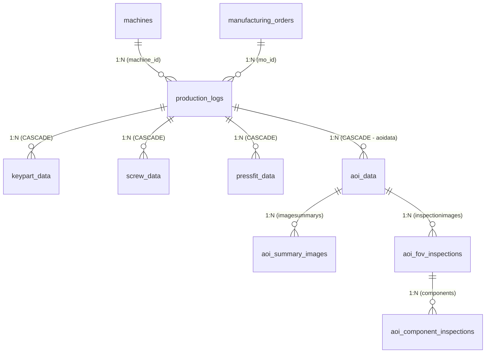

# ĐÁNH GIÁ THỰC THỂ ENTITY THEO PAYLOAD THỰC TẾ TRẠM ST3 VÀ KẾ HOẠCH SỬA ĐỔI

## DỰ ÁN: FOXCONN & NVIDIA STATION MANAGEMENT SYSTEM (SALAMANDRA SUB SA)
**Tài liệu tham chiếu:** `example ST3 (6).txt`  
**Vị trí lưu trữ:** `src/backend/EnterpriseProject/src/main/java/com/example/EnterpriseProject/md/`

---

## 1. TỔNG QUAN VÀ KẾT LUẬN ĐÁNH GIÁ (EXECUTIVE VERDICT)

Qua phân tích và đối soát chi tiết giữa gói tin JSON thực tế gửi từ trạm máy tự động hóa trạm 3 (`example ST3 (6).txt`) với hệ thống JPA Entities hiện tại trong package `com.example.EnterpriseProject.entity`, kết luận như sau:

> **ĐÁNH GIÁ TỔNG QUAN: ĐÚNG ~80% CÁC THỰC THỂ CỐT LÕI. ĐỀ XUẤT TÁCH BẢNG RIÊNG `aoi_data` ĐỂ QUẢN LÝ TOÀN BỘ PHÂN TRẠM QUANG HỌC AOI LÀ GIẢI PHÁP XUẤT SẮC, GIÚP TÁCH BẠCH NGHIỆP VỤ RÕ RÀNG VÀ CHUẨN MỰC NHẤT.**

### 1.1. Các phần đã thiết kế ĐÚNG và TỐT:
1. **Khối siết ốc tự động (`screwdata`):** Khớp 100% với thực thể `ScrewData.java` (`screwPosition`, `action`, `torque`, `angle`, `screwTime`, `standardVolume`, `limitVolume`, `realVolume`, `standardHeight`, `limitHeight`, `realHeight`, `result`, `errorCode`).
2. **Khối linh kiện con (`kps`):** Khớp với thực thể `KeypartData.java` (`kpName`, `kpValue`).
3. **Khối giao dịch trạm trung tâm:** `ProductionLog.java` đã lưu đầy đủ các định danh sản xuất (`carrierCode`, `serialNumber`, `step`, `runSequence`, `cycleTime`, `result`, `dataType`).
4. **Phân tách an ninh & quyền trực máy:** Tách riêng `username`/`password` sang bảng `Operator.java` và `MachineSession.java` để xác thực, không lưu mật khẩu trần vào bảng log sản xuất.
5. **Chiến lược tối ưu hóa hình ảnh AOI:** Hệ thống chỉ lưu đường dẫn file ảnh (`TEXT`) thay vì lưu chuỗi Base64 trực tiếp vào database, giúp DB không bị quá tải.

---

### 1.2. Đánh giá đề xuất kiến trúc mới cho khối AOI (`aoi_data`):

Ý tưởng tạo bảng `aoi_data` của bạn **rất chuẩn xác** và giải quyết triệt để vấn đề:
1. **Bảng trung tâm `aoi_data`:**
   - Đóng gói toàn bộ thông số phân trạm quang học: `cycle_time` (12.5s) và `carrier_code` ("need_scan").
   - Liên kết **N - 1** với `production_logs` (mỗi lượt sản xuất `production_logs` có 1 phiên kiểm tra AOI `aoi_data`).
   - Giúp `production_logs` giữ nguyên cấu trúc gọn gàng, không bị ô nhiễm bởi các trường chuyên biệt của AOI.

2. **Quan hệ với bảng ảnh tổng quan `aoi_summary_images`:**
   - Trong payload, `imagesummarys` là một **danh sách mảng `[ ... ]`** (thực tế máy AOI công nghiệp kiểm tra bo mạch có thể có **2 camera toàn cảnh: TOP và BOT** kèm mô tả `description`).
   - Do đó, quan hệ giữa `aoi_data` và `aoi_summary_images` nên là **1 - N** (hoặc `aoi_summary_images` ManyToOne về `aoi_data`). Nếu trạm chỉ có 1 ảnh thì bảng lưu 1 dòng; nếu có cả ảnh TOP và BOT thì lưu 2 dòng mà không làm vỡ cấu trúc.

3. **Quan hệ với FOV và Linh kiện (`components`):**
   - Trong payload, linh kiện con `components` (R1, R2, C5) được soi và định vị bên trong từng vùng chụp quang học `fov` (`inspectionimages`).
   - Mỗi vùng FOV có 1 ảnh toàn cảnh góc nhìn (`image: base64_full_fov_image_here`).
   - Do đó, mô hình phân cấp 3 tầng chuẩn công nghiệp là:
     $$\text{aoi\_data} \xrightarrow{1:N} \text{aoi\_fov\_inspections} \xrightarrow{1:N} \text{aoi\_component\_inspections}$$
   - Cách này giúp tránh việc phải lặp lại đường dẫn ảnh full FOV ở từng linh kiện con.

---

## 2. BẢNG ĐỐI SOÁT CHI TIẾT (PAYLOAD vs JPA ENTITIES)

### 2.1. Dữ liệu gốc (Root Level)

| Key trong JSON Payload | Kiểu mẫu | Cột trong JPA Entity (`ProductionLog`) | Đánh giá | Giải pháp xử lý |
| :--- | :--- | :--- | :---: | :--- |
| `carriercode` | `" need_scan "` | `carrierCode` (`VARCHAR(100)`) | **ĐÚNG** | Cần `.trim()` khi chuyển đổi qua DTO |
| `serialnumber` | `"need_scan "` | `serialNumber` (`VARCHAR(100)`) | **ĐÚNG** | Cần `.trim()` khi chuyển đổi qua DTO |
| `step` | `"STEP03"` | `step` (`VARCHAR(50)`) | **ĐÚNG** | Khớp chính xác |
| `action` | `"N/A"` | Chưa có cột | ❌ **THIẾU** | Bổ sung cột `@Column(length = 50) private String action;` vào `ProductionLog` |
| `result` | `"PASS \| FAIL"` | `result` (`TestResult`) | ⚠️ **CẢNH BÁO** | Bổ sung `@JsonCreator` cho `TestResult` để bắt các giá trị `"N/A"`, `"PASS"`, `"FAIL"` |
| `cycletime` | `19.5` | `cycleTime` (`DECIMAL(8, 2)`) | **ĐÚNG** | Khớp chính xác chu kỳ tổng của trạm ST3 |
| `username` | `"V0923834"` | `operatorUser` (`VARCHAR(50)`) | **ĐÚNG** | Lưu mã nhân viên, kiểm tra mật khẩu qua `Operator` |
| `password` | `"V0923834"` | Không lưu trong Log | **ĐÚNG** | Chuẩn an ninh: xác thực xong không lưu vào `production_logs` |
| `data_type` | `"autolink"` | `dataType` (`DataType`) | ⚠️ **CẢNH BÁO** | JSON gửi chữ thường `"autolink"`, Enum cần case-insensitive deserializer |
| `groupname` | `"ASSY_MGMT"` | `Machine.groupName` | **ĐÚNG** | Dùng cùng `stationip` để truy vấn ra `Machine` |
| `stationip` | `" need "` | `Machine.stationIp` / `ApiRequestLog` | **ĐÚNG** | Trạm gửi IP để xác định ID máy tự động |

---

### 2.2. Dữ liệu linh kiện con (`kps`)

| Key trong JSON Payload | Kiểu mẫu | Cột trong JPA Entity (`KeypartData`) | Đánh giá | Giải pháp xử lý |
| :--- | :--- | :--- | :---: | :--- |
| `kpname` | `"..."` | `kpName` (`VARCHAR(100)`) | **ĐÚNG** | Khớp |
| `kpvalue` | `" N/A "` / barcode | `kpValue` (`VARCHAR(150)`) | **ĐÚNG** | Khớp |
| (Auditing) | Timestamp | `name = "created_a" + "t"` | ⚠️ **LỖI CODE** | Sửa thành chuỗi liền `name = "created_at"` |

---

### 2.3. Dữ liệu kiểm tra ngoại quan quang học (`aoidata`) - THEO THIẾT KẾ MỚI

```json
"aoidata": {
  "cycletime": 12.5,
  "carriercode": "need_scan",
  "imagesummarys": [
    {
      "camera": "TOP",
      "imagedata": "base64_summary_top",
      "description": "Top view"
    }
  ],
  "inspectionimages": [
    {
      "fov": 1,
      "camera": "TOP",
      "image": "base64_full_fov_image_here",
      "components": [ ... ]
    }
  ]
}
```

| Key trong JSON Payload | Entity & Cột tương ứng mới | Đánh giá | Ý nghĩa nghiệp vụ |
| :--- | :--- | :---: | :--- |
| `aoidata.cycletime` (12.5) | `AoiData.cycleTime` (`DECIMAL(8, 2)`) | **CHUẨN** | Chu kỳ xử lý riêng của module AOI |
| `aoidata.carriercode` | `AoiData.carrierCode` (`VARCHAR(100)`) | **CHUẨN** | Mã carrier được đọc độc lập tại module AOI |
| `imagesummarys` (Mảng ảnh tổng quan) | `AoiSummaryImage` (liên kết 1-N với `AoiData`) | **CHUẨN** | Lưu ảnh chụp bao quát bo mạch (TOP/BOT), kèm `description` và đường dẫn ảnh |
| `inspectionimages.fov` (1, 2) | `AoiFovInspection.fovIndex` | **ĐÚNG** | Thứ tự vùng chụp (FOV index) |
| `inspectionimages.camera` | `AoiFovInspection.camera` | **ĐÚNG** | Hướng camera (TOP/BOT) |
| `inspectionimages.image` | `AoiFovInspection.fovImagePath` | **ĐÚNG** | Đường dẫn file ảnh toàn cảnh của vùng FOV |
| `components` (R1, R2...) | `AoiComponentInspection` (liên kết 1-N với `AoiFovInspection`) | **ĐÚNG** | Linh kiện phát hiện trong FOV (`score`, `measure`, `result`, `cropImagePath`) |

---

### 2.4. Dữ liệu siết ốc tự động (`screwdata`)

| Key trong JSON Payload | Kiểu mẫu | Cột trong JPA Entity (`ScrewData`) | Đánh giá | Ghi chú |
| :--- | :--- | :--- | :---: | :--- |
| `position` | `"screw1"` | `screwPosition` (`VARCHAR(50)`) | **ĐÚNG** | Khớp vị trí ốc |
| `action` | `"screw"`, `"unscrew"` | `action` (`VARCHAR(50)`) | **ĐÚNG** | Khớp thao tác |
| `torque` | `12.3` | `torque` (`DECIMAL(8, 3)`) | **ĐÚNG** | Lực siết |
| `angle` | `360.5` | `angle` (`DECIMAL(8, 2)`) | **ĐÚNG** | Góc siết |
| `time` | `1.5` | `screwTime` (`DECIMAL(6, 2)`) | **ĐÚNG** | Thời gian siết |
| `standardvolume`, `limitvolume`, `realvolume` | `123.45` | `standardVolume`, `limitVolume`, `realVolume` (`DECIMAL(10, 3)`) | **ĐÚNG** | Thể tích/độ sâu |
| `standardheight`, `limitheight`, `realheight` | `123.45` | `standardHeight`, `limitHeight`, `realHeight` (`DECIMAL(10, 3)`) | **ĐÚNG** | Chiều cao nhô của ốc |
| `result` | `"PASS"` | `result` (`TestResult`) | **ĐÚNG** | PASS / FAIL |
| `errorcode` | `"N/A"` | `errorCode` (`VARCHAR(50)`) | **ĐÚNG** | Cho phép null hoặc chuỗi |

---

## 3. SƠ ĐỒ THỰC THỂ CẢI TIẾN HOÀN CHỈNH (TARGET ERD)



---

## 4. KẾ HOẠCH TRIỂN KHAI SỬA ĐỔI SOURCE CODE (STEP-BY-STEP PLAN)

### Bước 1: Điều chỉnh Entity `ProductionLog.java`
- Thêm trường `action`:
  ```java
  @Column(length = 50)
  private String action;
  ```
- Thay thế quan hệ trực tiếp `aoiFovList` bằng quan hệ tới `AoiData`:
  ```java
  @JsonIgnore
  @OneToMany(mappedBy = "productionLog", cascade = CascadeType.ALL, orphanRemoval = true, fetch = FetchType.LAZY)
  @Builder.Default
  private List<AoiData> aoiDataList = new ArrayList<>();
  ```

---

### Bước 2: Tạo Entity mới `AoiData.java`
Tạo file tại `com/example/EnterpriseProject/entity/AoiData.java`:
```java
package com.example.EnterpriseProject.entity;

import com.fasterxml.jackson.annotation.JsonIgnore;
import jakarta.persistence.*;
import lombok.*;
import org.springframework.data.annotation.CreatedDate;
import org.springframework.data.jpa.domain.support.AuditingEntityListener;

import java.math.BigDecimal;
import java.time.Instant;
import java.util.ArrayList;
import java.util.List;

/**
 * Bảng aoi_data: Quản lý toàn bộ phiên kiểm tra ngoại quan quang học của trạm
 * Khớp với khối aoidata trong JSON payload
 */
@Entity
@Table(name = "aoi_data", indexes = {
    @Index(name = "idx_aoi_log_id", columnList = "log_id"),
    @Index(name = "idx_aoi_carrier", columnList = "carrier_code")
})
@EntityListeners(AuditingEntityListener.class)
@Getter
@Setter
@NoArgsConstructor
@AllArgsConstructor
@Builder
public class AoiData {

    @Id
    @GeneratedValue(strategy = GenerationType.IDENTITY)
    private Long id;

    @ManyToOne(fetch = FetchType.LAZY)
    @JoinColumn(name = "log_id", nullable = false, foreignKey = @ForeignKey(name = "fk_aoi_prod_logs"))
    private ProductionLog productionLog;

    @Column(name = "carrier_code", length = 100)
    private String carrierCode;

    @Column(name = "cycle_time", precision = 8, scale = 2)
    private BigDecimal cycleTime;

    @CreatedDate
    @Column(name = "created_at", nullable = false, updatable = false)
    private Instant createdAt;

    @JsonIgnore
    @OneToMany(mappedBy = "aoiData", cascade = CascadeType.ALL, orphanRemoval = true, fetch = FetchType.LAZY)
    @Builder.Default
    private List<AoiSummaryImage> summaryImages = new ArrayList<>();

    @JsonIgnore
    @OneToMany(mappedBy = "aoiData", cascade = CascadeType.ALL, orphanRemoval = true, fetch = FetchType.LAZY)
    @Builder.Default
    private List<AoiFovInspection> fovInspections = new ArrayList<>();

    @PrePersist
    protected void onCreate() {
        if (createdAt == null) {
            createdAt = Instant.now();
        }
    }
}
```

---

### Bước 3: Tạo Entity mới `AoiSummaryImage.java` (Liên kết với `AoiData`)
Tạo file tại `com/example/EnterpriseProject/entity/AoiSummaryImage.java`:
```java
package com.example.EnterpriseProject.entity;

import com.example.EnterpriseProject.enums.AoiCamera;
import jakarta.persistence.*;
import lombok.*;
import org.springframework.data.annotation.CreatedDate;
import org.springframework.data.jpa.domain.support.AuditingEntityListener;

import java.time.Instant;

/**
 * Bảng aoi_summary_images: Lưu trữ ảnh chụp tổng thể toàn bo mạch từ các hướng camera (TOP, BOT)
 * Khớp với mảng imagesummarys trong aoidata
 */
@Entity
@Table(name = "aoi_summary_images", indexes = {
    @Index(name = "idx_summary_aoi_id", columnList = "aoi_data_id")
})
@EntityListeners(AuditingEntityListener.class)
@Getter
@Setter
@NoArgsConstructor
@AllArgsConstructor
@Builder
public class AoiSummaryImage {

    @Id
    @GeneratedValue(strategy = GenerationType.IDENTITY)
    private Long id;

    @ManyToOne(fetch = FetchType.LAZY)
    @JoinColumn(name = "aoi_data_id", nullable = false, foreignKey = @ForeignKey(name = "fk_summary_aoi_data"))
    private AoiData aoiData;

    @Enumerated(EnumType.STRING)
    @Column(length = 10, nullable = false)
    private AoiCamera camera;

    @Column(name = "image_path", columnDefinition = "TEXT", nullable = false)
    private String imagePath;

    @Column(length = 150)
    private String description;

    @CreatedDate
    @Column(name = "created_at", nullable = false, updatable = false)
    private Instant createdAt;

    @PrePersist
    protected void onCreate() {
        if (createdAt == null) {
            createdAt = Instant.now();
        }
    }
}
```

---

### Bước 4: Cập nhật Entity `AoiFovInspection.java`
- Chuyển foreign key từ `ProductionLog` sang `AoiData`:
  ```java
  @ManyToOne(fetch = FetchType.LAZY)
  @JoinColumn(name = "aoi_data_id", nullable = false, foreignKey = @ForeignKey(name = "fk_fov_aoi_data"))
  private AoiData aoiData;
  ```
- Xóa bỏ trường `summaryImagePath` khỏi `AoiFovInspection` (vì đã thuộc về `AoiSummaryImage`).

---

### Bước 5: Sửa lỗi cú pháp trong `KeypartData.java`
- Sửa dòng 44-45 từ `name = "created_a" + "t"` thành:
  ```java
  @CreatedDate
  @Column(name = "created_at", nullable = false, updatable = false)
  private Instant createdAt;
  ```

---

### Bước 6: Cải tiến Enum `TestResult.java` & `DataType.java`
- Thêm `@JsonCreator` để chấp nhận linh hoạt các chuỗi từ máy gửi lên:
  - Cho phép `"N/A"`, `"NA"`, `"pass"`, `"fail"`, `"PASS"`, `"FAIL"`.
  - Không ném exception làm gián đoạn API của máy sản xuất.

---

### Bước 7: Hoàn thiện hệ thống DTO (`payload/`)
1. **Sửa lỗi cú pháp dở dang trong `InputData.java`**.
2. **Xây dựng cấu trúc DTO phân cấp rõ ràng**:
   - `InputData`: Chứa các trường root (`carriercode`, `serialnumber`, `kps`, `step`, `action`, `result`, `cycletime`, `username`, `password`, `data_type`, `groupname`, `stationip`, `aoidata`, `screwdata`).
   - `AoiDataDto`: Chứa `cycletime`, `carriercode`, `List<AoiSummaryImageDto> imagesummarys`, `List<AoiInspectionImageDto> inspectionimages`.
   - `AoiSummaryImageDto`: Chứa `camera`, `imagedata`, `description`.
   - `AoiInspectionImageDto`: Chứa `fov`, `camera`, `image`, `List<AoiComponentDto> components`.
   - `AoiComponentDto`: Chứa `componentname`, `location`, `score`, `measure`, `result`, `errorcode`, `cropimage`.
   - `ScrewDataDto`: Chứa `position`, `action`, `torque`, `angle`, `time`, `standardvolume`, `limitvolume`, `realvolume`, `standardheight`, `limitheight`, `realheight`, `result`, `errorcode`.

---

### Bước 8: Biên dịch và kiểm thử tự động
- Chạy `mvn clean test-compile` để xác nhận toàn bộ Entity và DTO ánh xạ chính xác và không có lỗi biên dịch.
